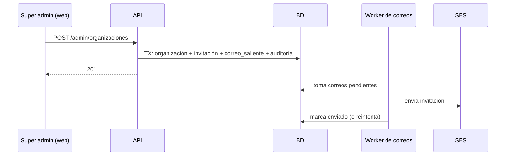

# HU-01 · Alta de organización — Plan técnico

> Fase SDD: **Plan** (Diseño). Cómo se construye lo que dice `spec.md`.
> Estado: `aprobado (2026-10-14)` · Rama: `feat/HU-01-alta-organizacion`
> **Orden en S1: 2.ª** (necesita el inicio de sesión de HU-06). Construye el contexto RLS y la cola de correos.

## 1. Módulos afectados

| Carpeta | Módulo / componente | Cambio |
|---|---|---|
| backend | `comun` | `PrismaService.enOrganizacion(orgId, fn)` y `PrismaService.comoSuperAdmin(fn)`: abren `$transaction` y fijan `app.organizacion_id` o `app.super_admin` con `set_config(…, true)`. `RolPlataformaGuard` + `@RolPlataforma('super_admin')` |
| backend | `organizaciones` | Nuevo: alta y listado de organizaciones; invitaciones (crear, reenviar, consultar, aceptar) |
| backend | `notificaciones` | Nuevo: cola `correos_salientes`, worker cada 30 s con reintentos (espera creciente, máximo 5), cliente SES v2, `CORREO_MODO=consola` para desarrollo, plantillas con `t()` |
| web | `src/paginas/admin/Organizaciones`, `src/paginas/AceptarInvitacion` | Nuevo |

Reutiliza (HU-06): `PrismaService`, `JwtGuard`, filtro de errores, `AuditoriaService`, `t()`.

## 2. Cambios al modelo de datos

| Tabla | Cambio | Restricciones | ¿`organizacion_id` + RLS? |
|---|---|---|---|
| `organizaciones` | Nueva: nombre, nombre_normalizado, tipo (`universidad`/`empresa`), modo_aprobacion (`manual` por defecto), precio_maximo_urc, estado (`activa`) | `UNIQUE(nombre_normalizado)` (`lower(trim(nombre))`), `precio_maximo_urc > 0` | RLS por `id` |
| `membresias` | Nueva: organizacion_id, usuario_id, rol (`miembro`/`admin_organizacion`), estado, correo_institucional, decidido_por, decidido_en, motivo | `UNIQUE(organizacion_id, usuario_id)`, `UNIQUE(lower(correo_institucional))` | Sí |
| `invitaciones` | Nueva: organizacion_id, correo, nombre, hash_token, vence_en (72 h), usada_en, reemplazada_en, creado_por | `UNIQUE(hash_token)` | Sí |
| `correos_salientes` | Nueva: destinatario, plantilla, datos JSONB, estado (`pendiente`/`enviado`/`fallido`), intentos, proximo_intento_en, ultimo_error, referencia_tipo, referencia_id | — | No: tabla interna, solo la usa el worker |

Políticas RLS (SQL en la migración): `ENABLE` + `FORCE` en `organizaciones`, `membresias`, `invitaciones` y `registros_auditoria`, con `USING (organizacion_id = current_setting('app.organizacion_id', true)::uuid OR current_setting('app.super_admin', true) = 'true')`.

Migración: `002_organizaciones_rls_correos`. Cambia RLS (requiere confirmación humana, `AGENTS.md` §14): **se confirma al aprobar este plan**.

## 3. Endpoints

| Método | Ruta | Rol | Request → Response | Errores (`codigo`) |
|---|---|---|---|---|
| POST | `/api/v1/admin/organizaciones` | super admin | `{ nombre, tipo, precioMaximoUrc, adminNombre, adminCorreo }` → 201 `{ id, … }` | `ORGANIZACION_NOMBRE_DUPLICADO` 409, `VALIDACION` 400 |
| GET | `/api/v1/admin/organizaciones` | super admin | — → `[{ id, nombre, tipo, estado, precioMaximoUrc, admin, estadoInvitacion, creadoEn }]` | — |
| POST | `/api/v1/admin/organizaciones/{id}/invitacion` | super admin | — → 201 (invalida la anterior y envía una nueva) | `NO_ENCONTRADO` 404 |
| GET | `/api/v1/invitaciones/{token}` | público | — → `{ organizacion, correo, cuentaExistente }` | `INVITACION_VENCIDA` 410 |
| POST | `/api/v1/invitaciones/{token}/aceptar` | público | cuenta nueva: `{ nombreCompleto, contrasena }`; cuenta existente: `{ contrasena }` → sesión iniciada (HU-06) | `INVITACION_VENCIDA` 410, `CONTRASENA_DEBIL` 400, `CREDENCIALES_INVALIDAS` 401 |

Reglas de implementación:
- El alta corre en **una** transacción `comoSuperAdmin`: organización + invitación + correo en cola + auditoría. Si algo falla, no queda nada.
- El token de invitación (32 bytes) solo viaja en el correo; en BD se guarda su hash.
- `estadoInvitacion` se deriva así: `aceptada` si tiene `usada_en`; `vencida` si pasó `vence_en`; si no, el estado del correo en la cola (`enviada` / `no_enviada`).
- Aceptar crea la membresía `admin_organizacion` en estado `aprobada` y fija `ultima_organizacion_id` (RN-7: reutiliza la cuenta si el correo ya existe).
- Doble clic: el botón se desactiva al enviar y `UNIQUE(nombre_normalizado)` garantiza una sola organización.

Swagger actualizado: [ ]

## 4. Pantallas y voz

| Cliente | Pantalla | Pasos del flujo | Claves i18n nuevas |
|---|---|---|---|
| web | Organizaciones (listado + botón "Nueva") | — | `organizaciones.lista.*` |
| web | Nueva organización (formulario) | 1 | `organizaciones.alta.*` |
| web | Aceptar invitación | 1 | `organizaciones.invitacion.*` |

Voz: no aplica (panel web; D-08 abierta).

## 5. Diagramas UML

- [x] Secuencia: alta con invitación (abajo).
- [ ] Clases: `Organizacion`, `Membresia`, `Invitacion`, `CorreoSaliente`.
- [ ] Casos de uso: "Dar de alta organización" y "Aceptar invitación".

## 6. Estrategia de pruebas

| Criterio / amenaza | Tipo | Archivo de prueba |
|---|---|---|
| CA-1 alta + invitación en cola | e2e | `backend/test/organizaciones/alta.e2e-spec.ts` |
| CA-2 nombre duplicado (mayúsculas y espacios) | e2e | mismo archivo |
| CA-3 validaciones (incluido el precio máximo) | e2e | mismo archivo |
| CA-4 aceptar invitación (cuenta nueva y existente) | e2e | `invitaciones.e2e-spec.ts` |
| CA-5 invitación vencida, usada o reenviada | e2e (reloj simulado) | mismo archivo |
| CA-6 A-13: admin de A no ve ni toca B; RLS a nivel BD | ataque e2e + integración SQL | `backend/test/ataques/a-13-organizaciones.e2e-spec.ts` |
| CA-7 un no super admin no puede dar de alta | ataque e2e | mismo archivo |
| CA-8 listado con estado de invitación | e2e | `alta.e2e-spec.ts` |
| Worker: reintentos y fallo definitivo | unitaria | `notificaciones/worker.spec.ts` |
| Pantallas | Vitest | `Organizaciones.test.tsx`, `AceptarInvitacion.test.tsx` |

## 7. Riesgos

| Riesgo | Probabilidad | Impacto | Mitigación |
|---|---|---|---|
| SES en modo sandbox solo envía a correos verificados | Alta | Medio | Pedir acceso de producción a SES en SP13; mientras tanto, verificar los correos del equipo |
| Olvidar `enOrganizacion` en una consulta | Media | Alto | RLS forzado: sin contexto, la consulta devuelve 0 filas. Prueba de ataque A-13 en cada HU |
| El worker procesa dos veces el mismo correo | Baja | Bajo | `SELECT … FOR UPDATE SKIP LOCKED` |

Dependencias nuevas (requieren confirmación): `@aws-sdk/client-sesv2` (backend).

## 8. Tareas propuestas (se copian a backlog.md al aprobar)

| Tarea | Horas | Responsable |
|---|---|---|
| `enOrganizacion` / `comoSuperAdmin`, `RolPlataformaGuard`, migración `002` con políticas RLS | 4 | |
| Modelo: organizaciones, membresias, invitaciones, correos_salientes | 2 | |
| Notificaciones: cola, worker con reintentos, cliente SES, modo consola, plantillas | 4 | |
| Alta y listado de organizaciones (servicio, controlador, DTOs, Swagger, auditoría) | 3 | |
| Invitaciones: reenviar, consultar, aceptar (cuenta nueva y existente) | 4 | |
| Web: Organizaciones, Nueva organización, Aceptar invitación | 5 | |
| Pruebas (CA-1 a CA-8, ataques A-13 y de rol, worker) | 4 | |
| **Total** | **26** | |
