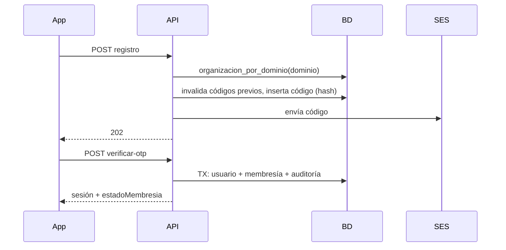

# HU-05 · Registro con correo institucional — Plan técnico

> Fase SDD: **Plan** (Diseño). Cómo se construye lo que dice `spec.md`.
> Estado: `aprobado (2026-10-14)` · Rama: `feat/HU-05-registro-correo-institucional`
> **Orden en S1: 4.ª.** Construye el servicio OTP que reutilizan HU-07 y HU-34.

## 1. Módulos afectados

| Carpeta | Módulo / componente | Cambio |
|---|---|---|
| backend | `autenticacion` | Nuevo `OtpService` (generar, enviar, verificar, bloquear, limitar reenvíos; con propósito `registro` / `agregar_organizacion` / `recuperacion`); endpoints de registro, verificación y reenvío |
| backend | `notificaciones` | `enviarAhora()` (envío síncrono, para OTP); plantillas `otp_registro` y `ya_tienes_cuenta` |
| mobile | `app/registro.tsx`, `app/codigo.tsx` | Nuevo; reutiliza la pantalla de estado de membresía de HU-06 |

Reutiliza: función `organizacion_por_dominio` (HU-02), `enOrganizacion` y la cola de correos (HU-01), emisión de tokens (HU-06).

## 2. Cambios al modelo de datos

| Tabla | Cambio | Restricciones | ¿`organizacion_id` + RLS? |
|---|---|---|---|
| `codigos_otp` | Nueva: correo, proposito, hash_codigo (HMAC-SHA256 con `OTP_SECRETO`), datos JSONB (nombre, hash_contrasena, organizacion_id), vence_en, intentos, bloqueado_hasta, usado_en, invalidado_en | Índice `(correo, proposito, creado_en)` | No: dato personal |
| `usuarios` | Sin cambios (`consentimiento_datos_en` ya existe desde HU-06) | — | — |

Migración: `004_codigos_otp`.

## 3. Endpoints

| Método | Ruta | Rol | Request → Response | Errores (`codigo`) |
|---|---|---|---|---|
| POST | `/api/v1/autenticacion/registro` | público | `{ nombreCompleto, correo, contrasena, aceptaTratamientoDatos }` → 202 `{ reenviarEn }` | `ORGANIZACION_NO_AFILIADA` 422, `CONTRASENA_DEBIL` 400, `CONSENTIMIENTO_REQUERIDO` 400, `CORREO_NO_DISPONIBLE` 503, `OTP_LIMITE_REENVIO` 429 |
| POST | `/api/v1/autenticacion/verificar-otp` | público | `{ correo, codigo }` → sesión iniciada (HU-06) + `{ estadoMembresia }` | `OTP_INVALIDO` 400, `OTP_VENCIDO` 410, `OTP_BLOQUEADO` 429 |
| POST | `/api/v1/autenticacion/reenviar-codigo` | público | `{ correo, proposito }` → 202 `{ reenviarEn }` | `OTP_LIMITE_REENVIO` 429 |

Reglas de implementación:
- La organización sale **solo** de `organizacion_por_dominio(dominio del correo)`. El `ValidationPipe` (`whitelist`) descarta cualquier `organizacionId` enviado (CA-8).
- Código de 6 dígitos con `crypto.randomInt`, hash HMAC y comparación en tiempo constante. Al pedir uno nuevo se invalidan los anteriores del mismo correo y propósito.
- Límites: un envío por minuto y 5 por hora por correo y propósito (se cuentan las filas de `codigos_otp`). 5 errores → `bloqueado_hasta = ahora + 15 min`.
- Si el correo ya tiene cuenta: no se genera código; se encola el aviso `ya_tienes_cuenta` y se responde igual que un registro normal (CA-7).
- El OTP se envía en el momento. Si SES falla, se revierte la transacción y se responde `CORREO_NO_DISPONIBLE`.
- Al verificar, en una transacción `enOrganizacion(orgId)`: se crea el usuario (con `consentimiento_datos_en`) y la membresía (`aprobada` si el modo es automático, `pendiente` si es manual) con `correo_institucional`; se fija `ultima_organizacion_id` si quedó aprobada, se registra la auditoría y se inicia la sesión (un paso menos para la persona).

Swagger actualizado: [ ]

## 4. Pantallas y voz

| Cliente | Pantalla | Pasos del flujo | Claves i18n nuevas |
|---|---|---|---|
| mobile | Registro (nombre, correo, contraseña, casilla de consentimiento con enlace al texto) | 1 | `autenticacion.registro.*` |
| mobile | Código (6 casillas, "Reenviar" con cuenta regresiva de 60 s) | 2 | `autenticacion.otp.*` |
| mobile | Estado de membresía (de HU-06) o inicio | — | — |

Voz: no aplica.

## 5. Diagramas UML

- [x] Secuencia: registro y verificación (abajo).
- [ ] Clases: `CodigoOtp`.
- [ ] Casos de uso: "Registrarse".

## 6. Estrategia de pruebas

| Criterio / amenaza | Tipo | Archivo de prueba |
|---|---|---|
| CA-1 envío de código | e2e (SES simulado) | `backend/test/autenticacion/registro.e2e-spec.ts` |
| CA-2 cuenta y membresía según el modo | e2e | mismo archivo |
| CA-3 dominio no afiliado | e2e | mismo archivo |
| CA-4 bloqueo tras 5 errores | unitaria + e2e | `otp.service.spec.ts` |
| CA-5 código vencido | unitaria (reloj simulado) | `otp.service.spec.ts` |
| CA-6 reenvío invalida el anterior; límites 1/min y 5/h | unitaria | `otp.service.spec.ts` |
| CA-7 correo existente no revela nada | e2e | `registro.e2e-spec.ts` |
| CA-8 A-13: `organizacionId` inyectado se ignora | ataque e2e | `backend/test/ataques/a-13-registro.e2e-spec.ts` |
| CA-9 sin consentimiento | e2e | `registro.e2e-spec.ts` |
| Pantallas | Jest (preset Expo) | `registro.test.tsx`, `codigo.test.tsx` |

## 7. Riesgos

| Riesgo | Probabilidad | Impacto | Mitigación |
|---|---|---|---|
| Fuerza bruta del código por varios correos | Media | Medio | Bloqueo por correo + límite de reenvío; el código vive 10 min |
| Contraseña en `datos` antes de confirmar | Baja | Alto | Solo se guarda el hash; la fila vence a los 10 min y se limpia |

Dependencias nuevas: ninguna.

## 8. Tareas propuestas (se copian a backlog.md al aprobar)

| Tarea | Horas | Responsable |
|---|---|---|
| Migración `004`: codigos_otp | 1 | |
| `OtpService` compartido (generar, verificar, bloqueo, límites, invalidación) | 4 | |
| Endpoints de registro, verificación y reenvío; alta de usuario y membresía | 4 | |
| `enviarAhora()` y plantillas de correo | 1 | |
| Mobile: pantallas Registro y Código, y navegación al estado o al inicio | 6 | |
| Pruebas (CA-1 a CA-9, ataque A-13) | 5 | |
| **Total** | **21** | |
