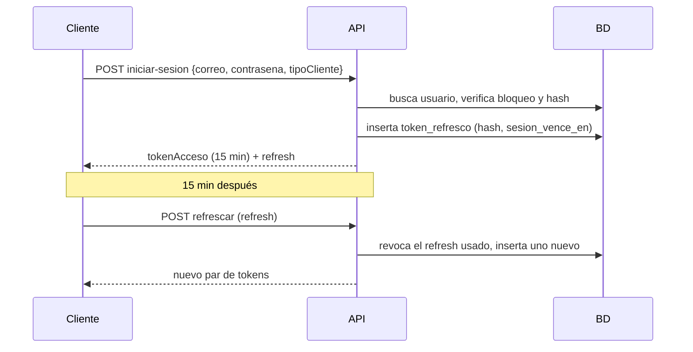

# HU-06 · Inicio de sesión — Plan técnico

> Fase SDD: **Plan** (Diseño). Cómo se construye lo que dice `spec.md`.
> Estado: `aprobado (2026-10-14)` · Rama: `feat/HU-06-inicio-sesion`
> **Orden en S1: 1.ª.** Construye la infraestructura común que reutilizan las demás HU (MEMORY, 2026-10-14, "Diseño (fase Plan)").

## 1. Módulos afectados

| Carpeta | Módulo / componente | Cambio |
|---|---|---|
| backend | `comun` | Nuevo: `PrismaService`; `ValidationPipe` global (`whitelist: true`); filtro de excepciones que responde `{ codigo }`; Swagger en `/api/docs`; `JwtGuard` global con decorador `@Publico()`; decorador `@UsuarioActual()`; `t()` para textos es-BO |
| backend | `auditoria` | Nuevo: `AuditoriaService.registrar(accion, entidad, entidadId, resultado, detalle?)` |
| backend | `autenticacion` | Nuevo: iniciar sesión, refrescar, cerrar sesión; `GET /yo` |
| backend | `prisma/semilla.ts` | Nuevo: crea el super administrador desde variables de entorno si no existe |
| web | `src/app`, `src/api`, `src/paginas/IniciarSesion` | Nuevo: shell con router, cliente HTTP con renovación automática, pantalla de inicio de sesión |
| mobile | `app/`, `src/api`, `app/iniciar-sesion.tsx` | Nuevo: shell con expo-router, cliente HTTP con renovación, pantalla de inicio de sesión, refresh token en almacenamiento seguro |

Reutiliza: nada (es la primera HU).

## 2. Cambios al modelo de datos

| Tabla | Cambio | Restricciones | ¿`organizacion_id` + RLS? |
|---|---|---|---|
| `usuarios` | Nueva: correo, hash_contrasena, nombre_completo, rol_plataforma, estado_identidad (`no_verificada` por defecto), intentos_fallidos, bloqueado_hasta, ultima_organizacion_id, consentimiento_datos_en | `UNIQUE(lower(correo))` | No: dato personal (D-07) |
| `tokens_refresco` | Nueva: usuario_id, hash_token (SHA-256), tipo_cliente (`movil`/`web`), vence_en, sesion_vence_en, revocado_en | `UNIQUE(hash_token)` | No |
| `registros_auditoria` | Nueva: organizacion_id (nulo en eventos personales), actor_id, accion, entidad, entidad_id, resultado, detalle JSONB | Solo inserción | Sí; las filas sin organización solo las ve el super admin |

Migración: `001_usuarios_sesiones_auditoria`. No borra ni transforma datos. Crea los dos roles de BD: `uniride_app` (sin dueño ni `BYPASSRLS`) y `uniride_migraciones` (dueño).

## 3. Endpoints

| Método | Ruta | Rol | Request → Response | Errores (`codigo`) |
|---|---|---|---|---|
| POST | `/api/v1/autenticacion/iniciar-sesion` | público | `{ correo, contrasena, tipoCliente }` → `{ tokenAcceso, tokenRefresco? }` (web: refresh en cookie `httpOnly`) | `CREDENCIALES_INVALIDAS` 401, `SESION_BLOQUEADA` 429 (`reintentarEn`) |
| POST | `/api/v1/autenticacion/refrescar` | refresh token | cookie o `{ tokenRefresco }` → nuevo par de tokens | `SESION_EXPIRADA` 401 |
| POST | `/api/v1/autenticacion/cerrar-sesion` | autenticado | — → 204 | — |
| GET | `/api/v1/yo` | autenticado | — → `{ id, nombreCompleto, correo, rolPlataforma, organizacionActiva, membresias[] }` | — |

Reglas de implementación:
- Token de acceso: JWT de 15 min con `{ sub, org, cli }` (`org` = `ultima_organizacion_id`; `cli` = tipo de cliente).
- Refresh: 32 bytes aleatorios; en BD solo su hash. Cada uso lo revoca y emite uno nuevo con el mismo `sesion_vence_en` (límite absoluto: 30 días móvil, 7 días web). Si llega un refresh ya revocado, se revocan **todos** los de ese usuario (CA-5).
- Si el correo no existe, se compara igual contra un hash ficticio para que el tiempo de respuesta no lo delate (RN-4).
- Bloqueo: `intentos_fallidos` llega a 5 → `bloqueado_hasta = ahora + 15 min`; se reinicia al entrar bien.
- Hash de contraseñas: bcrypt (`bcryptjs`, costo 12).

Swagger actualizado: [x]

## 4. Pantallas y voz

| Cliente | Pantalla | Pasos del flujo | Claves i18n nuevas |
|---|---|---|---|
| web | Iniciar sesión | 1 (correo + contraseña) | `autenticacion.sesion.*`, `comun.errores.*` |
| mobile | Iniciar sesión | 1 | `autenticacion.sesion.*`, `comun.errores.*` |
| mobile | Estado de membresía (pendiente o rechazada) | — | `membresias.estado.*` |

Voz: no aplica. Las acciones principales por voz son HU-27 y HU-28.

## 5. Diagramas UML

- [x] Secuencia: inicio de sesión y renovación (abajo).
- [ ] Clases: `Usuario`, `TokenRefresco`, `RegistroAuditoria` → diagrama de clases del dominio (SP17).
- [ ] Despliegue: agregar Caddy y la cookie de sesión al diagrama de despliegue.

## 6. Estrategia de pruebas

| Criterio | Tipo | Archivo de prueba |
|---|---|---|
| CA-1 inicio correcto | e2e | `backend/test/autenticacion/iniciar-sesion.e2e-spec.ts` |
| CA-2 error genérico (correo inexistente y contraseña mala dan la misma respuesta) | e2e | mismo archivo |
| CA-3 renovación | e2e | `refrescar.e2e-spec.ts` |
| CA-4 cerrar sesión revoca | e2e | `cerrar-sesion.e2e-spec.ts` |
| CA-5 reuso revoca todo | unitaria + e2e | `sesiones.service.spec.ts`, `refrescar.e2e-spec.ts` |
| CA-6 bloqueo tras 5 intentos | unitaria + e2e | `iniciar-sesion.e2e-spec.ts` |
| CA-7 membresía pendiente | e2e (`GET /yo`) | `yo.e2e-spec.ts` |
| CA-8 acceso vencido | e2e (reloj simulado) | `refrescar.e2e-spec.ts` |
| CA-9 contraseña con hash | e2e (consulta directa a BD) | `iniciar-sesion.e2e-spec.ts` |
| CA-10 límite absoluto 30/7 días | unitaria (reloj simulado) | `sesiones.service.spec.ts` |
| Pantallas | Vitest (web) / Jest (mobile) | `IniciarSesion.test.tsx` |

Rendimiento: no aplica.

## 7. Riesgos

| Riesgo | Probabilidad | Impacto | Mitigación |
|---|---|---|---|
| La contraseña inicial del super admin queda en una variable de entorno | Media | Alto | Solo se usa si el super admin no existe; documentar que se cambie tras el primer ingreso (con HU-34) y borrar la variable |
| Robo del refresh token en web | Baja | Alto | Cookie `httpOnly; Secure; SameSite=Strict`, mismo origen vía Caddy, rotación con detección de reuso |
| Se pierde la sesión móvil al reinstalar | Media | Bajo | Esperado: se vuelve a iniciar sesión |

Dependencias nuevas (requieren confirmación, `AGENTS.md` §14): `@nestjs/swagger`, `prisma`, `@prisma/client`, `class-validator`, `class-transformer`, `@nestjs/jwt`, `bcryptjs`, `cookie-parser` (backend); `react-router-dom` (web); `expo-router`, `expo-secure-store` (mobile).

## 8. Tareas propuestas (se copian a backlog.md al aprobar)

| Tarea | Horas | Responsable |
|---|---|---|
| Infraestructura común backend: `PrismaService`, `ValidationPipe`, filtro de errores con `codigo`, Swagger, `t()` | 4 | |
| Migración `001`: usuarios, tokens_refresco, registros_auditoria, roles de BD; semilla del super admin | 3 | |
| `AuditoriaService` | 1 | |
| Iniciar sesión con bloqueo y respuesta uniforme | 3 | |
| Refrescar (rotación, límite absoluto, reuso) y cerrar sesión | 4 | |
| `JwtGuard` global, `@Publico`, `@UsuarioActual`, `GET /yo` | 2 | |
| Web: shell, router, cliente HTTP con renovación, pantalla de inicio de sesión | 4 | |
| Mobile: shell, cliente HTTP, almacenamiento seguro, pantallas de inicio de sesión y estado de membresía | 4 | |
| Pruebas unitarias y e2e (CA-1 a CA-10) | 5 | |
| **Total** | **30** | |
