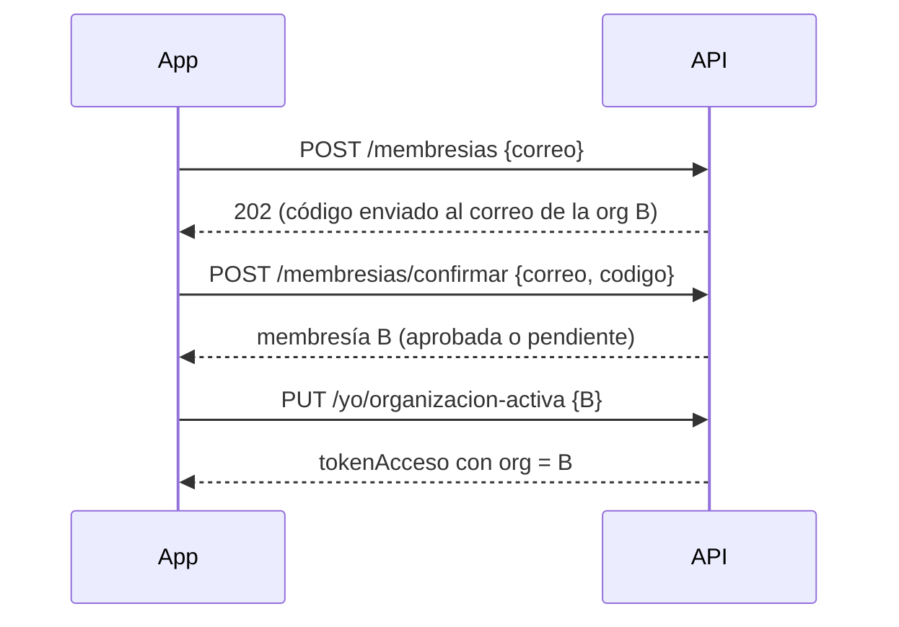

# HU-07 · Varias organizaciones — Plan técnico

> Fase SDD: **Plan** (Diseño). Cómo se construye lo que dice `spec.md`.
> Estado: `aprobado (2026-10-14)` · Rama: `feat/HU-07-varias-organizaciones`
> **Orden en S1: 6.ª.**

## 1. Módulos afectados

| Carpeta | Módulo / componente | Cambio |
|---|---|---|
| backend | `membresias` | Agregar organización (pedir código, confirmar) y cambiar la organización activa |
| mobile | `app/organizaciones.tsx`, `app/agregar-organizacion.tsx` | Nuevo; reutiliza la pantalla Código de HU-05 |

Reutiliza: `OtpService` (HU-05, propósito `agregar_organizacion`), `organizacion_por_dominio` (HU-02), emisión de tokens y `GET /yo` (HU-06).

## 2. Cambios al modelo de datos

Sin tablas nuevas. Ya existen: `membresias.correo_institucional` con `UNIQUE` global (un correo institucional, una persona) y `usuarios.ultima_organizacion_id`. Sin migración.

## 3. Endpoints

| Método | Ruta | Rol | Request → Response | Errores (`codigo`) |
|---|---|---|---|---|
| POST | `/api/v1/membresias` | autenticado | `{ correo }` → 202 `{ reenviarEn }` | `ORGANIZACION_NO_AFILIADA` 422, `YA_ES_MIEMBRO` 409, `MEMBRESIA_RECHAZADA` 409, `CORREO_EN_USO` 409, `OTP_LIMITE_REENVIO` 429 |
| POST | `/api/v1/membresias/confirmar` | autenticado | `{ correo, codigo }` → `{ membresia }` | `OTP_INVALIDO` 400, `OTP_VENCIDO` 410, `OTP_BLOQUEADO` 429 |
| PUT | `/api/v1/yo/organizacion-activa` | autenticado | `{ organizacionId }` → `{ tokenAcceso }` | `MEMBRESIA_NO_APROBADA` 403 |
| GET | `/api/v1/yo` | autenticado | (de HU-06) incluye todas las membresías con su estado | — |

Reglas de implementación:
- La organización sale del dominio del correo, nunca del cliente.
- Antes de enviar el código se comprueba si ya existe una membresía en esa organización: si está aprobada o pendiente, `YA_ES_MIEMBRO`; si fue rechazada, `MEMBRESIA_RECHAZADA` (HU-03 RN-4). Si otro usuario ya usa ese correo institucional, `CORREO_EN_USO`.
- Confirmar crea la membresía dentro de `enOrganizacion(orgId)`, con el estado que dicte el modo de aprobación, y deja auditoría.
- Cambiar de organización activa: verifica membresía `aprobada`, actualiza `ultima_organizacion_id` y emite un token de acceso nuevo con ese `org`. El refresh token no cambia; las renovaciones siguientes leen `ultima_organizacion_id`.
- CA-6: toda consulta de datos de organización corre con `app.organizacion_id = org del token`. Pedir datos de B con A activa devuelve 404 aunque la persona sea miembro de B.

Swagger actualizado: [ ]

## 4. Pantallas y voz

| Cliente | Pantalla | Pasos del flujo | Claves i18n nuevas |
|---|---|---|---|
| mobile | Mis organizaciones (lista con estado, activa marcada, tocar para cambiar, botón "Agregar") | 1 | `membresias.lista.*`, `membresias.activa.*` |
| mobile | Agregar organización (correo) → Código (de HU-05) | 2 | `membresias.agregar.*` |

Voz: no aplica.

## 5. Diagramas UML

- [x] Secuencia: agregar organización y cambiar la activa (abajo).
- [ ] Clases: relación `Usuario 1–N Membresia N–1 Organizacion` con `ultima_organizacion_id`.

## 6. Estrategia de pruebas

| Criterio / amenaza | Tipo | Archivo de prueba |
|---|---|---|
| CA-1 / CA-2 agregar con código | e2e | `backend/test/membresias/varias.e2e-spec.ts` |
| CA-3 lista con estados | e2e (`GET /yo`) | mismo archivo |
| CA-4 cambiar la activa | e2e | mismo archivo |
| CA-5 no se puede activar una pendiente o rechazada | e2e | mismo archivo |
| CA-6 A-13 entre organizaciones propias | ataque e2e | `backend/test/ataques/a-13-varias-organizaciones.e2e-spec.ts` |
| CA-7 ya es miembro; rechazado; correo en uso | e2e | `varias.e2e-spec.ts` |
| Pantallas | Jest (preset Expo) | `organizaciones.test.tsx` |

## 7. Riesgos

| Riesgo | Probabilidad | Impacto | Mitigación |
|---|---|---|---|
| Token viejo con la organización anterior sigue vivo hasta 15 min | Media | Bajo | Aceptable: la membresía sigue aprobada; si se revoca una membresía, `OrganizacionGuard` la consulta en cada petición |

Dependencias nuevas: ninguna.

## 8. Tareas propuestas (se copian a backlog.md al aprobar)

| Tarea | Horas | Responsable |
|---|---|---|
| Agregar organización (validaciones, código, confirmar) | 3 | |
| Cambiar organización activa con token nuevo | 2 | |
| Mobile: Mis organizaciones y Agregar organización | 5 | |
| Pruebas (CA-1 a CA-7, ataque A-13) | 3 | |
| **Total** | **13** | |
