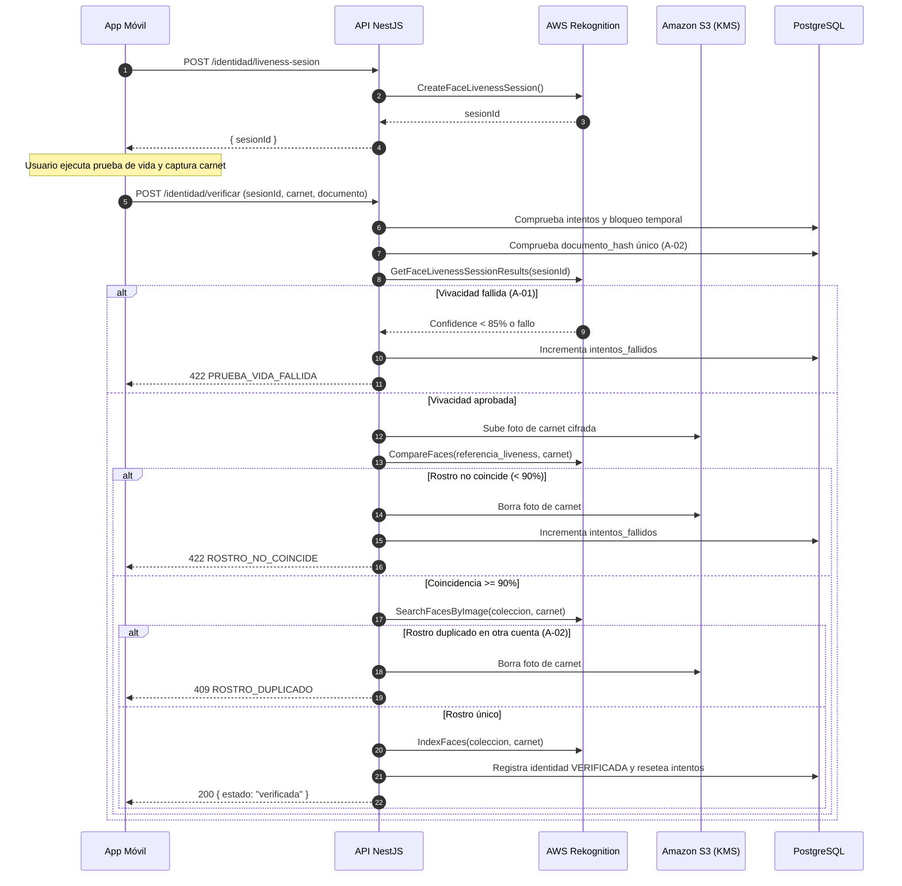

# HU-08 · Verificación de identidad — Plan técnico

> Fase SDD: **Plan** (Diseño). Cómo se construye lo que dice `spec.md`.
> Estado: `aprobado (2026-11-02)` · Rama: `feat/HU-08-verificacion-identidad`
> **Orden en S2: 1.ª.** Habilita la creación de billetera (HU-12) y la publicación de viajes (HU-17).

## 1. Módulos afectados

| Carpeta | Módulo / componente | Cambio |
|---|---|---|
| backend | `identidad` | Nuevo: controlador, servicio, DTOs y validación de vivacidad y comparación facial |
| backend | `comun` | `RekognitionService` (interacción con AWS Rekognition: sesiones de liveness, comparación y búsqueda de duplicados); decorador `@RequiereIdentidadVerificada()` |
| mobile | `app/identidad/verificar.tsx` | Nuevo: flujo en 3 pasos (consentimiento, captura de carnet, sesión de Face Liveness) |
| mobile | `app/identidad/estado.tsx` | Nuevo: pantalla informativa del estado de verificación |
| raíz | `.env.example` | Variables de AWS Rekognition y bandera `REKOGNITION_SIMULADO=true` para desarrollo/emulador |

Reutiliza: `AlmacenamientoService` (HU-11: subida y borrado de compensación en S3/MinIO), `AuditoriaService` (HU-06).

## 2. Cambios al modelo de datos

| Tabla | Cambio | Restricciones | ¿`organizacion_id` + RLS? |
|---|---|---|---|
| `identidades` | Nueva: `usuario_id`, `documento_hash`, `estado`, `similitud_facial`, `clave_s3_carnet`, `face_id_coleccion`, `intentos_fallidos`, `bloqueado_hasta`, `consentimiento_en`, `verificado_en` | `UNIQUE(usuario_id)`, `UNIQUE(documento_hash)` (A-02), `CHECK (intentos_fallidos >= 0)` | No: dato personal (Art. 2.6 y D-07); protegido por dueño |

Migración: `006_identidades`.

Notas de modelo:
- `documento_hash`: HMAC-SHA256 del número de documento con clave secreta del servidor. Permite validar unicidad global (A-02) sin almacenar el número de carnet en texto plano.
- `face_id_coleccion`: Identificador devuelto por Rekognition `IndexFaces` para indexar el rostro en la colección privada de UniRide y evitar cuentas duplicadas con diferente documento (A-02).

## 3. Endpoints

| Método | Ruta | Rol | Request → Response | Errores (`codigo`) |
|---|---|---|---|---|
| POST | `/api/v1/identidad/liveness-sesion` | autenticado | — → 201 `{ sesionId }` | `IDENTIDAD_YA_VERIFICADA` 400, `IDENTIDAD_BLOQUEADA_TEMPORAL` 403, `SERVICIO_NO_DISPONIBLE` 503 |
| POST | `/api/v1/identidad/verificar` | autenticado | `multipart/form-data`: `numeroDocumento, aceptaConsentimiento, sesionId, fotoCarnet` → 200 `{ estado, verificadoEn }` | `DOCUMENTO_DUPLICADO` 409, `ROSTRO_DUPLICADO` 409, `PRUEBA_VIDA_FALLIDA` 422, `ROSTRO_NO_COINCIDE` 422, `IMAGEN_ILEGIBLE` 400, `CONSENTIMIENTO_REQUERIDO` 400, `INTENTOS_AGOTADOS` 429 |
| GET | `/api/v1/identidad/estado` | autenticado | — → 200 `{ estado, verificadoEn, bloqueadoHasta }` | — |

Reglas de implementación y mitigación de fallas:
- **Protección de datos (CA-8):** La foto del carnet se sube a S3 con SSE-KMS en `identidades/{usuario_id}/{uuid}.jpg`. Nunca se devuelve en ningún endpoint de la API ni se incluye en logs de auditoría.
- **Doble validación biométrica:**
  1. Se consulta `GetFaceLivenessSessionResults` con el `sesionId`. Se valida `Confidence >= 85 %` y `Status == 'SUCCEEDED'`.
  2. Se extrae el rostro de referencia de la sesión de vivacidad y se ejecuta `CompareFaces` contra la `fotoCarnet`. Se exige `Similarity >= 90 %`.
  3. Se ejecuta `SearchFacesByImage` contra la colección de Rekognition. Si encuentra coincidencia $\ge$ 90 % con un `face_id` de otro usuario, se rechaza (`ROSTRO_DUPLICADO`).
  4. Si todo es correcto, se llama a `IndexFaces` y se almacena el `face_id` resultante.
- **Compensación por error:** Si la inserción o actualización en base de datos falla, se borra la foto subida a S3 y se desindexa el rostro de Rekognition.
- **Límite de ataques (CA-9):** Al acumular 3 fallos consecutivos en `intentos_fallidos`, se fija `bloqueado_hasta = NOW() + INTERVAL '24 hours'`.

## 4. Pantallas y flujo móvil

| Cliente | Pantalla | Pasos del flujo | Claves i18n nuevas |
|---|---|---|---|
| mobile | Verificación de identidad (Consentimiento informado → Captura de carnet con guía de encuadre → Prueba de vida interactiva) | 3 | `identidad.verificacion.*` |
| mobile | Estado de verificación (Insignia verde de verificado / mensaje de bloqueo con temporizador) | 1 | `identidad.estado.*` |

Voz: No aplica (la biometría y captura de documentos exigen interacción visual y física obligatoria).

## 5. Diagramas UML

## 6. Estrategia de pruebas

| Criterio | Tipo | Archivo de prueba |
|---|---|---|
| CA-1 Verificación exitosa | e2e (Rekognition simulado) | `backend/test/identidad/verificacion.e2e-spec.ts` |
| CA-2 Ataque A-01: spoofing / falta de vivacidad | e2e | `verificacion.e2e-spec.ts` |
| CA-3 Ataque A-01: carnet con rostro ajeno (< 90%) | e2e | `verificacion.e2e-spec.ts` |
| CA-4 Ataque A-02: documento duplicado | e2e | `verificacion.e2e-spec.ts` |
| CA-5 Ataque A-02: rostro duplicado en otra cuenta | e2e | `verificacion.e2e-spec.ts` |
| CA-6 Bloqueo a no verificados en endpoints protegidos | integración | `identidad.guard.spec.ts` |
| CA-7 Rechazo de imagen ilegible | e2e | `verificacion.e2e-spec.ts` |
| CA-8 Privacidad: foto y hash nunca expuestos en respuestas/logs | e2e | `verificacion.e2e-spec.ts` |
| CA-9 Bloqueo temporal tras 3 fallos consecutivos | unitaria + e2e | `verificacion.e2e-spec.ts` |
| Pantallas y consentimiento | Jest (preset Expo) | `mobile/test/identidad/verificar.test.tsx` |

## 7. Dependencias y requerimientos

- **Backend:** `@aws-sdk/client-rekognition` (se agrega a `backend/package.json`).
- **Móvil:** `@aws-amplify/ui-react-native` (o módulo de cámara con soporte de Face Liveness / mock en desarrollo).
- **AWS:** Colección Rekognition `uniride-rostros-amoy` provisionada en la región configurada.

## 8. Tareas propuestas (para backlog.md al aprobar)

- `SP88`: Modelo Prisma `identidades`, migración `006_identidades` y pruebas de repositorio — 3h.
- `SP89`: `RekognitionService` con soporte para sesiones de vivacidad, comparación facial y búsqueda en colección (con mock para desarrollo local) — 4h.
- `SP90`: Endpoints `/liveness-sesion`, `/verificar`, `/estado` y guard `@RequiereIdentidadVerificada()` — 5h.
- `SP91`: Suite de pruebas automatizadas y pruebas de ataque A-01 y A-02 (cobertura ≥ 70 %) — 4h.
- `SP92`: Pantalla móvil de verificación en Expo (consentimiento, captura de carnet y componente de vivacidad) — 6h.
