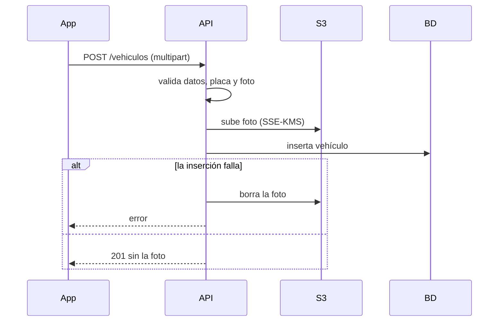

# HU-11 · Registro de vehículo — Plan técnico

> Fase SDD: **Plan** (Diseño). Cómo se construye lo que dice `spec.md`.
> Estado: `aprobado (2026-10-14)` · Rama: `feat/HU-11-registro-vehiculo`
> **Orden en S1: 8.ª.**

## 1. Módulos afectados

| Carpeta | Módulo / componente | Cambio |
|---|---|---|
| backend | `vehiculos` | Nuevo: registrar vehículo; proyección `VehiculoPublico { placa, marca, modelo, color }` para HU-17 y HU-18 |
| backend | `comun` | `AlmacenamientoService`: sube a S3 con cifrado SSE-KMS y borra en caso de compensación; `S3_ENDPOINT` apunta a MinIO en desarrollo |
| raíz | `docker-compose.yml` | Servicio MinIO, solo para desarrollo |
| mobile | `app/vehiculo.tsx` | Nuevo |

Reutiliza: `OrganizacionGuard` (HU-02: exige membresía aprobada, D-21), `AuditoriaService` (HU-06).

## 2. Cambios al modelo de datos

| Tabla | Cambio | Restricciones | ¿`organizacion_id` + RLS? |
|---|---|---|---|
| `vehiculos` | Nueva: propietario_id, placa, marca, modelo, color, capacidad, clave_s3_foto, consentimiento_foto_en | `UNIQUE(placa)`, `UNIQUE(propietario_id)` (un vehículo por conductor en v1), `CHECK (capacidad BETWEEN 1 AND 6)`, `CHECK (placa ~ '^[0-9]{3,4}[A-Z]{3}$')` | No: dato personal (D-07); filtro por dueño |

Migración: `005_vehiculos`.

## 3. Endpoints

| Método | Ruta | Rol | Request → Response | Errores (`codigo`) |
|---|---|---|---|---|
| POST | `/api/v1/vehiculos` | miembro aprobado | `multipart/form-data`: `placa, marca, modelo, color, capacidad, aceptaUsoFoto, foto` → 201 `{ id, placa, marca, modelo, color, capacidad }` | `VEHICULO_PLACA_DUPLICADA` 409, `VEHICULO_YA_REGISTRADO` 409, `VEHICULO_DATO_INVALIDO` 400, `VEHICULO_FOTO_INVALIDA` 400, `CONSENTIMIENTO_REQUERIDO` 400, `ALMACENAMIENTO_NO_DISPONIBLE` 503 |
| GET | `/api/v1/vehiculos/mio` | autenticado | — → el mismo objeto, o 404 | `NO_ENCONTRADO` 404 |

Reglas de implementación:
- Normalización de placa: mayúsculas, sin espacios ni guiones (`"1234-abc"` → `"1234ABC"`), validada con la misma expresión que el `CHECK`.
- Foto: máximo 5 MB, JPEG o PNG verificado por sus primeros bytes (no por la extensión), con el límite de tamaño de Multer (incluido en NestJS). La clave en S3 es `vehiculos/{uuid}`, sin datos personales.
- Orden para no dejar nada a medias: validar → comprobar placa y vehículo previo → subir foto → insertar en BD. Si la inserción falla (por ejemplo, otra persona registró la placa a la vez), se borra la foto subida.
- La foto y su clave **nunca** salen en respuestas, mensajes de error, auditoría ni logs (CA-7, D-20). Ningún DTO de salida tiene esos campos.

Swagger actualizado: [ ]

## 4. Pantallas y voz

| Cliente | Pantalla | Pasos del flujo | Claves i18n nuevas |
|---|---|---|---|
| mobile | Registrar vehículo (placa, marca, modelo, color, capacidad 1–6, tomar o elegir foto, casilla de consentimiento) | 1 | `vehiculos.registro.*` |

Voz: no aplica.

## 5. Diagramas UML

- [x] Secuencia: registro con compensación (abajo).
- [ ] Clases: `Vehiculo` y su proyección `VehiculoPublico`.
- [ ] Despliegue: MinIO en desarrollo; S3 cifrado en AWS.

## 6. Estrategia de pruebas

| Criterio | Tipo | Archivo de prueba |
|---|---|---|
| CA-1 registro | e2e (S3 simulado) | `backend/test/vehiculos/registro.e2e-spec.ts` |
| CA-2 placa duplicada (también en paralelo, con compensación) | e2e | mismo archivo |
| CA-3 normalización | unitaria | `placa.spec.ts` |
| CA-4 placa o capacidad inválidas; foto inválida | unitaria + e2e | `registro.e2e-spec.ts` |
| CA-5 / CA-6 capacidad como máximo de cupos y "sin vehículo no publica" | se verifican en HU-17 con `VehiculoPublico` | — |
| CA-7 la foto no aparece en respuestas, auditoría ni logs | e2e | `registro.e2e-spec.ts` |
| CA-8 membresía pendiente o rechazada | e2e | mismo archivo |
| Pantalla | Jest (preset Expo) | `vehiculo.test.tsx` |

## 7. Riesgos

| Riesgo | Probabilidad | Impacto | Mitigación |
|---|---|---|---|
| Fotos huérfanas en S3 si la compensación también falla | Baja | Bajo | Se registra el error; limpieza manual en v1 |
| Licencia de MinIO (AGPL) | Baja | Bajo | Solo es una herramienta local de desarrollo; no se distribuye ni se modifica |

Dependencias nuevas (requieren confirmación): `@aws-sdk/client-s3` (backend), `expo-image-picker` (mobile).

## 8. Tareas propuestas (se copian a backlog.md al aprobar)

| Tarea | Horas | Responsable |
|---|---|---|
| Migración `005`: vehiculos | 1 | |
| `AlmacenamientoService` (S3 + SSE-KMS) y MinIO en `docker compose` | 3 | |
| Endpoint de registro con validaciones, normalización y compensación; `GET /vehiculos/mio` | 4 | |
| Mobile: pantalla Registrar vehículo | 5 | |
| Pruebas (CA-1 a CA-8) | 3 | |
| **Total** | **16** | |
