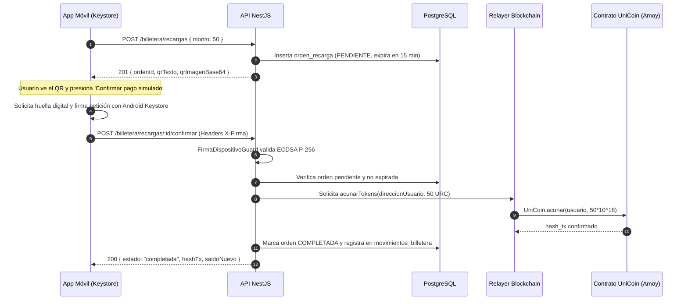

# HU-13 · Recarga de saldo — Plan técnico

> Fase SDD: **Plan** (Diseño). Cómo se construye lo que dice `spec.md`.
> Estado: `aprobado (2026-11-02)` · Rama: `feat/HU-13-recarga-saldo`
> **Orden en S2: 5.ª.** Requiere billetera (HU-12) y dispositivo vinculado (HU-09); alimenta el saldo para reservas (HU-19).

## 1. Módulos afectados

| Carpeta | Módulo / componente | Cambio |
|---|---|---|
| backend | `recargas` (o submódulo de `billetera`) | Nuevo: controlador y servicio para emitir órdenes de pago QR, verificar vencimientos y procesar confirmaciones idempotentes |
| backend | `blockchain` | Método `acunarTokens(direccion, monto)` en `BlockchainService` para interactuar con la función `acunar` del contrato `UniCoin` |
| mobile | `app/billetera/recargar.tsx` | Nuevo: pantalla con selector de montos (10–500 Bs), visualizador de QR con temporizador de 15 min y botón de simulación |
| raíz | `.env.example` | Variables del relayer acuñador de blockchain |

Reutiliza: `FirmaDispositivoGuard` (HU-09), `BlockchainService` (HU-12), `movimientos_billetera` (HU-14).

## 2. Cambios al modelo de datos

| Tabla | Cambio | Restricciones | ¿`organizacion_id` + RLS? |
|---|---|---|---|
| `ordenes_recarga` | Nueva: `id`, `usuario_id`, `billetera_id`, `monto`, `estado`, `hash_tx`, `clave_idempotencia`, `expira_en`, `completada_en`, `creado_en` | `CHECK (monto BETWEEN 10 AND 500)`, `UNIQUE(clave_idempotencia)`, `INDEX(usuario_id, expira_en)` | No: dato personal (Art. 2.6 y D-07); protegido por dueño |

Migración: `010_ordenes_recarga`.

## 3. Endpoints

| Método | Ruta | Rol | Request → Response | Errores (`codigo`) |
|---|---|---|---|---|
| POST | `/api/v1/billetera/recargas` | verificado | `{ monto: 50.00 }` → 201 `{ ordenId, monto, expiraEn, qrTexto, qrImagenBase64 }` | `MONTO_FUERA_DE_RANGO` 400, `BILLETERA_NO_ENCONTRADA` 404 |
| POST | `/api/v1/billetera/recargas/:id/confirmar` | verificado + firma dispositivo | — (Headers `X-Firma`, `X-Timestamp`, `X-Nonce`) → 200 `{ ordenId, estado: "completada", monto, hashTx, saldoNuevo }` | `ORDEN_EXPIRADA` 410, `ORDEN_YA_PROCESADA` 200 (idempotente), `FIRMA_DISPOSITIVO_INVALIDA` 401, `SERVICIO_BLOCKCHAIN_NO_DISPONIBLE` 503 |
| GET | `/api/v1/billetera/recargas/:id` | verificado | — → 200 `{ ordenId, monto, estado, expiraEn, hashTx }` | `NO_ENCONTRADO` 404 |

### Resolución de Decisión D-13 (Biometría en recarga)
La confirmación de recarga (`POST /recargas/:id/confirmar`) está decorada con `@RequiereFirmaDispositivo()`. Como la llave privada del Keystore se genera con autenticación biométrica requerida (HU-09), el teléfono solicita la huella/rostro al usuario antes de firmar la petición. Con esto se resuelve D-13 sin duplicar pantallas. En Sprint 3, HU-29 solo agregará el diálogo visual para comandos por voz.

## 4. Pantallas y flujo móvil

| Cliente | Pantalla | Pasos del flujo | Claves i18n nuevas |
|---|---|---|---|
| mobile | Recargar saldo (Selección de monto 10–500 Bs → Pantalla de QR con temporizador de 15 min → Botón de pago simulado y confirmación biométrica) | 2 | `billetera.recarga.*` |

## 5. Diagramas UML

## 6. Estrategia de pruebas

| Criterio | Tipo | Archivo de prueba |
|---|---|---|
| CA-1 Recarga exitosa con acuñación | e2e (nodo simulado) | `backend/test/billetera/recarga.e2e-spec.ts` |
| CA-2 Rechazo de monto fuera de rango (< 10 o > 500) | unitaria + e2e | `recarga.e2e-spec.ts` |
| CA-3 Ataque A-09: confirmaciones repetidas son idempotentes | e2e | `recarga.e2e-spec.ts` |
| CA-4 Ataque A-08: confirmación sin firma de dispositivo | integración | `firma-dispositivo.guard.spec.ts` |
| CA-5 Orden expirada (> 15 min) rechaza la acreditación | e2e | `recarga.e2e-spec.ts` |
| CA-6 Usuario sin billetera no puede recargar | integración | `recarga.guard.spec.ts` |
| Móvil: selector de monto y render de QR | Jest (preset Expo) | `mobile/test/billetera/recargar.test.tsx` |

## 7. Dependencias y requerimientos

- **Backend:** `qrcode` para generación rápida de códigos QR en servidor.
- **Relayer:** Cuenta de relayer con rol `ROL_ACUNADOR` en el contrato `UniCoin`.

## 8. Tareas propuestas (para backlog.md al aprobar)

- `SP109`: Modelo Prisma `ordenes_recarga`, migración `010_ordenes_recarga` y repositorio — 2h.
- `SP110`: Servicio de generación de QR con expiración y cálculo de idempotencia — 3h.
- `SP111`: Método `acunarTokens` en `BlockchainService` e integración con relayer — 3h.
- `SP112`: Endpoint de confirmación de recarga con `FirmaDispositivoGuard` — 4h.
- `SP113`: Suite de pruebas automatizadas y prueba de ataque A-09 (doble acreditación) — 3h.
- `SP114`: Mobile: pantalla de recarga en Expo (selector, QR y confirmación biométrica) — 5h.
