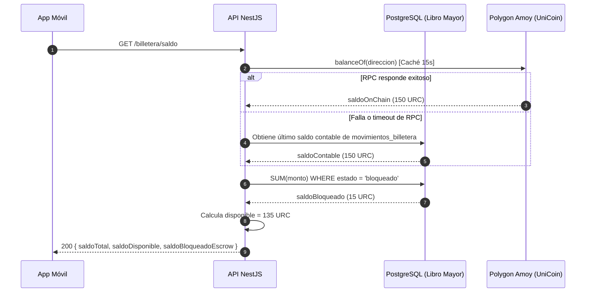

# HU-14 · Saldo e historial — Plan técnico

> Fase SDD: **Plan** (Diseño). Cómo se construye lo que dice `spec.md`.
> Estado: `aprobado (2026-11-02)` · Rama: `feat/HU-14-saldo-historial`
> **Orden en S2: 4.ª.** Complementa la billetera (HU-12) y sienta el libro mayor inmutable para recargas (HU-13) y reservas (HU-19).

## 1. Módulos afectados

| Carpeta | Módulo / componente | Cambio |
|---|---|---|
| backend | `billetera` | Endpoints para consultar balance desglosado (`/saldo`) y lista paginada de movimientos (`/movimientos`) |
| backend | `blockchain` | Método para consultar balance ERC-20 con caché de corto plazo (15 s) y conciliación con libro mayor contable |
| mobile | `app/billetera/movimientos.tsx` | Nuevo: pantalla con lista de transacciones, estados, pull-to-refresh y enlaces al explorador Polygonscan |
| mobile | `componentes/TarjetaSaldo.tsx` | Nuevo: desglose visual de saldo disponible vs bloqueado en escrow |

Reutiliza: `BlockchainService` (HU-12), `AuditoriaService` (HU-06).

## 2. Cambios al modelo de datos

| Tabla | Cambio | Restricciones | ¿`organizacion_id` + RLS? |
|---|---|---|---|
| `movimientos_billetera` | Nueva: `id`, `billetera_id`, `tipo`, `monto`, `saldo_posterior`, `estado`, `hash_tx`, `clave_idempotencia`, `metadatos`, `creado_en` | `FOREIGN KEY (billetera_id) REFERENCES billeteras(id)`, `UNIQUE(clave_idempotencia)`, `INDEX(billetera_id, creado_en DESC)` | No: dato personal (Art. 2.6 y D-07); protegido por dueño |

Migración: `009_movimientos_billetera`.

Tipos de movimiento (`tipo` ENUM):
- `recarga`: Ingreso de saldo simulado.
- `bloqueo_reserva`: Saldo congelado en escrow al reservar viaje.
- `liberacion_viaje`: Cobro de pasaje acreditado al conductor tras verificar viaje.
- `reembolso_reserva`: Devolución de fondos por viaje cancelado o no abordado.

## 3. Endpoints

| Método | Ruta | Rol | Request → Response | Errores (`codigo`) |
|---|---|---|---|---|
| GET | `/api/v1/billetera/saldo` | verificado | — → 200 `{ saldoTotal: "150.00", saldoDisponible: "135.00", saldoBloqueadoEscrow: "15.00", moneda: "URC", enLinea: true }` | `BILLETERA_NO_ENCONTRADA` 404 |
| GET | `/api/v1/billetera/movimientos` | verificado | Query: `?pagina=1&limite=20` → 200 `{ items: [...], total, pagina, paginas }` | `BILLETERA_NO_ENCONTRADA` 404 |

### Estrategia de conciliación y resiliencia (CA-4)

1. Para responder `/saldo`:
   - El backend lee el balance on-chain de `UniCoin.balanceOf(direccion)` (con caché en memoria de 15 segundos para no saturar el RPC de Amoy).
   - Consulta en base de datos la suma de fondos en estado `bloqueado` en escrow para el usuario.
   - `saldoDisponible = saldoTotalOnChain - saldoBloqueadoEscrow`.
2. Si el RPC de Polygon Amoy tiene latencia o no responde:
   - Responde inmediatamente con el último saldo contable consolidado en PostgreSQL y marca `enLinea: false` para que la app informe al usuario sin bloquear la pantalla.

## 4. Pantallas y flujo móvil

| Cliente | Pantalla | Pasos del flujo | Claves i18n nuevas |
|---|---|---|---|
| mobile | Historial de movimientos (Lista paginada, filtros por tipo, detalle con hash de transacción y link a Polygonscan) | 1 | `billetera.historial.*` |
| mobile | Tarjeta de saldo en Inicio y Billetera (Desglose `Disponible` y `En garantía`) | 1 | `billetera.saldo.*` |

## 5. Diagramas UML

## 6. Estrategia de pruebas

| Criterio | Tipo | Archivo de prueba |
|---|---|---|
| CA-1 Saldo desglosado (total, disponible, escrow) | e2e (nodo simulado) | `backend/test/billetera/saldo.e2e-spec.ts` |
| CA-2 Lista de movimientos paginada con hash | e2e | `movimientos.e2e-spec.ts` |
| CA-3 Transacción pendiente visualizada correctamente | e2e | `movimientos.e2e-spec.ts` |
| CA-4 Conciliación contable BD ↔ Blockchain | unitaria + e2e | `conciliacion.service.spec.ts` |
| CA-5 Paginación fluida (20 items) | e2e | `movimientos.e2e-spec.ts` |
| CA-6 Redirección si no tiene billetera | integración | `billetera.guard.spec.ts` |
| Móvil: listado y pull-to-refresh | Jest (preset Expo) | `mobile/test/billetera/movimientos.test.tsx` |

## 7. Dependencias y configuración

- Reutiliza dependencias de `ethers` y Prisma ya configuradas en HU-12.

## 8. Tareas propuestas (para backlog.md al aprobar)

- `SP104`: Modelo Prisma `movimientos_billetera`, migración `009_movimientos_billetera` e índices contables — 2h.
- `SP105`: Lógica de conciliación de saldo (on-chain + escrow en BD) y endpoint `/saldo` — 3h.
- `SP106`: Endpoint paginado `/movimientos` y servicio de registro inmutable — 3h.
- `SP107`: Suite de pruebas automatizadas y prueba de conciliación contable — 3h.
- `SP108`: Mobile: pantalla de Historial de movimientos y componente `TarjetaSaldo` en Expo — 4h.
