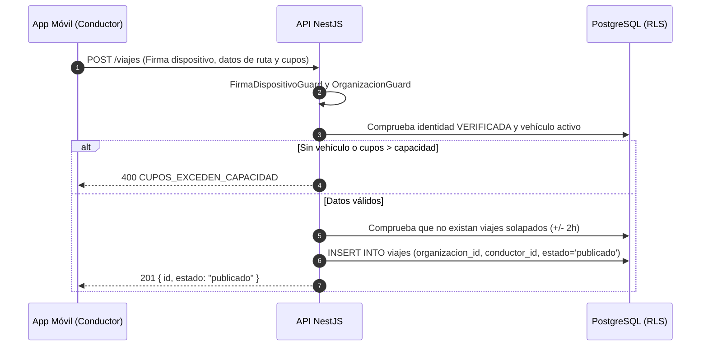

# HU-17 · Publicar viaje — Plan técnico

> Fase SDD: **Plan** (Diseño). Cómo se construye lo que dice `spec.md`.
> Estado: `aprobado (2026-11-02)` · Rama: `feat/HU-17-publicar-viaje`
> **Orden en S2: 6.ª.** Conecta identidad (HU-08), vehículo (HU-11), dispositivo (HU-09) y billetera (HU-12).

## 1. Módulos afectados

| Carpeta | Módulo / componente | Cambio |
|---|---|---|
| backend | `viajes` | Nuevo: módulo completo de viajes (controlador, servicio, DTOs y validaciones de conductor y capacidad) |
| backend | `comun` | Políticas RLS por organización en SQL para la tabla `viajes` |
| mobile | `app/viajes/publicar.tsx` | Nuevo: pantalla con selección de origen/destino (OSM), selector de horario, cupos y precio |
| mobile | `servicios/geocoding.ts` | Servicio ligero de sugerencia de direcciones usando OpenStreetMap (Nominatim) |

Reutiliza: `OrganizacionGuard` (HU-02), `@RequiereIdentidadVerificada()` (HU-08), `@RequiereFirmaDispositivo()` (HU-09), `VehiculoPublico` (HU-11).

## 2. Cambios al modelo de datos

| Tabla | Cambio | Restricciones | ¿`organizacion_id` + RLS? |
|---|---|---|---|
| `viajes` | Nueva: `id`, `organizacion_id`, `conductor_id`, `vehiculo_id`, `origen_nombre`, `origen_lat`, `origen_lng`, `destino_nombre`, `destino_lat`, `destino_lng`, `fecha_hora_salida`, `cupos_totales`, `cupos_disponibles`, `precio_por_asiento`, `estado`, `creado_en` | `CHECK (cupos_totales BETWEEN 1 AND 6)`, `CHECK (cupos_disponibles <= cupos_totales)`, `CHECK (precio_por_asiento BETWEEN 1.00 AND 20.00)`, `INDEX(organizacion_id, estado, fecha_hora_salida)` | **Sí**: dato institucional con RLS estricto (`A-13`) |

Migración: `011_viajes`.

Estados de viaje (`estado_viaje` ENUM):
- `publicado` (inicial)
- `reservado` (al menos un cupo reservado en escrow)
- `en_curso` (abordaje verificado con doble firma)
- `verificado` (bajada y traza GPS confirmadas)
- `pagado` (fondos liberados al conductor)
- `cancelado`
- `expirado`

## 3. Endpoints

| Método | Ruta | Rol | Request → Response | Errores (`codigo`) |
|---|---|---|---|---|
| POST | `/api/v1/viajes` | miembro aprobado + verificado + firma dispositivo | `{ origenNombre, origenLat, origenLng, destinoNombre, destinoLat, destinoLng, fechaHoraSalida, cuposTotales, precioPorAsiento }` → 201 `{ id, estado: "publicado", cuposDisponibles }` | `CONDUCTOR_SIN_VEHICULO` 403, `CUPOS_EXCEDEN_CAPACIDAD` 400, `PRECIO_FUERA_DE_RANGO` 400, `HORARIO_INVALIDO` 400, `VIAJE_SOLAPADO` 409, `IDENTIDAD_NO_VERIFICADA` 403 |
| GET | `/api/v1/viajes/mis-viajes` | autenticado | — → 200 `[ { id, origenNombre, destinoNombre, fechaHoraSalida, cuposDisponibles, precioPorAsiento, estado } ]` | — |
| GET | `/api/v1/viajes/:id` | miembro de la organización | — → 200 `{ id, origen, destino, conductor: { nombre }, vehiculo: { placa, marca, modelo, color }, cuposDisponibles, precioPorAsiento, estado }` | `VIAJE_NO_ENCONTRADO` 404 |

Reglas de validación:
- **Capacidad física:** Verifica que `cuposTotales <= vehiculo.capacidad` del conductor.
- **Anticipación:** `fechaHoraSalida >= NOW() + INTERVAL '15 minutes'`.
- **Anti-solapamiento:** Verifica que el conductor no tenga otro viaje activo en un margen de $\pm$ 2 horas.

## 4. Pantallas y flujo móvil

| Cliente | Pantalla | Pasos del flujo | Claves i18n nuevas |
|---|---|---|---|
| mobile | Publicar viaje (Búsqueda de origen y destino con OSM → Fecha/hora → Cupos disponibles con tope automático según vehículo → Precio por asiento) | 2 | `viajes.publicar.*` |

## 5. Diagramas UML

## 6. Estrategia de pruebas

| Criterio | Tipo | Archivo de prueba |
|---|---|---|
| CA-1 Publicación exitosa de viaje | e2e | `backend/test/viajes/publicar.e2e-spec.ts` |
| CA-2 Cupos exceden capacidad del auto (rechazo) | e2e | `publicar.e2e-spec.ts` |
| CA-3 Precio fuera de rango institucional | unitaria + e2e | `publicar.e2e-spec.ts` |
| CA-4 Horario pasado o con < 15 min de anticipación | e2e | `publicar.e2e-spec.ts` |
| CA-5 Conflicto por viajes solapados del conductor | e2e | `publicar.e2e-spec.ts` |
| CA-6 Conductor sin vehículo o no verificado | e2e | `publicar.e2e-spec.ts` |
| CA-7 Ataque A-08: publicación sin firma de dispositivo | integración | `firma-dispositivo.guard.spec.ts` |
| Ataque A-13: aislamiento multi-organización (RLS) | e2e | `publicar.e2e-spec.ts` |
| Móvil: formulario de publicación | Jest (preset Expo) | `mobile/test/viajes/publicar.test.tsx` |

## 7. Dependencias y requerimientos

- Reutiliza `VehiculoPublico` (HU-11) y la infraestructura de OpenStreetMap.

## 8. Tareas propuestas (para backlog.md al aprobar)

- `SP115`: Modelo Prisma `viajes`, migración `011_viajes` y políticas RLS por organización — 3h.
- `SP116`: Lógica de validación de conductor, vehículo y anti-solapamiento — 3h.
- `SP117`: Endpoints `/viajes`, `/mis-viajes` y consulta de detalle — 4h.
- `SP118`: Suite de pruebas y validación de amenazas A-08 y A-13 — 3h.
- `SP119`: Mobile: pantalla de Publicar viaje con mapa OSM y selección de cupos en Expo — 5h.
