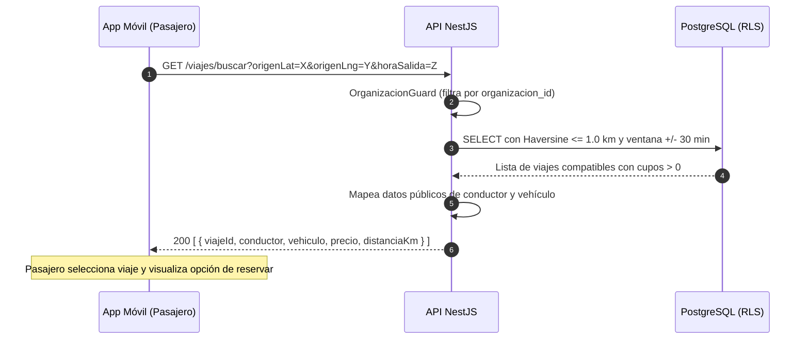

# HU-18 · Buscar viajes — Plan técnico

> Fase SDD: **Plan** (Diseño). Cómo se construye lo que dice `spec.md`.
> Estado: `aprobado (2026-11-02)` · Rama: `feat/HU-18-buscar-viajes`
> **Orden en S2: 7.ª.** Cierra el Sprint 2 y conecta la oferta de viajes (HU-17) con la demanda del pasajero para reservas (HU-19).

## 1. Módulos afectados

| Carpeta | Módulo / componente | Cambio |
|---|---|---|
| backend | `viajes` | Nuevo: endpoint `GET /viajes/buscar` con consulta geoespacial Haversine y filtro de ventana temporal |
| backend | `comun` | Utilidad matemática `GeoDistance` (cálculo de distancia geodésica) e índices espaciales en BD |
| mobile | `app/viajes/buscar.tsx` | Nuevo: pantalla con mapa o lista de viajes disponibles, filtros de horario y selector de destino |
| mobile | `componentes/TarjetaViaje.tsx` | Nuevo: tarjeta de viaje con datos del conductor, vehículo, precio, cupos y distancia |

Reutiliza: `OrganizacionGuard` (HU-02), `viajes` (HU-17), `VehiculoPublico` (HU-11).

## 2. Cambios al modelo de datos

No crea tablas nuevas. Utiliza la tabla `viajes` (HU-17) y añade un índice compuesto optimizado para búsqueda:

```sql
CREATE INDEX idx_viajes_busqueda ON viajes (
  organizacion_id,
  estado,
  fecha_hora_salida,
  cupos_disponibles
);
```

## 3. Endpoints

| Método | Ruta | Rol | Request → Response | Errores (`codigo`) |
|---|---|---|---|---|
| GET | `/api/v1/viajes/buscar` | miembro aprobado | Query: `?origenLat=-17.783&origenLng=-63.182&horaSalida=2026-11-03T07:30:00Z` → 200 `[ { id, origenNombre, distanciaKm, destinoNombre, fechaHoraSalida, cuposDisponibles, precioPorAsiento, conductor: { nombre, verificado, calificacionPromedio }, vehiculo } ]` | `COORDENADAS_INVALIDAS` 400 |

### Algoritmo de filtrado geoespacial y temporal

1. **Filtro de aislamiento (A-13):** Aplica automáticamente RLS por `organizacion_id`.
2. **Filtro temporal:** `fecha_hora_salida BETWEEN :horaSalida - INTERVAL '30 minutes' AND :horaSalida + INTERVAL '30 minutes'`.
3. **Filtro de disponibilidad:** `estado IN ('publicado', 'reservado') AND cupos_disponibles > 0`.
4. **Filtro geoespacial (Haversine):**
   ```sql
   (6371 * acos(
     cos(radians(:origenLat)) * cos(radians(origen_lat)) *
     cos(radians(origen_lng) - radians(:origenLng)) +
     sin(radians(:origenLat)) * sin(radians(origen_lat))
   )) <= 1.0
   ```
5. **Resolución de D-17:** Si el conductor no tiene reseñas en BD (HU-21 en reserva), devuelve `calificacionPromedio: null` y `esNuevo: true`.

## 4. Pantallas y flujo móvil

| Cliente | Pantalla | Pasos del flujo | Claves i18n nuevas |
|---|---|---|---|
| mobile | Buscar viajes (Entrada de destino, detección GPS actual del origen, visualización de tarjetas de viajes a ≤ 1 km con hora y precio) | 2 | `viajes.buscar.*` |

## 5. Diagramas UML



## 6. Estrategia de pruebas

| Criterio | Tipo | Archivo de prueba |
|---|---|---|
| CA-1 Búsqueda exitosa a ≤ 1 km y ± 30 min | e2e | `backend/test/viajes/buscar.e2e-spec.ts` |
| CA-2 Información pública (conductor y auto) sin datos sensibles | e2e | `buscar.e2e-spec.ts` |
| CA-3 Ataque A-13: viajes de otra organización nunca aparecen | e2e | `buscar.e2e-spec.ts` |
| CA-4 Viajes sin cupos o pasados quedan excluidos | e2e | `buscar.e2e-spec.ts` |
| CA-5 Conductor sin calificación muestra badge 'Nuevo' (D-17) | e2e | `buscar.e2e-spec.ts` |
| CA-6 Rendimiento: respuesta en < 2 segundos con 50 viajes | e2e / carga | `buscar.e2e-spec.ts` |
| Móvil: lista de resultados y tarjeta de viaje | Jest (preset Expo) | `mobile/test/viajes/buscar.test.tsx` |

## 7. Dependencias y requerimientos

- Reutiliza módulo `viajes` (HU-17) y OpenStreetMap.

## 8. Tareas propuestas (para backlog.md al aprobar)

- `SP120`: Lógica de consulta geoespacial Haversine y filtro de ventana temporal — 3h.
- `SP121`: Endpoint `/viajes/buscar` con DTOs seguros y resolución D-17 — 3h.
- `SP122`: Suite de pruebas automatizadas, prueba de aislamiento A-13 y medición de latencia < 2s — 3h.
- `SP123`: Mobile: pantalla de Búsqueda de viajes y componente `TarjetaViaje` en Expo — 5h.
