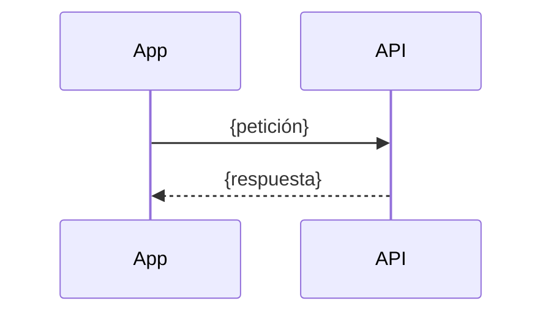

# HU-xx · {Nombre corto} — Plan técnico

> Fase SDD: **Plan** (Diseño). Cómo se construye lo que dice `spec.md`. Copiar a `SPECS/features/HU-xx-slug/plan.md`.
> Estado: `borrador` | `aprobado (fecha, revisores)` · Rama: `feat/HU-xx-slug`
> Solo cuando este plan esté aprobado se cargan sus tareas en `.agents/STEERING/backlog.md`.
> Si el plan se desvía de `ssd.md`, registrar primero el desvío en `MEMORY.md` y actualizar `ssd.md`.

## 1. Módulos afectados

| Carpeta | Módulo / componente | Cambio |
|---|---|---|
| backend | `{modulo}` | {nuevo / modificado} |
| web | | |
| mobile | | |
| contracts | | |

Reutiliza: {guards, servicios o utilidades existentes}.

## 2. Cambios al modelo de datos

| Tabla | Cambio | Restricciones | ¿`organization_id` + RLS? |
|---|---|---|---|
| | | | |

Migración: {nombre}. ¿Borra o transforma datos existentes o cambia RLS? {sí → requiere confirmación humana (`AGENTS.md` §14) / no}.

## 3. Endpoints

| Método | Ruta | Rol | Firma de dispositivo / biometría | Request → Response | Errores (`code`) |
|---|---|---|---|---|---|
| | | | | | |

Swagger actualizado: [ ]

## 4. Pantallas y voz

| Cliente | Pantalla | Pasos del flujo | Claves i18n nuevas |
|---|---|---|---|
| mobile | | | |
| web | | | |

| Comando de voz | Acción | Alternativa táctil | ¿Pide biometría? |
|---|---|---|---|
| | | | |

## 5. Diagramas UML

- [ ] Secuencia: {flujo}
- [ ] Clases: {entidades}
- [ ] Otros a actualizar (casos de uso, paquetes, despliegue): {cuáles}

## 6. Estrategia de pruebas

| Criterio / amenaza | Tipo (unitaria / integración / e2e / Hardhat / manual en dispositivo) | Archivo de prueba |
|---|---|---|
| CA-1 | | |
| A-xx | ataque | |

Metas de rendimiento aplicables: {abordaje < 3 s / búsqueda < 2 s / no aplica}.

## 7. Riesgos

| Riesgo | Probabilidad | Impacto | Mitigación |
|---|---|---|---|
| | | | |

## 8. Tareas propuestas (se copian a backlog.md al aprobar)

| Tarea | Horas | Responsable |
|---|---|---|
| | | |
