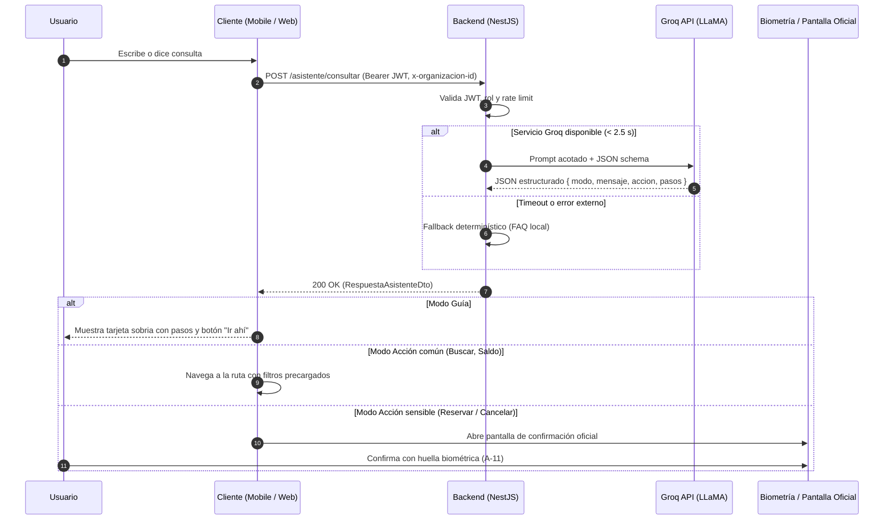

# Asistente · Asistente y guía inteligente para el usuario — Plan técnico

> Fase SDD: **Plan** (Diseño). Cómo se construye lo que dice `spec.md`.
> Ubicación: `SPECS/features/asistente/plan.md`
> Estado: `borrador` · Rama: `feat/asistente-guia-usuario` en raíz, `backend`, `mobile` y `web`.
> **Requiere confirmación humana (`AGENTS.md` §14):** endpoint nuevo aditivo `POST /asistente/consultar` y dependencia liviana `groq-sdk` en el backend.

## 1. Módulos afectados

| Carpeta | Módulo / componente | Cambio |
|---|---|---|
| backend | `src/asistente/asistente.module.ts` | Módulo nuevo para orquestar consultas y fallback |
| backend | `src/asistente/asistente.controller.ts` | Controlador con endpoint `POST /asistente/consultar` |
| backend | `src/asistente/asistente.service.ts` | Lógica de system prompts, validación de esquemas y fallback local |
| backend | `src/asistente/groq.servicio.ts` | Cliente aislado para la API de Groq con timeout estricto de 2,5 s (soporta `qwen/qwen3.8-27b`, `llama-3.3-70b-versatile`, `llama-3.1-8b-instant`) |
| backend | `src/asistente/dto/consulta-asistente.dto.ts` | DTO con validación `class-validator` para la consulta |
| mobile | `src/componentes/BotonAsistente.tsx` | Botón discreto con ícono `help_outline` / `spark` sobrio (DESIGN_SYSTEM P10) |
| mobile | `src/componentes/TarjetaGuiaAsistente.tsx` | Tarjeta plana no invasiva con 2-3 pasos y botón «Ir ahí» |
| mobile | `src/componentes/TutorialUniRide.tsx` | Recorrido modal liviano de 3 pasos («¿Cómo funciona UniRide?») |
| mobile | `src/api/cliente.ts` | Función `consultarAsistente(consulta: string)` |
| web | `src/componentes/BotonAsistente.tsx` | Acceso sutil en el encabezado de `Estructura.tsx` |
| web | `src/componentes/PanelAsistente.tsx` | Tarjeta desplegable plana con campo de consulta, pasos y atajos |
| web | `src/api/cliente.ts` | Función `consultarAsistente(consulta: string)` |
| mobile/web | `i18n/es-BO.json` | Claves de microcopia, tutorial y estados de error |

Reutiliza: `JwtAuthGuard`, `OrganizacionGuard`, `ThrottlerGuard` (backend); `Estructura`, `Dialogo`, `Boton` (web); `HojaInferior`, `PanelVoz`, router de `expo-router` (mobile).

## 2. Cambios al modelo de datos

**Ninguno.** El asistente es completamente stateless y opera por solicitud-respuesta inmediata:
- No almacena conversaciones ni historiales en la base de datos (privacidad y simplicidad).
- El rate limiting se controla en memoria del proceso con `@nestjs/throttler`.
- No requiere migraciones ni cambios en PostgreSQL ni RLS.

## 3. Endpoints

| Método | Ruta | Rol | F/B | Request → Response | Errores (`codigo`) |
|---|---|---|---|---|---|
| POST | `/asistente/consultar` | usuario autenticado | — | `{ "consulta": string }` → `RespuestaAsistenteDto` | `CONSULTA_INVALIDA` (400), `NO_AUTORIZADO` (401), `SIN_ORGANIZACION` (403), `LIMITE_EXCEDIDO` (429), `SERVICIO_NO_DISPONIBLE` (503) |

### Estructura de `RespuestaAsistenteDto`:
```typescript
export interface RespuestaAsistenteDto {
  modo: 'accion' | 'guia';
  mensaje: string;
  accion?: {
    ruta: string;
    params?: Record<string, string>;
    etiquetaBoton: string;
  };
  pasos?: string[];
}
```

### Prompt y Control de Salida (Groq):
- Modelo: Configurable por variable de entorno `GROQ_MODELO` (por defecto `qwen/qwen3.8-27b`, con soporte para `llama-3.3-70b-versatile` o `llama-3.1-8b-instant`), con `response_format: { type: 'json_object' }`. Qwen 27B destaca por su altísima precisión en seguimiento de instrucciones y modo JSON estricto a velocidad Groq (< 200 ms).
- System prompt cerrado con el mapa de rutas válidas de mobile y web:
  - Mobile: `/buscar`, `/mis-viajes`, `/billetera`, `/publicar`, `/perfil`.
  - Web: `/`, `/organizaciones`, `/perfil`.
- Si Groq responde una ruta desconocida o el JSON no cumple el esquema, el backend degrada a modo guía con texto seguro.

Swagger actualizado: [x]

## 4. Pantallas y navegación

### 4.1 Móvil
- **Acceso:** Botón sutil en la esquina superior del encabezado de pantalla raíz o integrado en el panel de voz como sugerencia rápida.
- **Interacción:**
  - Si es **Modo Acción**: el teléfono ejecuta `router.push({ pathname: r.accion.ruta, params: r.accion.params })`.
  - Si es **Modo Guía**: se abre una tarjeta inferior plana (`TarjetaGuiaAsistente`) con el mensaje, 2 o 3 viñetas breves y un botón secundario que lleva a la pantalla correspondiente.
  - **Tutorial autoguiado:** botón «¿Cómo funciona?» en Perfil que abre 3 tarjetas secuenciales (Escrow, QR/GPS y Pago).

### 4.2 Web
- **Acceso:** Botón sutil con ícono `help_outline` en la barra superior (`Estructura.tsx`), al lado del nombre de usuario.
- **Interacción:**
  - Al hacer clic se despliega un panel plano (`PanelAsistente`) alineado a la derecha, con un campo de texto simple y 3 sugerencias frecuentes («¿Cómo vinculo mi celular?», «¿Cómo funciona el saldo?», «Requisitos de viaje»).
  - Al responder, muestra la explicación breve, los pasos a seguir y un enlace directo a la sección o descarga del APK.

### 4.3 Comandos y Biometría (A-11)

| Acción interpretada | Efecto en la interfaz | ¿Pide biometría? |
|---|---|---|
| «Buscar viaje a {destino}» | Abre `/buscar` con el destino precargado | No |
| «Ver mi saldo» | Abre `/billetera` | No |
| «¿Cómo funciona el pago?» | Muestra tarjeta con pasos del escrow | No |
| «Reservar viaje» | Abre la pantalla de confirmación oficial de HU-19 | **Sí (huella obligatoria)** |
| «Cancelar reserva» | Abre la confirmación oficial de cancelación de HU-20 | **Sí (huella obligatoria)** |

## 5. Diagramas UML

### 5.1 Diagrama de Secuencia: Consulta al Asistente y Navegación



## 6. Estrategia de pruebas

| Criterio / amenaza | Tipo | Archivo de prueba |
|---|---|---|
| CA-1 | unitaria (visual/estilos) | `mobile/src/__tests__/asistente-boton.test.tsx`, `web/src/componentes/BotonAsistente.test.tsx` |
| CA-2 | integración | `backend/src/asistente/__tests__/asistente.service.spec.ts` |
| CA-3 | integración (cliente) | `mobile/src/__tests__/asistente-navegacion.test.tsx` |
| CA-4 | unitaria | `mobile/src/__tests__/tutorial-autoguiado.test.tsx` |
| CA-5 | unitaria | `web/src/componentes/PanelAsistente.test.tsx` |
| CA-6 (A-11) | ataque | `mobile/src/__tests__/a-11-asistente-biometria.test.tsx` (verifica que la IA nunca reserve ni cancele sin el prompt biométrico) |
| CA-7 (A-13) | ataque | `backend/test/a-13-asistente-organizacion.e2e-spec.ts` (verifica filtrado estricto por organización activa) |
| CA-8 (A-08) | integración | `backend/test/asistente-auth.e2e-spec.ts` (rechazo 401/403 sin token válido) |
| CA-9 / CA-10 | unitaria | `backend/src/asistente/__tests__/asistente-fallback.spec.ts` (fallback ante timeout y respuestas fuera de dominio) |

Metas de rendimiento:
- Respuesta del asistente en backend: **p95 < 800 ms** (gracias a la baja latencia de Groq y timeout en 2,5 s).
- Renderizado de tarjeta guía: **< 100 ms** en cliente.

## 7. Riesgos y mitigaciones

| Riesgo | Probabilidad | Impacto | Mitigación |
|---|---|---|---|
| Latencia alta o caída de Groq | Media | Bajo | Timeout estricto de 2,5 s y degradación automática a preguntas frecuentes locales sin bloquear al usuario. |
| Alucinación de rutas o parámetros | Baja | Medio | System prompt con lista blanca cerrada de rutas permitidas y validación del DTO de respuesta antes de enviar al cliente. |
| Agotamiento de cuota de API | Baja | Medio | Throttler de NestJS configurado a máx 15 consultas/min por usuario; caché en memoria para preguntas idénticas repetitivas. |
| Violación de regla A-11 (intento de saltear huella) | Baja | Crítico | El cliente jamás ejecuta mutaciones financieras desde el asistente; solo navega a las pantallas oficiales que exigen biometría. |

## 8. Tareas propuestas

| Tarea | Descripción | Horas | Responsable |
|---|---|---|---|
| SP-ASIST-01 | Backend: Módulo `AsistenteModule`, cliente Groq con timeout y DTOs | 4 h | Backend |
| SP-ASIST-02 | Backend: Lógica de system prompt cerrado, fallback local y pruebas unitarias/e2e | 3 h | Backend |
| SP-ASIST-03 | Mobile: Componente sobrio `BotonAsistente`, `TarjetaGuiaAsistente` y navegación | 4 h | Mobile |
| SP-ASIST-04 | Mobile: `TutorialUniRide` (tour autoguiado de 3 pasos) y pruebas Jest | 3 h | Mobile |
| SP-ASIST-05 | Web: `BotonAsistente`, `PanelAsistente` en `Estructura.tsx` y pruebas React | 3 h | Web |
| SP-ASIST-06 | Seguridad: Pruebas de ataque automatizadas A-11 y A-13 | 3 h | QA / Backend |

**Total estimado:** 20 horas.

