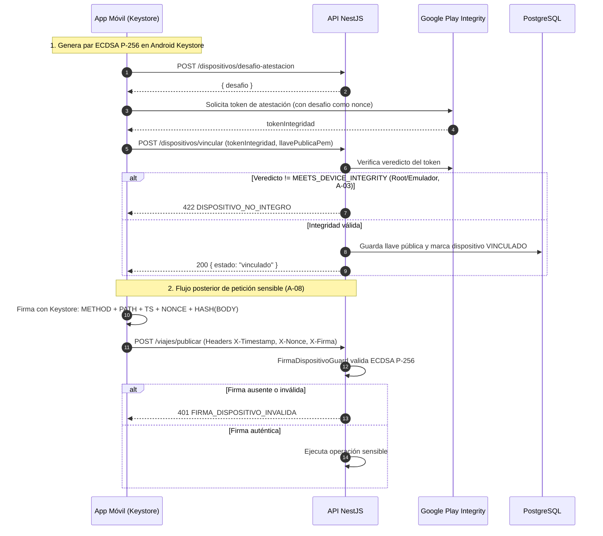

# HU-09 · Vinculación de dispositivo — Plan técnico

> Fase SDD: **Plan** (Diseño). Cómo se construye lo que dice `spec.md`.
> Estado: `aprobado (2026-11-02)` · Rama: `feat/HU-09-vinculacion-dispositivo`
> **Orden en S2: 2.ª.** Establece la Capa 2 de seguridad requerida para recargas (HU-13) y todas las peticiones sensibles.

## 1. Módulos afectados

| Carpeta | Módulo / componente | Cambio |
|---|---|---|
| backend | `dispositivos` | Nuevo: controlador y servicio para emitir desafíos de atestación, validar tokens de Play Integrity y registrar llaves públicas |
| backend | `comun` | `PlayIntegrityService` (validación oficial con Google API y mock simulado para desarrollo); `FirmaDispositivoGuard` y decorador `@RequiereFirmaDispositivo()` |
| mobile | `src/dispositivo/` | `keystore.ts` (frontera nativa: llave, firma y token de Play Integrity; sin módulo nativo falla de forma segura), `firma.ts` (mensaje canónico y encabezados) y `sha256.ts`; para generar par de llaves ECDSA P-256 en Android Keystore, firmar payloads y solicitar token de Play Integrity |
| mobile | `src/app/dispositivo.tsx` | Nuevo: pantalla de comprobación de integridad y vinculación |
| raíz | `.env.example` | Variables de Google Cloud (`PLAY_INTEGRITY_PAQUETE`, `GOOGLE_APPLICATION_CREDENTIALS`) y bandera `MODO_EMULADOR_DEV=false` (nombres de `SPECS/ssd.md` §13) |

Reutiliza: `AuditoriaService` (HU-06).

## 2. Cambios al modelo de datos

| Tabla | Cambio | Restricciones | ¿`organizacion_id` + RLS? |
|---|---|---|---|
| `dispositivos` | Nueva: `id`, `usuario_id`, `llave_publica`, `algoritmo`, `modelo_dispositivo`, `veredicto_integridad`, `activo`, `vinculado_en`, `ultimo_uso_en` | `UNIQUE(usuario_id)` (un dispositivo por cuenta en v1, A-02), `CHECK (activo IN (true, false))` | No: dato personal (Art. 2.6 y D-07); protegido por dueño |

Migración: `007_dispositivos`.

## 3. Endpoints

| Método | Ruta | Rol | Request → Response | Errores (`codigo`) |
|---|---|---|---|---|
| POST | `/api/v1/dispositivos/desafio-atestacion` | autenticado | — → 201 `{ desafio, expiraEn }` | `DISPOSITIVO_YA_VINCULADO` 400 |
| POST | `/api/v1/dispositivos/vincular` | autenticado | `{ desafio, tokenIntegridad, llavePublicaPem, modelo }` → 200 `{ id, estado: "vinculado" }` | `DESAFIO_INVALIDO` 400, `DISPOSITIVO_NO_INTEGRO` 422, `LLAVE_INVALIDA` 400, `SERVICIO_NO_DISPONIBLE` 503 |
| GET | `/api/v1/dispositivos/mi-dispositivo` | autenticado | — → 200 `{ id, modelo, vinculadoEn, activo }` o 404 | `NO_ENCONTRADO` 404 |

### Mecanismo de validación de firma (`FirmaDispositivoGuard`)

Para cada endpoint con `@RequiereFirmaDispositivo()`:
1. El cliente envía los encabezados:
   - `X-Dispositivo-Id`: UUID del dispositivo.
   - `X-Timestamp`: Epoch en milisegundos.
   - `X-Nonce`: Cadena aleatoria de 16 bytes.
   - `X-Firma`: Firma digital en Base64.
2. El guard verifica:
   - Ventana de tiempo: `|ahora - X-Timestamp| <= 30000` ms (30 segundos).
   - Nonce no repetido en los últimos 60 segundos (en memoria o caché con TTL).
   - Reconstrucción canónica del mensaje:
     ```
     METODO\n
     RUTA_CANONICA\n
     TIMESTAMP\n
     NONCE\n
     SHA256(RAW_BODY)
     ```
   - Criptografía: Verificación ECDSA con curva NIST P-256 (`SHA256withECDSA`) usando la llave pública registrada del usuario.
   - Si no cuadra o falta la firma: respuesta 401 con `FIRMA_DISPOSITIVO_INVALIDA`.

## 4. Pantallas y flujo móvil

| Cliente | Pantalla | Pasos del flujo | Claves i18n nuevas |
|---|---|---|---|
| mobile | Vinculación de teléfono (Comprobación de hardware → Solicitud de permisos biométricos → Registro seguro) | 2 | `dispositivo.vinculacion.*` |

## 5. Diagramas UML



## 6. Estrategia de pruebas

| Criterio | Tipo | Archivo de prueba |
|---|---|---|
| CA-1 Vinculación exitosa con atestación | e2e (Play Integrity simulado) | `backend/test/dispositivos/vinculacion.e2e-spec.ts` |
| CA-2 Ataque A-03: emulador/root | e2e | `vinculacion.e2e-spec.ts` |
| CA-3 Ataque A-08: petición sin firma a endpoint sensible | integración | `firma-dispositivo.guard.spec.ts` |
| CA-4 Ataque A-04/A-08: firma con llave ajena o alterada | integración | `firma-dispositivo.guard.spec.ts` |
| CA-5 Ataque Replay: timestamp caducado o nonce duplicado | integración | `firma-dispositivo.guard.spec.ts` |
| CA-6 Doble vinculación simultánea bloqueada | e2e | `vinculacion.e2e-spec.ts` |
| Bypass prohibido en producción | unitaria | `play-integrity.service.spec.ts` |
| Móvil: generación de llaves y firma | unitaria | `mobile/src/__tests__/firma.test.ts` y `dispositivo.test.tsx` |

## 7. Dependencias y configuración

- **Backend:** `google-auth-library` y `@googleapis/playintegrity` (se agregan a `backend/package.json`).
- **Móvil:** Módulo nativo o librería de Keystore con soporte de Secure Element / StrongBox.
- **Ambientes:** Variable `MODO_EMULADOR_DEV=true` en local; en producción (`NODE_ENV=production`) la API fuerza verificación real con Google y bloquea el arranque si la configuración es insegura.

## 8. Tareas propuestas (para backlog.md al aprobar)

- `SP93`: Modelo Prisma `dispositivos`, migración `007_dispositivos` y repositorio — 3h.
- `SP94`: `PlayIntegrityService` (integración con Google Play Integrity API y mock simulado con bloqueo en prod) — 4h.
- `SP95`: Endpoints de atestación y vinculación en backend — 4h.
- `SP96`: `FirmaDispositivoGuard` con validación de ECDSA, nonce y ventana temporal de 30s — 5h.
- `SP97`: Suite de pruebas y pruebas de ataque A-03, A-04, A-08 — 4h.
- `SP98`: Módulo móvil de Android Keystore y pantalla de vinculación en Expo — 6h.
