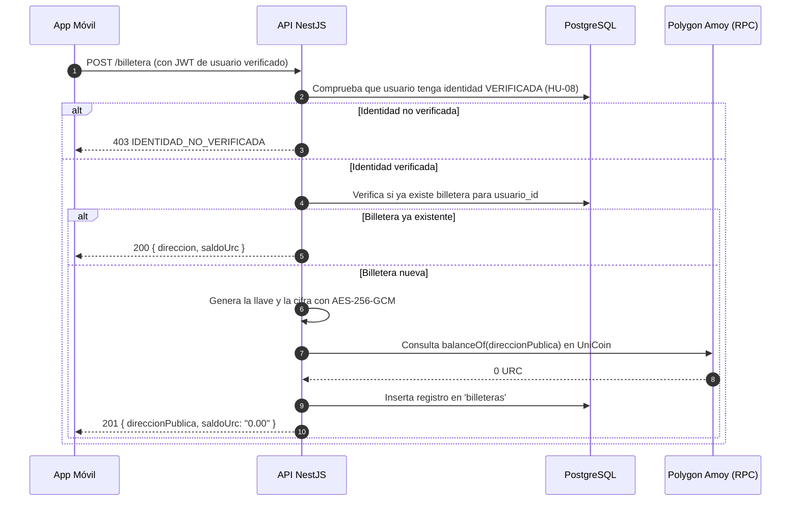

# HU-12 · Creación de billetera — Plan técnico

> Fase SDD: **Plan** (Diseño). Cómo se construye lo que dice `spec.md`.
> Estado: `aprobado (2026-11-02)` · Rama: `feat/HU-12-creacion-billetera`
> **Orden en S2: 3.ª.** Depende de HU-08 (identidad aprobada) y habilita recargas (HU-13) y pagos (HU-19).

> [!IMPORTANT]
> **👁️ OJO PARA IMPLEMENTACIÓN / ARQUITECTURA (CUSTODIA DE LLAVES Y COSTO $0):**
> Para evitar que AWS KMS facture $1 USD/mes por cada usuario registrado (insostenible en desarrollo/pruebas), la custodia se implementa en **modo dual sin costo base**:
> 1. **Modo estándar ($0 costo):** Cifrado simétrico nativo en backend (`node:crypto` AES-256-GCM) utilizando la variable de entorno secreta `WALLET_ENCRYPTION_KEY`. Las claves privadas se guardan cifradas en `billeteras.llave_custodia_ref` y nunca en texto plano (cumple A-12).
> 2. **Modo AWS KMS opcional:** Si el equipo o el docente exigen KMS real en producción, se usa una única **Llave Maestra KMS** para cifrar las llaves (Envelope Encryption), sin crear una clave KMS por alumno.
> 3. **Modo Local:** Nodo local de Hardhat en Docker con cuentas pre-fondeadas.
> *Revisar esta nota si el equipo decide migrar 100% a llaves dedicadas de KMS.*

## 1. Módulos afectados

| Carpeta | Módulo / componente | Cambio |
|---|---|---|
| backend | `billetera` | Nuevo: controlador y servicio para crear billetera, consultar dirección y balance on-chain |
| backend | `blockchain` | Nuevo: servicio relayer, conexión JSON-RPC con Polygon Amoy / Hardhat local, contrato `UniCoin` y firma segura |
| mobile | `src/app/(pestanas)/billetera.tsx` y `src/app/(pestanas)/_layout.tsx` | Nuevo: barra de pestañas (`DESIGN_SYSTEM.md` §6.1) y pantalla de billetera con saldo URC y dirección pública; los accesos a recarga y movimientos llegan con HU-13 y HU-14 |
| raíz | `.env.example` | Variables de blockchain: `CADENA_RPC_URL`, `CADENA_ID` y `DIRECCION_TOKEN_URC` (ya existen), `WALLET_ENCRYPTION_KEY` y `BLOCKCHAIN_SIMULADA` (nuevas) |

Reutiliza: `@RequiereIdentidadVerificada()` (HU-08), `FirmaDispositivoGuard` (HU-09).

## 2. Cambios al modelo de datos

| Tabla | Cambio | Restricciones | ¿`organizacion_id` + RLS? |
|---|---|---|---|
| `billeteras` | Nueva: `id`, `usuario_id`, `direccion`, `llave_custodia_ref`, `creado_en`, `actualizado_en` | `UNIQUE(usuario_id)`, `UNIQUE(direccion)`, `CHECK (direccion ~ '^0x[0-9a-fA-F]{40}$')` | No: dato personal (Art. 2.6 y D-07); protegido por dueño |

| `usuarios` | Nueva columna `suspendida_en` (`TIMESTAMPTZ NULL`), para el caso "cuenta suspendida" de la spec §4 | Sin efecto sobre filas existentes; nada la escribe hasta que una HU de administración lo necesite | No aplica |

Migración: `008_billeteras`.

Nota de seguridad (A-12):
- La base de datos relacional **nunca** guarda la clave privada en texto claro ni expone frases semilla.
- `llave_custodia_ref`: almacena la llave privada cifrada con AES-256-GCM (IV, etiqueta y texto cifrado) con `WALLET_ENCRYPTION_KEY`. El modo KMS opcional queda sin implementar hasta que alguien lo exija.

## 3. Endpoints

| Método | Ruta | Rol | Request → Response | Errores (`codigo`) |
|---|---|---|---|---|
| POST | `/api/v1/billetera` | verificado + firma de dispositivo | — → 201 (o 200 si ya existía) `{ id, direccion, saldoUrc: "0.00", exploradorUrl }` | `CUENTA_SUSPENDIDA` 403, `IDENTIDAD_NO_VERIFICADA` 403, `FIRMA_DISPOSITIVO_INVALIDA` 401, `PETICION_EXPIRADA` 401, `SERVICIO_BLOCKCHAIN_NO_DISPONIBLE` 503 |
| GET | `/api/v1/billetera/mia` | verificado + firma de dispositivo | — → 200 `{ id, direccion, saldoUrc, exploradorUrl }` (`exploradorUrl` es `null` fuera de Amoy) | los mismos, más `BILLETERA_NO_ENCONTRADA` 404 |

Reglas de implementación:
- **Idempotencia:** Si el usuario ya posee una billetera activa en `billeteras`, el endpoint `POST /api/v1/billetera` devuelve 200 con la billetera existente en lugar de fallar o generar duplicados.
- **Consulta on-chain:** El saldo mostrado se lee directamente del contrato ERC-20 `UniCoin.balanceOf(direccion)` formateado a 2 decimales (unidades URC).
- **Enlace a explorador:** Para Polygon Amoy, genera URL a `https://amoy.polygonscan.com/address/{direccion}`.

## 4. Pantallas y flujo móvil

| Cliente | Pantalla | Pasos del flujo | Claves i18n nuevas |
|---|---|---|---|
| mobile | Billetera (Tarjeta con balance URC, dirección acortada con botón copiar, enlace a Polygonscan, accesos rápidos a Recargar y Movimientos) | 1 | `billetera.pantalla.*` |

## 5. Diagramas UML

## 6. Estrategia de pruebas

| Criterio | Tipo | Archivo de prueba |
|---|---|---|
| CA-1 Creación automática de billetera tras verificación | e2e (nodo simulado) | `backend/test/billetera/creacion.e2e-spec.ts` |
| CA-2 Idempotencia (no duplica si ya existe) | e2e | `creacion.e2e-spec.ts` |
| CA-3 Amenaza A-12: llave privada nunca almacenada en BD | e2e | `creacion.e2e-spec.ts` |
| CA-4 Rechazo 403 a usuarios no verificados | integración | `billetera.guard.spec.ts` |
| CA-5 Consulta de dirección pública y saldo | e2e | `creacion.e2e-spec.ts` |
| CA-6 Resiliencia ante falla de conexión RPC / KMS | e2e | `creacion.e2e-spec.ts` |
| Móvil: renderizado de tarjeta y dirección | Jest (preset Expo) | `mobile/src/__tests__/billetera.test.tsx` |

## 7. Dependencias y requerimientos

- **Backend:** `ethers` ^6.17 (nueva en backend, confirmada el 06/11). `@aws-sdk/client-kms` no se añade: el modo KMS es opcional y no se implementa aquí.
- **Contratos:** Despliegue de `UniCoin.sol` en Amoy (o nodo Hardhat local).
- **Ambientes:** Variable `BLOCKCHAIN_SIMULADA=true` para ejecutar la suite de pruebas sin llamadas remotas a Amoy.

## 8. Tareas propuestas (para backlog.md al aprobar)

- `SP99`: Modelo Prisma `billeteras`, migración `008_billeteras` y repositorio — 2h.
- `SP100`: `BlockchainService` (conexión ethers con Polygon Amoy / Hardhat y lectura de balance de UniCoin) — 4h.
- `SP101`: Endpoints de creación y consulta de billetera en backend — 3h.
- `SP102`: Suite de pruebas y validación de seguridad A-12 (sin llaves en BD) — 3h.
- `SP103`: Mobile: pantalla de Billetera en Expo (tarjeta de saldo, dirección y accesos) — 4h.
