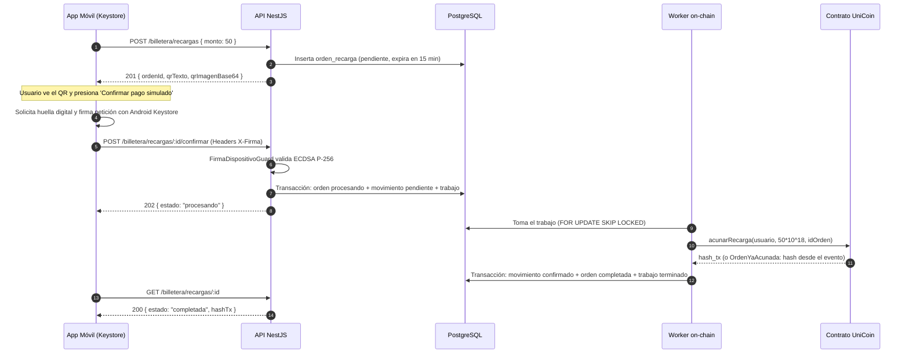

# HU-13 · Recarga de saldo — Plan técnico

> Fase SDD: **Plan** (Diseño). Cómo se construye lo que dice `spec.md`.
> Estado: `aprobado (2026-11-02)`; **ajuste del 2026-11-07 con las decisiones del integrante, pendiente de aprobación** · Rama: `feat/HU-13-recarga-saldo` (apilada sobre `feat/HU-14-saldo-historial`)
> **Orden en S2: 5.ª.** Requiere billetera (HU-12) y dispositivo vinculado (HU-09); alimenta el saldo para reservas (HU-19).
> **Requieren confirmación humana (`AGENTS.md` §14), dada el 07/11:** lógica de recarga, función nueva en `UniCoin`, dependencia `qrcode`. Se fusiona después de HU-12 y HU-14.

## 1. Módulos afectados

| Carpeta | Módulo / componente | Cambio |
|---|---|---|
| contracts | `UniCoin.sol` | Nuevo: `acunarRecarga(destino, monto, idOrden)`, que revierte con `OrdenYaAcunada` si el id ya se usó y emite `RecargaAcunada(idOrden indexado, destino indexado, monto)`. `acunar` queda para subsidios |
| backend | `billetera/recargas` | Nuevo: controlador y servicio de órdenes: emitir QR, vencer y confirmar de forma idempotente |
| backend | `blockchain` | `acunarRecarga` en `Cadena`, `CadenaReal` y `CadenaSimulada`; firmante del relayer; worker de `trabajos_onchain` |
| backend | `billetera/movimientos.service.ts` | Endurece el libro mayor (ver §2.1) |
| mobile | `src/app/recargar.tsx` | Nuevo: selector de montos (10–500 Bs), QR con temporizador de 15 min, botón de pago simulado y espera de "procesando" |
| mobile | `src/app/(pestanas)/billetera.tsx`, `src/app/movimientos.tsx` | Botón Recargar en Billetera y en el historial vacío; aviso de recarga pendiente |
| raíz | `.env.example` | `RELAYER_LLAVE_PRIVADA` (solo Hardhat y desarrollo) |

Reutiliza: `FirmaDispositivoGuard` (HU-09), `IdentidadVerificadaGuard` y `CuentaActivaGuard`, `BlockchainService` (HU-12), `MovimientosService` (HU-14) y el patrón de cola con `SKIP LOCKED` de `notificaciones/correos.service.ts`.

## 2. Cambios al modelo de datos

| Tabla | Cambio | Restricciones | ¿`organizacion_id` + RLS? |
|---|---|---|---|
| `ordenes_recarga` | Nueva: `id`, `usuario_id`, `billetera_id`, `monto`, `estado` (`pendiente`/`procesando`/`completada`/`expirada`), `hash_tx`, `expira_en`, `completada_en`, `creado_en` | `CHECK (monto BETWEEN 10 AND 500)`, `INDEX(usuario_id, expira_en)` | No: dato personal (Art. 2.6 y D-07); protegido por dueño |
| `trabajos_onchain` | Nueva (`ssd.md` §6): `id`, `movimiento_id`, `operacion`, `intentos`, `proximo_intento_en`, `ultimo_error`, `estado` | `UNIQUE(movimiento_id)` | No: tabla interna, sin acceso de usuarios |
| `movimientos_billetera` | Trigger: `fallido` pasa a ser final | Sin cambiar datos ni columnas | No |

Migración: `010_ordenes_recarga`. No borra ni transforma datos.

La clave de idempotencia no se guarda en la orden: es `recarga:<ordenId>` en `movimientos_billetera`, que ya tiene `UNIQUE(clave_idempotencia)`. En el contrato, `idOrden` es el `keccak256` del id de la orden.

### 2.1 Libro mayor en su primer uso (decisiones del 07/11)

- Una clave repetida con otra billetera, tipo o monto **falla** con `CLAVE_IDEMPOTENCIA_EN_CONFLICTO`; con los mismos datos devuelve el original. Cambia a propósito la prueba de `a-09-libro-mayor.e2e-spec.ts` que exige lo contrario.
- Un `monto` con más de 2 decimales se rechaza, en vez de redondearse.
- `fallido` es final: el trigger rechaza salir de ese estado. Cambia a propósito la prueba "los demás caminos siguen abiertos". El worker de esta HU no marca `fallido` por sí solo, porque toda falla de acuñación se puede reintentar sin riesgo gracias a `idOrden`.
- Un `pendiente` atascado se sigue reintentando con espera creciente, hasta 1 h entre intentos. Al llegar a **5 intentos** se registra una alerta `billetera.recarga.atascada` en auditoría, una sola vez. La conciliación no cambia: esa billetera no se concilia mientras tenga pendientes, y la alerta lo deja a la vista.

## 3. Endpoints

| Método | Ruta | Rol | Request → Response | Errores (`codigo`) |
|---|---|---|---|---|
| POST | `/api/v1/billetera/recargas` | verificado | `{ monto: 50.00 }` → 201 `{ ordenId, monto, estado, expiraEn, qrTexto, qrImagenBase64 }` | `MONTO_FUERA_DE_RANGO` 400, `MONTO_INVALIDO` 400, `IDENTIDAD_NO_VERIFICADA` 403, `BILLETERA_NO_ENCONTRADA` 404 |
| POST | `/api/v1/billetera/recargas/:id/confirmar` | verificado + firma dispositivo | — (Headers `X-Dispositivo-Id`, `X-Firma`, `X-Timestamp`, `X-Nonce`) → 202 `{ ordenId, estado: "procesando", monto }`. Repetida: 202 si sigue procesando; 200 `{ ordenId, estado: "completada", monto, hashTx }` si ya se acreditó | `ORDEN_EXPIRADA` 410, `FIRMA_DISPOSITIVO_INVALIDA` 401, `NO_ENCONTRADO` 404 |
| GET | `/api/v1/billetera/recargas/:id` | verificado | — → 200 `{ ordenId, monto, estado, expiraEn, hashTx }` | `NO_ENCONTRADO` 404, también si la orden es de otra persona |

`qrTexto` es `uniride://recarga/<ordenId>` y no lleva secretos: el pago es simulado (spec §5). La orden vencida pasa a `expirada` al consultarla o al intentar confirmarla, y una en `procesando` ya no vence. El saldo nuevo se lee de `GET /billetera/saldo`: un movimiento confirmado invalida su caché.

### Confirmación

1. En una sola transacción de BD: `UPDATE` condicional de la orden (`pendiente` y sin vencer) a `procesando`, movimiento `pendiente` con clave `recarga:<ordenId>` y su trabajo en `trabajos_onchain`. Dos confirmaciones simultáneas: solo una gana y la otra responde el estado actual.
2. El worker envía `acunarRecarga`. Con el recibo, marca en una sola transacción: movimiento `confirmado` con `hash_tx`, orden `completada` y trabajo terminado.
3. Si el contrato revierte con `OrdenYaAcunada` (respuesta perdida en un intento anterior), el hash se recupera del evento `RecargaAcunada` filtrando por `idOrden` y se sigue por el paso 2.
4. Cualquier otra falla suma un intento y reprograma con espera creciente (§2.1).

### Firmante del relayer

`RELAYER_LLAVE_PRIVADA` solo en Hardhat y desarrollo. Con `NODE_ENV=production` esa variable no se acepta y el arranque falla mientras no haya firmante KMS (`KMS_LLAVE_RELAYER_ID`, `ssd.md` §10), que queda como tarea de despliegue (SP129). `CadenaSimulada` acuña en memoria, idempotente por `idOrden`, y suma al saldo que devuelve `leerSaldo`; si no, el saldo seguiría en 0 y la conciliación reportaría diferencia.

### Resolución de Decisión D-13 (Biometría en recarga)
La confirmación de recarga (`POST /recargas/:id/confirmar`) está decorada con `@RequiereFirmaDispositivo()`. Como la llave privada del Keystore se genera con autenticación biométrica requerida (HU-09), el teléfono solicita la huella/rostro al usuario antes de firmar la petición. Con esto se resuelve D-13 sin duplicar pantallas. En Sprint 3, HU-29 solo agregará el diálogo visual para comandos por voz.

### Resolución de Decisión D-10 (Cola on-chain)
Tabla `trabajos_onchain` en PostgreSQL y worker dentro del backend, sin servicios extra. Es lo que piden `spec.md` §4 y `ssd.md` §10. HU-19 reutiliza la misma cola para el escrow.

## 4. Pantallas y flujo móvil

| Cliente | Pantalla | Pasos del flujo | Claves i18n nuevas |
|---|---|---|---|
| mobile | Recargar saldo (Selección de monto 10–500 Bs → Pantalla de QR con temporizador de 15 min → Botón de pago simulado y confirmación biométrica → Procesando, consultando `GET /recargas/:id` → Acreditada) | 3 | `billetera.recarga.*` |

## 5. Diagramas UML

## 6. Estrategia de pruebas

| Criterio | Tipo | Archivo de prueba |
|---|---|---|
| CA-1 Recarga exitosa con acuñación | e2e (cadena simulada) + una con `UniCoin` real en Hardhat | `backend/test/billetera/recarga.e2e-spec.ts` |
| CA-2 Rechazo de monto fuera de rango (< 10 o > 500) y con más de 2 decimales | unitaria + e2e | `recarga.e2e-spec.ts` |
| CA-3 Ataque A-09: confirmaciones repetidas y simultáneas son idempotentes; reintento tras respuesta perdida no acuña dos veces | e2e + contrato | `backend/test/ataques/a-09-recarga.e2e-spec.ts`, `contracts/test/UniCoin.ts` |
| CA-4 Ataque A-08 y A-11: confirmación sin firma de dispositivo da 401 | e2e | `backend/test/ataques/a-08-recarga.e2e-spec.ts` |
| CA-5 Orden expirada (> 15 min) rechaza la acreditación | e2e | `recarga.e2e-spec.ts` |
| CA-6 Usuario sin billetera o sin verificar no puede recargar | e2e | `recarga.e2e-spec.ts` |
| Ataque A-10: leer o confirmar la orden de otra persona da 404 | e2e | `recarga.e2e-spec.ts` |
| Falla del nodo: reintento automático, alerta a los 5 intentos y nada se descarta | unitaria | `backend/src/blockchain/trabajos-onchain.service.spec.ts` |
| Libro mayor: clave en conflicto, decimales y `fallido` final | e2e | `backend/test/ataques/a-09-libro-mayor.e2e-spec.ts` |
| Producción sin firmante KMS no arranca | unitaria | `backend/src/blockchain/blockchain.service.spec.ts` |
| Móvil: selector de monto, render de QR y estado procesando | Jest (preset Expo) | `mobile/src/__tests__/recargar.test.tsx` |

## 7. Dependencias y requerimientos

- **Backend:** `qrcode` para generar el QR en el servidor (autorizada el 07/11). Sin `@aws-sdk/client-kms` hasta SP129.
- **Relayer:** Cuenta de relayer con rol `ROL_ACUNADOR` en el contrato `UniCoin`.

## 8. Tareas propuestas (para backlog.md al aprobar)

- `SP109`: Modelo Prisma `ordenes_recarga` y `trabajos_onchain`, migración `010_ordenes_recarga` y repositorio — 2h.
- `SP110`: Servicio de generación de QR con expiración y cálculo de idempotencia — 3h.
- `SP111`: Método `acunarRecarga` en `BlockchainService` e integración con relayer — 3h.
- `SP112`: Endpoint de confirmación de recarga con `FirmaDispositivoGuard` — 4h.
- `SP113`: Suite de pruebas automatizadas y prueba de ataque A-09 (doble acreditación) — 3h.
- `SP114`: Mobile: pantalla de recarga en Expo (selector, QR y confirmación biométrica), botón Recargar y aviso de pendiente — 5h.
- `SP126`: `UniCoin.acunarRecarga` idempotente con evento, y sus pruebas — 2h.
- `SP127`: Worker de `trabajos_onchain` con reintentos y alerta en auditoría (D-10) — 4h.
- `SP128`: Libro mayor: clave en conflicto, decimales y `fallido` final — 2h.
- `SP129`: Firmante KMS del relayer (al desplegar; requiere `@aws-sdk/client-kms`) — 3h.
