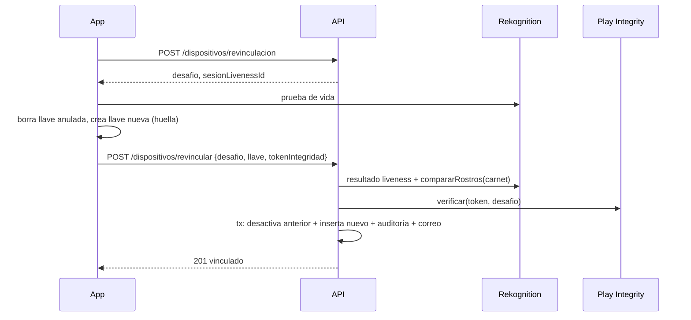

# HU-10 · Volver a vincular o cambiar de teléfono — Plan técnico

> Fase SDD: **Plan** (Diseño). Cómo se construye lo que dice `spec.md`.
> Estado: `aprobado (2026-11-08, integrante autorizado)` · Rama: `feat/HU-10-cambio-dispositivo` en `backend`, `mobile` y raíz, desde `develop`.
> **Orden en S3: 1.ª.** HU-29 reutiliza los códigos de error nativos que agrega esta historia.
> **Requiere confirmación humana (`AGENTS.md` §14):** cambio en una capa de verificación (reemplazo de dispositivo) y migración que cambia una restricción única. No borra ni transforma datos.

## 1. Módulos afectados

| Carpeta | Módulo / componente | Cambio |
|---|---|---|
| backend | `dispositivos` | Nuevo `RevinculacionService` y dos endpoints; `miDispositivo` lee el dispositivo activo |
| backend | `identidad` | Expone `comprobarRostroDelTitular(usuarioId, sesionLivenessId)`: prueba de vida + `compararRostros` contra el carnet guardado en S3 + contador de fallos y bloqueo de HU-08 |
| backend | `notificaciones` | Plantilla `dispositivo_revinculado` en la cola `correos_salientes` |
| mobile | `modules/llave-dispositivo` (Kotlin) | Códigos de rechazo propios: `LLAVE_ANULADA` (`KeyPermanentlyInvalidatedException`), `SIN_LLAVE`, `SIN_BIOMETRIA`, `BIOMETRIA_BLOQUEADA` (`ERROR_LOCKOUT*`) |
| mobile | `src/dispositivo/keystore.ts` | `ErrorKeystore` con esos códigos (hoy solo dos) |
| mobile | `src/app/dispositivo.tsx` | Flujo «Volver a vincular» / «Pasar mi cuenta a este teléfono» |
| mobile | `src/i18n/es-BO.json` | Corrige `keystore_no_disponible` («Actualiza la app») y agrega `dispositivo.llave_anulada.*`, `dispositivo.revincular.*` |

Reutiliza: `PlayIntegrityService`, `normalizarLlavePublica`, desafíos en memoria de `DispositivosService`, `MotorFacial` (`crearSesionLiveness`, `obtenerResultadoLiveness`, `compararRostros`), umbrales `CONFIANZA_MINIMA_LIVENESS` y `SIMILITUD_MINIMA`, `AlmacenamientoService` (foto del carnet), `CorreosService`, `AuditoriaService`, la pantalla de prueba de vida de HU-08.

## 2. Cambios al modelo de datos

| Tabla | Cambio | Restricciones | ¿`organizacion_id` + RLS? |
|---|---|---|---|
| `dispositivos` | Quita `UNIQUE(usuario_id)`; agrega `desactivado_en TIMESTAMPTZ NULL` | Índice único parcial `(usuario_id) WHERE activo` (lo que ya dice `ssd.md` §6) | No: dato personal (D-07) |

Migración: `013_dispositivos_historial`. No borra ni transforma filas. En Prisma, `Usuario.dispositivo` pasa de 1–1 a 1–N: `findUnique({ where: { usuarioId } })` se reemplaza por `findFirst({ where: { usuarioId, activo: true } })` (hoy en `miDispositivo`). `FirmaDispositivoGuard` ya filtra por `activo`.

## 3. Endpoints

| Método | Ruta | Rol | Firma / biometría | Request → Response | Errores (`codigo`) |
|---|---|---|---|---|---|
| POST | `/api/v1/dispositivos/revinculacion` | autenticado | No (la llave vieja no sirve) | — → 201 `{ desafio, expiraEn, requiereIdentidad, sesionLivenessId? }` | `IDENTIDAD_BLOQUEADA` 429, `SERVICIO_NO_DISPONIBLE` 503 |
| POST | `/api/v1/dispositivos/revincular` | autenticado | No; prueba de identidad + integridad | `{ desafio, llavePublicaPem, tokenIntegridad, modelo, sesionLivenessId? }` → 201 `{ id, estado: "vinculado" }` | `DESAFIO_INVALIDO` 400, `LLAVE_INVALIDA` 400, `ROSTRO_NO_COINCIDE` 422, `LIVENESS_FALLIDA` 422, `DISPOSITIVO_NO_INTEGRO` 422, `IDENTIDAD_BLOQUEADA` 429, `SERVICIO_NO_DISPONIBLE` 503 |

`requiereIdentidad` es `true` si la identidad está aprobada (CA-2) y `false` si no (CA-10). La primera vinculación (`/dispositivos/desafio-vinculacion`, `/vincular`) no cambia y sigue rechazando con un activo.

### Orden de `revincular` (todo falla sin cambiar nada, CA-11)

1. Consumir el desafío (un uso, 5 min, del mismo usuario).
2. Si `requiereIdentidad`: bloqueo vigente → 429; `obtenerResultadoLiveness` (≥ 85) y `compararRostros(referencia, carnet)` (≥ 90). Cada rechazo suma un fallo; el 3.º bloquea 24 h (CA-7). La imagen de referencia no se guarda (RN-7).
3. `normalizarLlavePublica` y Play Integrity con el desafío como nonce.
4. Una transacción: `UPDATE dispositivos SET activo=false, desactivado_en=now() WHERE usuario_id AND activo`, `INSERT` del nuevo, auditoría `dispositivo.revinculacion` y correo encolado. El índice parcial resuelve dos revinculaciones simultáneas: la perdedora no deja nada.

Las llaves de trayecto del teléfono anterior (CA-9) dejan de valer solas: HU-22 las ata al `dispositivo_id` y el guard exige que ese dispositivo siga activo.

Swagger actualizado: [ ]

## 4. Pantallas y voz

| Cliente | Pantalla | Pasos del flujo | Claves i18n nuevas |
|---|---|---|---|
| mobile | Aviso global: una firma que falla con `LLAVE_ANULADA` abre «Registraste una huella nueva…» con «Confirmar mi identidad» | 1 | `dispositivo.llave_anulada.*` |
| mobile | «Mi teléfono»: si este teléfono no tiene llave (o el id guardado no coincide con `/dispositivos/mio`), «Pasar mi cuenta a este teléfono» | 1 | `dispositivo.revincular.*` |
| mobile | Volver a vincular: prueba de vida (si `requiereIdentidad`) → huella para crear la llave → resultado | 2 | `dispositivo.revincular.*` |

Sin comandos de voz.

## 5. Diagramas UML

- [ ] Secuencia: revinculación.
- [ ] Clases: `Dispositivo` (1–N con `Usuario`).
- [ ] Casos de uso: «Volver a vincular teléfono».

## 6. Estrategia de pruebas

| Criterio / amenaza | Tipo | Archivo de prueba |
|---|---|---|
| CA-1 mensaje de llave anulada | Jest | `mobile/src/__tests__/keystore.test.ts`, `dispositivo.test.tsx` |
| CA-2, CA-10 revinculación con y sin identidad | e2e | `backend/test/dispositivos/revinculacion.e2e-spec.ts` |
| CA-3 / A-04 firma del anterior rechazada | ataque e2e | `backend/test/ataques/a-04-revinculacion.e2e-spec.ts` |
| CA-4 / A-01 rostro ajeno (motor simulado) | ataque e2e | `a-04-revinculacion.e2e-spec.ts` |
| CA-5 / A-02 rostro de otra cuenta | ataque e2e | `a-04-revinculacion.e2e-spec.ts` |
| CA-6 / A-03 integridad fallida | ataque e2e | `backend/test/ataques/a-03-revinculacion.e2e-spec.ts` |
| CA-7 bloqueo 24 h | e2e | `revinculacion.e2e-spec.ts` |
| CA-8 correo encolado | e2e | `revinculacion.e2e-spec.ts` |
| CA-11 servicio caído deja todo igual | unitaria | `backend/src/dispositivos/revinculacion.service.spec.ts` |
| CA-12 auditoría sin datos biométricos | e2e | `revinculacion.e2e-spec.ts` |
| Dos revinculaciones simultáneas | e2e | `revinculacion.e2e-spec.ts` |
| Huella nueva real | manual en teléfono físico | checklist en MEMORY |

Metas de rendimiento: no aplica.

## 7. Riesgos

| Riesgo | Probabilidad | Impacto | Mitigación |
|---|---|---|---|
| La prueba de vida nativa de HU-08 sigue pendiente en la app | Alta | Alto | El flujo usa el mismo componente que HU-08; en desarrollo, motor simulado. Se cierra junto con ese pendiente |
| Play Integrity simulada | Alta | Medio | Igual que HU-09; no se declara A-03 verificado en emulador |
| Un integrante pierde la llave en plena demo | Media | Alto | Este flujo es justamente la salida |

## 8. Tareas propuestas (se copian a backlog.md al aprobar)

| Tarea | Horas | Responsable |
|---|---|---|
| SP134 · Migración `013_dispositivos_historial` y ajuste de Prisma (1–N, `findFirst` activo) | 1,5 | @[POR DEFINIR] |
| SP135 · `IdentidadService.comprobarRostroDelTitular` con bloqueo de HU-08 | 2 | @[POR DEFINIR] |
| SP136 · `RevinculacionService` + endpoints + Swagger + correo + auditoría | 3 | @[POR DEFINIR] |
| SP137 · Pruebas e2e y de ataque A-01, A-02, A-03, A-04 | 3 | @[POR DEFINIR] |
| SP138 · Módulo nativo: códigos `LLAVE_ANULADA`, `SIN_LLAVE`, `SIN_BIOMETRIA`, `BIOMETRIA_BLOQUEADA`; `keystore.ts` | 2 | @[POR DEFINIR] |
| SP139 · Mobile: aviso de llave anulada y flujo de revinculación en «Mi teléfono»; textos | 4 | @[POR DEFINIR] |
| SP140 · Prueba en teléfono físico: registrar huella nueva y volver a vincular | 1 | @[POR DEFINIR] |
