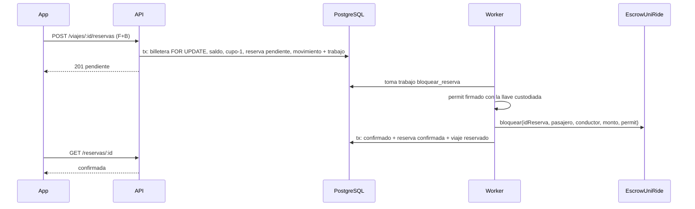

# HU-19 · Reserva con escrow — Plan técnico

> Fase SDD: **Plan** (Diseño). Cómo se construye lo que dice `spec.md`.
> Estado: `aprobado (2026-11-08, integrante autorizado)` · Rama: `feat/HU-19-reserva-escrow` en `backend`, `mobile` y raíz, apilada sobre HU-29.
> **Orden en S3: 3.ª.**
> **Requiere confirmación humana (`AGENTS.md` §14):** lógica de escrow (bloqueo), máquina de estados (estado de reserva y viaje derivado, D-23), tabla nueva con RLS y FK nueva en `movimientos_billetera`. El contrato **no** cambia.

## 1. Módulos afectados

| Carpeta | Módulo / componente | Cambio |
|---|---|---|
| backend | `reservas` (nuevo) | `ReservasController`, `ReservasService`, DTOs |
| backend | `viajes` | `EstadoViajeService.recalcular(tx, viajeId)`: único lugar que deriva el estado del viaje (D-23); `POST /viajes` exige precio múltiplo de 0,02 (D-25); `buscar` excluye `conductor_id = usuario` (D-26); `GET /viajes/:id/pasajeros` |
| backend | `blockchain` | `Cadena.bloquearReserva(...)` y `estadoReservaEscrow(idReserva)` en `CadenaReal` y `CadenaSimulada` (la simulada mueve saldos al escrow); el worker despacha por `operacion` (`acunar_recarga`, `bloquear_reserva`) en lugar de asumir recarga |
| backend | `billetera` | Firma del `permit` EIP-2612 con la llave custodiada (`descifrarLlave`) dentro del worker, nunca en la petición |
| mobile | `src/app/viajes/[id].tsx` | «Reservar y pagar {precio} URC» habilitado con `ConfirmacionBiometrica` (HU-29); faltante → «Recargar saldo» y vuelta a la misma confirmación |
| mobile | `src/app/reserva/[id].tsx` (nuevo) | Resultado y estado de la reserva (*Pendiente* → *Confirmada* / *No se completó*) consultando `GET /reservas/:id` |
| mobile | `src/app/(pestanas)/viajes.tsx` (nuevo) | Pestaña «Mis viajes»: reservas del pasajero y viajes publicados del conductor con sus pasajeros |
| mobile | `(pestanas)/index.tsx` | Tarjeta del viaje activo (paso 4 del flujo, `DESIGN_SYSTEM.md` §10.2) |

Reutiliza: `PrismaService.enOrganizacion`, `OrganizacionGuard`, `IdentidadVerificadaGuard`, `CuentaActivaGuard`, `@AccionSensible` (HU-29), `MovimientosService.registrar/resumen`, `TrabajosOnchainService` (cola D-10), `custodia.ts`, `urcAUnidades`, `ConfirmacionBiometrica`.

## 2. Cambios al modelo de datos

| Tabla | Cambio | Restricciones | ¿`organizacion_id` + RLS? |
|---|---|---|---|
| `reservas` | Nueva: `id`, `organizacion_id`, `viaje_id`, `pasajero_id`, `monto NUMERIC(12,2)`, `estado`, `clave_idempotencia`, `motivo`, `creado_en`, `actualizado_en` | `estado` TEXT + CHECK (`pendiente`, `confirmada`, `abordada`, `verificada`, `pagada`, `fallida`, `verificacion_fallida`); `UNIQUE(clave_idempotencia)`; índice único parcial `(viaje_id, pasajero_id) WHERE estado NOT IN ('fallida')` (HU-20 agrega sus estados finales); `monto > 0` | Sí, `FORCE ROW LEVEL SECURITY` |
| `movimientos_billetera` | FK `reserva_id → reservas(id)` | La FK se valida sin borrar nada: la migración falla si hay filas huérfanas (solo datos de prueba locales) | No (persona) |

Migración: `014_reservas`. No borra ni transforma datos. `trabajos_onchain.operacion` ya es TEXT libre.

## 3. Endpoints

| Método | Ruta | Rol | Firma / biometría | Request → Response | Errores (`codigo`) |
|---|---|---|---|---|---|
| POST | `/api/v1/viajes/:id/reservas` | pasajero verificado | F + B (`@AccionSensible('reservar')`) | `{ claveIdempotencia: uuid }` → 201 `{ reservaId, estado: "pendiente", monto, viajeId }`; misma clave → 200 con la original | `SALDO_INSUFICIENTE` 409 (con `faltante`), `SIN_ASIENTOS` 409, `VIAJE_PROPIO` 409, `YA_RESERVADO` 409, `VIAJE_NO_DISPONIBLE` 409, `CONDUCTOR_SIN_BILLETERA` 409, `NO_ENCONTRADO` 404, `CUENTA_SUSPENDIDA` 403, `FIRMA_DISPOSITIVO_INVALIDA` 401 |
| GET | `/api/v1/reservas/:id` | pasajero de la reserva o conductor del viaje | — | → `{ reservaId, estado, monto, viaje, hashTx }` | `NO_ENCONTRADO` 404 |
| GET | `/api/v1/reservas/mias` | autenticado | — | → `{ reservas: [...] }` (activas primero) | — |
| GET | `/api/v1/viajes/:id/pasajeros` | conductor del viaje | — | → `{ pasajeros: [{ reservaId, nombre, estado }] }` (nombre de pila, RN-9) | `NO_ENCONTRADO` 404 |

El DTO usa `whitelist` + `forbidNonWhitelisted`: un `monto`, `conductor` o `estado` en el cuerpo da 400 (CA-7). Monto y conductor salen siempre del viaje.

### Reservar (una transacción `enOrganizacion`)

1. `SELECT … FROM billeteras WHERE usuario_id FOR UPDATE`: serializa las reservas del mismo pasajero (CA-5).
2. Reglas del viaje: existe en la organización (si no, 404, CA-8), no es propio, conductor sin suspender, `fecha_hora_salida > now()`, precio múltiplo de 0,02 (RN-11), estado `publicado`/`reservado`.
3. Saldo (RN-4): `resumen(billetera).contable` (solo confirmados) menos la suma de los `bloqueo_reserva` **pendientes** de esa billetera ≥ precio, sin leer la cadena; así funciona con el nodo caído (CA-12). `ResumenLibro` gana el campo `bloqueosPendientes`.
4. `UPDATE viajes SET cupos_disponibles = cupos_disponibles - 1 WHERE id = $1 AND cupos_disponibles > 0 … RETURNING` — si no devuelve fila, `SIN_ASIENTOS` (CA-3).
5. `INSERT reservas` (`pendiente`); el índice parcial rechaza la duplicada (CA-10).
6. `MovimientosService.registrar` (`bloqueo_reserva`, clave `reserva:<id>`, `reserva_id`) + `trabajos_onchain` (`bloquear_reserva`).
7. Auditoría `reserva.creada`.

### Worker `bloquear_reserva`

1. Si la reserva ya no está `pendiente`, terminar el trabajo.
2. `estadoReservaEscrow(keccak256(reservaId))`: si ya está `Bloqueada`, recuperar el hash del evento `ReservaBloqueada` (respuesta perdida, igual que HU-13).
3. Firmar el `permit` (EIP-712, `nonces(pagador)`, plazo 1 h) con la llave custodiada y enviar `bloquear` como relayer (`ROL_OPERADOR`).
4. Éxito, en una transacción: movimiento `confirmado` + reserva `confirmada` + `EstadoViajeService.recalcular` (pasa a `reservado`) + auditoría.
5. Revertido por `ERC20InsufficientBalance`, `DatosInvalidos` o `ReservaExistente` con otros datos (falla **permanente**): movimiento `fallido` + reserva `fallida` + `cupos_disponibles + 1` + auditoría. Cualquier otra falla: reintento con espera creciente y alerta a los 5 intentos (RN-7).

### `EstadoViajeService.recalcular` (D-23)

Sin transiciones nuevas, solo hacia adelante, con `UPDATE … WHERE estado = <anterior>`:
`publicado → reservado` (≥ 1 confirmada) · `reservado → en_curso` (≥ 1 abordada, HU-22) · `en_curso → verificado` (ninguna `confirmada` ni `abordada`, ≥ 1 `verificada`/`pagada`, HU-23) · `verificado → pagado` (ninguna `verificada` sin pagar, HU-24).

Swagger actualizado: [ ]

## 4. Pantallas y voz

| Cliente | Pantalla | Pasos del flujo | Claves i18n nuevas |
|---|---|---|---|
| mobile | Detalle → confirmación «Reservar y pagar 12,00 URC», con «Saldo disponible después» | paso 3 del flujo principal | `reservas.confirmar.*` |
| mobile | Resultado «Reserva confirmada» / *Pendiente* / *No se completó* | — | `reservas.estado.*` |
| mobile | Mis viajes (pasajero y conductor) | — | `reservas.mis_viajes.*` |

| Comando de voz | Acción | Alternativa táctil | ¿Pide biometría? |
|---|---|---|---|
| «reserva el primero» (HU-27) | abre esta confirmación | botón Reservar | Sí |

## 5. Diagramas UML

- [ ] Secuencia: reserva y bloqueo en escrow por la cola.
- [ ] Clases: `Reserva`, relación con `Viaje` y `MovimientoBilletera`.
- [ ] Estados: reserva (D-23) y viaje derivado.

## 6. Estrategia de pruebas

| Criterio / amenaza | Tipo | Archivo de prueba |
|---|---|---|
| CA-1, CA-11, CA-13, CA-14 | e2e (cadena simulada) | `backend/test/reservas/reservar.e2e-spec.ts` |
| CA-2 saldo insuficiente con faltante | e2e | `reservar.e2e-spec.ts` |
| CA-3 último asiento concurrente | ataque e2e (`Promise.all`) | `backend/test/ataques/a-09-reserva.e2e-spec.ts` |
| CA-4 petición repetida / CA-5 dos viajes a la vez | ataque e2e | `a-09-reserva.e2e-spec.ts` |
| CA-6 sin firma / CA-7 campos del cliente | ataque e2e | `backend/test/ataques/a-08-reserva.e2e-spec.ts` |
| CA-8 otra organización (API y RLS) | ataque e2e | `backend/test/ataques/a-13-reservas.e2e-spec.ts` |
| CA-9 viaje propio, CA-10 duplicada, RN-11 precio, RN-12 búsqueda, RN-13 suspendida | e2e | `reservar.e2e-spec.ts`, `viajes/publicar.e2e-spec.ts`, `viajes/buscar.e2e-spec.ts` |
| CA-12 nodo caído, reintento, falla permanente devuelve el cupo | unitaria | `backend/src/blockchain/trabajos-onchain.service.spec.ts` |
| CA-15 / A-10 conservación del total | e2e | `backend/test/ataques/a-10-reserva.e2e-spec.ts` |
| `recalcular` solo avanza | unitaria | `backend/src/viajes/estado-viaje.service.spec.ts` |
| Bloqueo real con permit contra Hardhat | manual registrada en MEMORY | — |
| Mobile: confirmación, faltante, pendiente, Mis viajes | Jest | `mobile/src/__tests__/reservar.test.tsx`, `mis-viajes.test.tsx` |

Metas de rendimiento: la reserva no espera a la cadena (responde con el asiento retenido).

## 7. Riesgos

| Riesgo | Probabilidad | Impacto | Mitigación |
|---|---|---|---|
| El saldo del libro y el de la cadena difieren (transferencia externa de URC) | Baja | Medio | La falla permanente del bloqueo deja la reserva `fallida` y devuelve el cupo; la conciliación de HU-14 lo reporta |
| Nonce del permit pisado por dos bloqueos del mismo pasajero | Media | Medio | El worker procesa de a uno (ya lo hace por el nonce del relayer); el permit se firma al enviar, no al reservar |
| Reservas `pendiente` atascadas inmovilizan el asiento | Baja | Medio | Alerta a los 5 intentos (RN-7) |

## 8. Tareas propuestas (se copian a backlog.md al aprobar)

| Tarea | Horas | Responsable |
|---|---|---|
| SP145 · Migración `014_reservas` (RLS, índices, FK) y modelos Prisma | 2 | @[POR DEFINIR] |
| SP146 · `EstadoViajeService.recalcular` con pruebas | 1,5 | @[POR DEFINIR] |
| SP147 · `ReservasService.reservar` + endpoints + Swagger | 4 | @[POR DEFINIR] |
| SP148 · `Cadena.bloquearReserva`/`estadoReservaEscrow` (real y simulada), permit con llave custodiada, worker por `operacion` | 4 | @[POR DEFINIR] |
| SP149 · HU-17: precio múltiplo de 0,02; HU-18: sin viajes propios | 1 | @[POR DEFINIR] |
| SP150 · Pruebas e2e y de ataque A-08, A-09, A-10, A-13 | 4 | @[POR DEFINIR] |
| SP151 · Mobile: confirmación de reserva, resultado y estado | 4 | @[POR DEFINIR] |
| SP152 · Mobile: pestaña «Mis viajes» y tarjeta del viaje activo | 4 | @[POR DEFINIR] |
| SP153 · Prueba real de bloqueo contra `EscrowUniRide` en Hardhat local | 1 | @[POR DEFINIR] |
