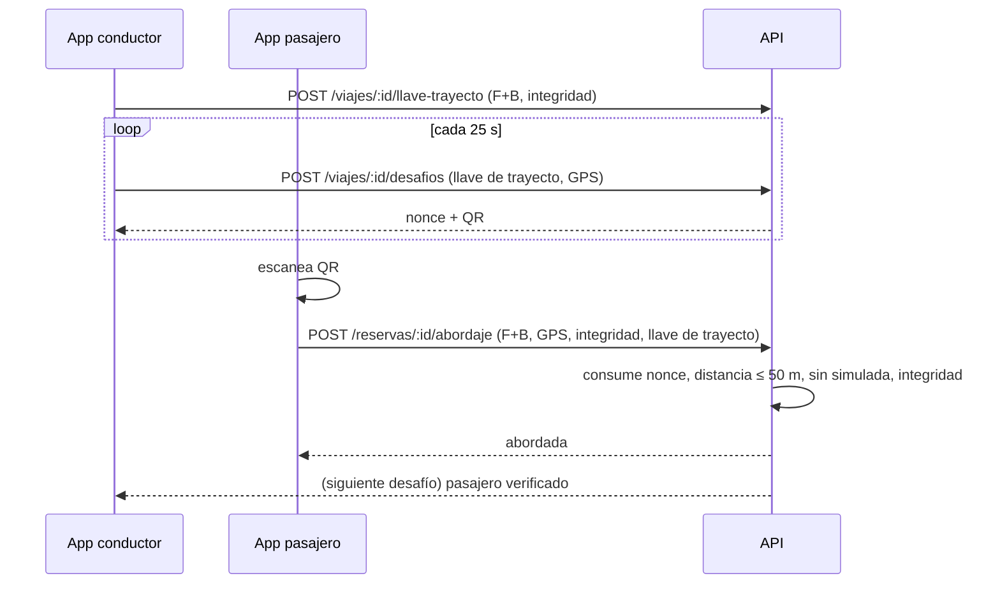

# HU-22 · Verificación de abordaje — Plan técnico

> Fase SDD: **Plan** (Diseño). Cómo se construye lo que dice `spec.md`.
> Estado: `aprobado (2026-11-08, integrante autorizado)` · Rama: `feat/HU-22-verificacion-abordaje` en `backend`, `mobile` y raíz (HU-19 ya en `develop`: ramas creadas desde `develop` el 14/11).
> **Orden en S3: 4.ª.**
> **Requiere confirmación humana (`AGENTS.md` §14):** capa de verificación nueva (encuentro y llave de trayecto, D-22), estados `abordada` / `en_curso`, tres tablas con RLS y una **dependencia nueva**: `expo-camera` (oficial de Expo, MIT) para escanear el QR.

## 1. Módulos afectados

| Carpeta | Módulo / componente | Cambio |
|---|---|---|
| backend | `presencia` (nuevo) | `PresenciaService` (llave del conductor, desafíos y abordaje en un servicio: comparten validaciones y auditoría), `geo.ts` (Haversine, ventana, RN-4), `PresenciaController` |
| backend | `comun/firma-dispositivo.guard.ts` | Se extrae la verificación (cabeceras, ventana, mensaje canónico, nonce) a `verificarFirmaPeticion(llavePem, …)`; la reutilizan `FirmaDispositivoGuard` y el nuevo `FirmaTrayectoGuard` |
| backend | `comun/firma-trayecto.guard.ts` (nuevo) | Cabeceras `X-Llave-Trayecto-Id`, `X-Timestamp`, `X-Nonce`, `X-Firma`; la llave debe ser del usuario, estar vigente y su `dispositivo_id` seguir activo (HU-10 CA-9) |
| backend | `viajes/estado-viaje.service.ts` (HU-19) | `reservado → en_curso` |
| mobile | `modules/llave-dispositivo` | `crearLlaveTrayecto()` y `firmarTrayecto()`: alias `uniride.llave.trayecto`, P-256 en hardware, **sin** autenticación de usuario; se reemplaza en cada viaje |
| mobile | `src/dispositivo/firma.ts` | `cabecerasFirmaTrayecto(...)` |
| mobile | `src/app/abordaje/mostrar/[viajeId].tsx` (nuevo) | Conductor: pantalla completa con QR, cuenta regresiva y pasajeros (`DESIGN_SYSTEM.md` §10.4) |
| mobile | `src/app/abordaje/escanear/[reservaId].tsx` (nuevo) | Pasajero: cámara con marco, placa del vehículo, resultado con vibración (`expo-haptics`, ya instalado) |
| mobile | `src/servicios/ubicacion.ts` | `posicionParaEncuentro()`: posición fresca con `accuracy`, `timestamp` y `mocked` de `expo-location` (la última de ≤ 10 s y ≤ 50 m, si no, una nueva con tope de 15 s) |
| mobile | `src/viajes/abordaje.ts` | Lectura del QR, intervalos (renovar 25 s, sondeo 3 s) y textos de cada rechazo, compartidos por las dos pantallas |

Reutiliza: `PlayIntegrityService.verificar(token, nonce)` con el `X-Nonce` de la misma petición firmada como nonce de integridad (sin ida y vuelta extra), `normalizarLlavePublica`, `RegistroNonces`, `qrcode` (ya en backend: el QR se dibuja en el servidor, sin librería de QR en el móvil), `@AccionSensible`, `enOrganizacion`.

## 2. Cambios al modelo de datos

| Tabla | Cambio | Restricciones | ¿`organizacion_id` + RLS? |
|---|---|---|---|
| `llaves_trayecto` | Nueva: `id`, `organizacion_id`, `viaje_id`, `reserva_id` (nulo para el conductor), `usuario_id`, `dispositivo_id`, `llave_publica`, `creado_en`, `revocada_en` | Única parcial `(viaje_id, usuario_id) WHERE revocada_en IS NULL` | Sí |
| `desafios_handshake` | Nueva: `id`, `organizacion_id`, `viaje_id`, `tipo` (`abordaje`/`bajada`), `nonce`, `conductor_lat`, `conductor_lng`, `conductor_precision_m`, `conductor_tomada_en`, `vence_en`, `usado_en`, `reserva_id` | `UNIQUE(nonce)`; vence 30 s | Sí |
| `pruebas_presencia` | Nueva: `id`, `organizacion_id`, `reserva_id`, `desafio_id`, `tipo`, `pasajero_lat`, `pasajero_lng`, `pasajero_precision_m`, `distancia_m`, `veredicto_integridad`, `resultado` (`aceptada`/`rechazada`), `motivo`, `hash_prueba`, `creado_en` | Única parcial `(reserva_id, tipo) WHERE resultado = 'aceptada'` | Sí |

Migración: `015_presencia`. No borra ni transforma datos. Cambia de `ssd.md` §6: el desafío es del **viaje** (un QR sirve a cualquier pasajero, un uso cada uno), no de la reserva.

`hash_prueba` = SHA-256 de la serialización canónica de `{ reservaId, tipo, nonce, conductor: {lat, lng, tomadaEn}, pasajero: {lat, lng, tomadaEn}, distanciaM, veredicto }`; HU-24 lo usa.

## 3. Endpoints

| Método | Ruta | Rol | Firma | Request → Response | Errores (`codigo`) |
|---|---|---|---|---|---|
| POST | `/api/v1/viajes/:id/llave-trayecto` | conductor del viaje | F + B (`@AccionSensible`) | `{ llavePublicaPem, tokenIntegridad }` → 201 `{ llaveTrayectoId }` | `FUERA_DE_VENTANA` 409, `SIN_RESERVAS` 409, `DISPOSITIVO_NO_INTEGRO` 422, `LLAVE_INVALIDA` 400 |
| POST | `/api/v1/viajes/:id/desafios` | conductor del viaje | llave de trayecto | `{ tipo, posicion: {lat, lng, precisionM, tomadaEn, simulada} }` → 201 `{ nonce, venceEn, qrImagenBase64, pasajeros: [...] }` | `FUERA_DE_VENTANA` 409, `SENAL_GPS` 422, `UBICACION_SIMULADA` 422, `FIRMA_TRAYECTO_INVALIDA` 401 |
| POST | `/api/v1/reservas/:id/abordaje` | pasajero de la reserva | F + B (`@AccionSensible`) | `{ nonce, posicion, tokenIntegridad, llavePublicaTrayectoPem }` → 200 `{ estado: "abordada" }` | `CODIGO_INVALIDO` 409, `DISTANCIA` 422 (con `distanciaM`), `UBICACION_SIMULADA` 422, `SENAL_GPS` 422, `DISPOSITIVO_NO_INTEGRO` 422, `SIN_RESERVA` 409, `SERVICIO_NO_DISPONIBLE` 503 |

QR: `uniride://encuentro/<nonce>`. El nonce son 32 bytes aleatorios; el QR no lleva datos personales. La app del conductor pide uno nuevo cada 25 s y apenas un escaneo lo consume (lo ve en `pasajeros`).

### Abordaje (orden; la primera transacción se confirma siempre)

1. **Tx 1 — consumir:** `UPDATE desafios_handshake SET usado_en = now(), reserva_id = $r WHERE nonce = $n AND usado_en IS NULL AND vence_en > now() AND viaje_id = <viaje de la reserva> RETURNING *`. Sin fila → `CODIGO_INVALIDO` (CA-3, CA-4, CA-10). Así el código queda gastado aunque luego se rechace (spec RN-1).
2. Reserva `confirmada` del usuario (CA-9); ya `abordada` → 200 idempotente (CA-14).
3. Posiciones: precisión ≤ 50 m, `tomadaEn` ≤ 30 s, `simulada = false` en las dos (CA-6, CA-12). Distancia Haversine ≤ 50 m (CA-5).
4. Integridad del pasajero con `X-Nonce` (CA-7).
5. **Tx 2:** `pruebas_presencia` aceptada + reserva `abordada` + `llaves_trayecto` del pasajero + `EstadoViajeService.recalcular` + auditoría. Cada rechazo también deja su `pruebas_presencia` rechazada (CA-13).

Ventana (RN-3) en `llave-trayecto` y `desafios` de tipo `abordaje`: `fecha_hora_salida − 30 min ≤ now ≤ fecha_hora_salida + 15 min`.

Swagger actualizado: [x] (14/11: los tres endpoints con sus errores; `desafios` sin huella justificado en el catálogo de acciones sensibles)

### Decisiones de diseño (14/11, al empezar el backend)

- **El código se consume sin filtrar por viaje** (cambia el paso 1): la RLS ya lo limita a la organización y, si el código es de otro viaje, se responde `SIN_RESERVA` (CA-9) en vez de `CODIGO_INVALIDO`. Con el filtro por viaje el pasajero con reserva en otro viaje recibía «código inválido». Cumple RN-1: cada escaneo lo gasta.
- **`llavePublicaTrayectoPem` se valida antes de consumir**: una petición mal formada no gasta el código del conductor.
- **Las validaciones baratas van antes de Play Integrity** (paso 3 antes del 4): un rechazo por distancia o señal no llama a Google.
- **`desafio_id` y `reserva_id` de `pruebas_presencia`:** el primero admite nulo (código inexistente o vencido: no hay desafío que citar). Un intento sin reserva propia no tiene fila en `pruebas_presencia` y queda solo en auditoría (CA-13).
- **Posición del conductor:** se valida al emitir el desafío (precisión, antigüedad ≤ 30 s, simulada); al escanear ya está atada a ese desafío de ≤ 30 s.
- **`tipo` del desafío:** la tabla admite `bajada` para HU-23, pero el DTO solo acepta `abordaje` hasta entonces.
- **Reutiliza:** `ViajesService.pasajeros` para la lista del conductor (sin otra consulta), `EstadoViajeService.recalcular` con una segunda sentencia para `reservado → en_curso`, `normalizarLlavePublica`, `PlayIntegrityService`, `RegistroNonces` (clave `trayecto:<id>`) y `QRCode.toBuffer` como en recargas. Se descartó una llave por petición sin biometría para el conductor: es justo lo que D-22 resolvió con la llave de trayecto.
- **`FirmaDispositivoGuard` deja `dispositivoId` en la petición**: la llave de trayecto se ata al dispositivo que firmó, sin otra consulta.

### Decisiones del cliente móvil (14/11)

- **El token de integridad se pide con el `X-Nonce` de la misma petición:** `solicitarFirmado` acepta un `nonce` ya elegido (`OpcionesFirma.nonce`) y la app lo usa para Play Integrity antes de armar el cuerpo. Antes `cabecerasFirma` lo generaba adentro y no había cómo atarlo.
- **Llave de trayecto en un alias propio** (`uniride.llave.trayecto`), sin `setUserAuthenticationRequired`; crear una nueva borra la anterior. Se reutiliza la generación y la comprobación de hardware de la llave del dispositivo (`crearEnHardware`).
- **El conductor ve los escaneos con un sondeo de 3 s** a `GET /viajes/:id/pasajeros`: si aumenta el número de abordados, pide otro código enseguida. Un escaneo rechazado también gasta el código y ese no se ve: se renueva a los ≤ 25 s. Se descartó un aviso del servidor (push o socket) por ser infraestructura nueva.
- **Al leer el QR se abre la huella sin otro toque:** el escaneo ya es la acción de la persona y el código vive 30 s. Posición y llave de trayecto se preparan a la vez.
- **El QR se valida en la app solo por forma** (`uniride://encuentro/<43 caracteres>`): un QR ajeno no pide huella ni llama al servidor.

### Consultas (sin N+1)

| Endpoint | Consultas |
|---|---|
| `llave-trayecto` | 1 viaje con `EXISTS` de reserva confirmada o abordada · 1 `UPDATE` que revoca la anterior · 1 `INSERT` · auditoría |
| `desafios` | guard: 1 consulta llave + dispositivo activo · 1 viaje · 1 `INSERT` · pasajeros: 1 consulta con `JOIN` a usuarios |
| `abordaje` | Tx 1: 1 reserva + 1 `UPDATE … RETURNING` del desafío · Tx 2: `INSERT` prueba, `UPDATE` reserva, revoca e inserta llave, 2 sentencias de `recalcular`, auditoría. Ningún bucle por pasajero |

Índices: `UNIQUE(nonce)` para el consumo; `(viaje_id, usuario_id)` parcial para la llave vigente; `(reserva_id, tipo)` parcial para la prueba aceptada.

### Amenazas y su prueba de ataque

| Amenaza | Qué la frena | Prueba |
|---|---|---|
| A-03 | Play Integrity del pasajero con el `X-Nonce` de su petición firmada; la del conductor al registrar la llave | `a-03-abordaje.e2e-spec.ts`: token `simulado:root` → 422 y la reserva sigue `confirmada` |
| A-04 | Abordaje y llave del conductor son `@AccionSensible` (llave con huella) | `a-08-abordaje.e2e-spec.ts`: firma con otra llave → 401 |
| A-05 | `UPDATE … WHERE usado_en IS NULL AND vence_en > now()` | `a-05-repeticion-handshake.e2e-spec.ts`: segundo uso y código de hace 31 s → `CODIGO_INVALIDO`; dos escaneos simultáneos, uno solo gana |
| A-06 | Haversine ≤ 50 m entre dos posiciones del mismo desafío | `a-06-qr-lejos.e2e-spec.ts`: a 60 m → 422 con `distanciaM` y el código queda gastado |
| A-07 | `simulada`, precisión ≤ 50 m y antigüedad ≤ 30 s en las dos posiciones | `a-07-abordaje.e2e-spec.ts` |
| A-08 | `FirmaTrayectoGuard`: llave del usuario, vigente, de ese viaje y de su dispositivo activo; el estado solo lo fija el servidor | `a-08-abordaje.e2e-spec.ts`: firma alterada, llave ajena, dispositivo desactivado, `estado` en el cuerpo |
| A-13 | `organizacion_id` + RLS en las tres tablas; el consumo corre en `enOrganizacion` | `a-13-presencia.e2e-spec.ts`: código de otra organización = código inválido; con el rol de la API no se ven filas ajenas |

## 4. Pantallas y voz

| Cliente | Pantalla | Pasos del flujo | Claves i18n nuevas |
|---|---|---|---|
| mobile | Conductor «Mostrar código» (huella una vez al entrar) | 1 | `presencia.abordaje.*` |
| mobile | Pasajero «Escanear QR» → huella → resultado | paso 4 del flujo principal | `presencia.abordaje.*` |

Sin comandos de voz en esta historia (HU-28 agrega «¿dónde está mi conductor?»).

## 5. Diagramas UML

- [ ] Secuencia: abordaje (actualiza `ssd.md` §9).
- [ ] Clases: `LlaveTrayecto`, `DesafioHandshake`, `PruebaPresencia`.
- [ ] Despliegue: Play Integrity en la ruta del abordaje.

## 6. Estrategia de pruebas

| Criterio / amenaza | Tipo | Archivo de prueba |
|---|---|---|
| CA-1, CA-11 ventana y llave del conductor | e2e | `backend/test/presencia/abordaje.e2e-spec.ts` |
| CA-2, CA-13, CA-14 | e2e | `abordaje.e2e-spec.ts` |
| CA-3, CA-4 / A-05 reuso y vencimiento | ataque e2e | `backend/test/ataques/a-05-repeticion-handshake.e2e-spec.ts` |
| CA-5 / A-06 QR enviado lejos | ataque e2e | `backend/test/ataques/a-06-qr-lejos.e2e-spec.ts` |
| CA-6, CA-12 / A-07 ubicación simulada y señal | ataque e2e | `backend/test/ataques/a-07-abordaje.e2e-spec.ts` |
| CA-7 / A-03 integridad | ataque e2e (integridad simulada en modo no íntegro) | `backend/test/ataques/a-03-abordaje.e2e-spec.ts` |
| CA-8 / A-08 firma del conductor falsa, llave de trayecto ajena o de un dispositivo inactivo | ataque e2e | `backend/test/ataques/a-08-abordaje.e2e-spec.ts` |
| CA-9, CA-10 / A-13 | ataque e2e | `backend/test/ataques/a-13-presencia.e2e-spec.ts` |
| Haversine y ventana | unitaria | `backend/src/presencia/geo.spec.ts` |
| Mobile: QR rotativo, escaneo y resultados | Jest (cámara simulada) | `mobile/src/__tests__/abordaje.test.tsx` |
| Abordaje real < 3 s con dos teléfonos | manual en teléfonos físicos | checklist en MEMORY |

Meta de rendimiento: **abordaje < 3 s** (medido en e2e sin integridad real y en el teléfono).

## 7b. Con qué se cruza

- **HU-09 / HU-10:** la llave de trayecto deja de valer si su dispositivo se desactiva al revincular (HU-10 CA-9).
- **HU-19:** `recalcular` gana `reservado → en_curso`; «Mis viajes» y los pasajeros del conductor muestran `abordada`.
- **HU-29:** abordaje y llave del conductor entran al catálogo de acciones sensibles (`a-11-catalogo-sensible`).
- **HU-20:** la ventana de abordaje (RN-3) es la que usará la expiración.
- **HU-23 / HU-24:** reutilizan la llave de trayecto, el desafío de tipo `bajada` y `hash_prueba`.

## 7. Riesgos

| Riesgo | Probabilidad | Impacto | Mitigación |
|---|---|---|---|
| Play Integrity real no conectada | Alta | Alto | Simulada solo en desarrollo; CA-7 no se declara verificado sin teléfono físico con integridad real |
| GPS impreciso bajo techo | Media | Medio | Mensaje para pedir mejor señal; 50 m de precisión |
| La llamada a Play Integrity se acerca a los 3 s | Media | Medio | Una sola llamada en la petición; medir en el teléfono |

## 8. Tareas propuestas (se copian a backlog.md al aprobar)

| Tarea | Horas | Responsable |
|---|---|---|
| SP154 · Migración `015_presencia` (3 tablas, RLS) y modelos | 2 | @[POR DEFINIR] |
| SP155 · Extraer `verificarFirmaPeticion` y crear `FirmaTrayectoGuard` | 2 | @[POR DEFINIR] |
| SP156 · Llave de trayecto del conductor y desafíos con QR | 3 | @[POR DEFINIR] |
| SP157 · Abordaje: consumo, validaciones, integridad, prueba con hash, estados | 4 | @[POR DEFINIR] |
| SP158 · Pruebas e2e y de ataque A-03, A-05, A-06, A-07, A-08, A-13 | 4 | @[POR DEFINIR] |
| SP159 · Módulo nativo: llave de trayecto sin biometría; `cabecerasFirmaTrayecto` | 2 | @[POR DEFINIR] |
| SP160 · Mobile: «Mostrar código» del conductor | 3 | @[POR DEFINIR] |
| SP161 · Mobile: «Escanear QR» con `expo-camera` (dependencia autorizada el 08/11) y resultados | 4 | @[POR DEFINIR] |
| SP162 · Prueba con dos teléfonos físicos y medición < 3 s | 1 | @[POR DEFINIR] |
