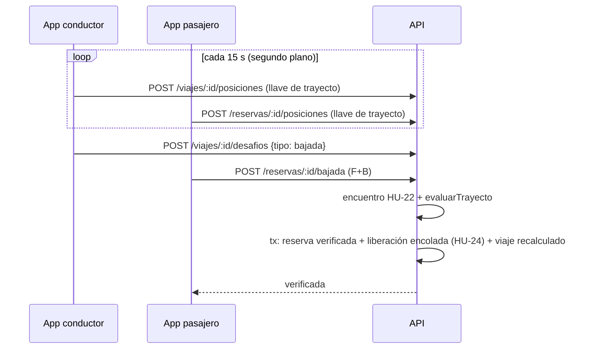

# HU-23 · Seguimiento y verificación de bajada — Plan técnico

> Fase SDD: **Plan** (Diseño). Cómo se construye lo que dice `spec.md`.
> Estado: `aprobado (2026-11-08, integrante autorizado)` · Rama: `feat/HU-23-seguimiento-bajada` en `backend`, `mobile` y raíz, apilada sobre HU-22.
> **Orden en S3: 5.ª.**
> **Requiere confirmación humana (`AGENTS.md` §14):** capa de trayecto, estados `verificada` / `verificacion_fallida` / `verificado`, tabla nueva con RLS y una **dependencia nueva**: `expo-task-manager` (oficial de Expo, MIT) para la ubicación con la pantalla apagada. Cambia `app.json` (permisos de Android).

## 1. Módulos afectados

| Carpeta | Módulo / componente | Cambio |
|---|---|---|
| backend | `presencia/posiciones` | `PosicionesService` y controlador: recibe lotes firmados con la llave de trayecto |
| backend | `presencia/trayecto.ts` (nuevo) | `evaluarTrayecto(pasajero[], conductor[])`, función pura: pares, coincidencia, velocidad máxima, simulada, resultado y motivo |
| backend | `presencia/bajada` | `BajadaService`: el mismo encuentro de HU-22 con `tipo = 'bajada'`, luego evalúa, deja la reserva `verificada` o `verificacion_fallida` y, si se verificó, encola la liberación de HU-24 en la misma transacción |
| backend | `viajes/estado-viaje.service.ts` | `en_curso → verificado` |
| mobile | `src/viajes/seguimiento.ts` (nuevo) | Tarea en segundo plano: `Location.startLocationUpdatesAsync` cada 15 s con servicio en primer plano y notificación; cola en memoria; lotes firmados con `firmarTrayecto` |
| mobile | `src/app/viaje-activo/[id].tsx` (nuevo) | «En viaje a {destino}», indicador «Compartiendo tu ubicación cada 15 s», acción «Verificar bajada» (conductor, reutiliza «Mostrar código») / «Escanear QR de bajada» (pasajero, reutiliza el escáner), resultado «Viaje verificado» |
| mobile | `app.json` | Plugin de `expo-location` con `isAndroidBackgroundLocationEnabled` e `isAndroidForegroundServiceEnabled` |

Reutiliza: todo el encuentro de HU-22 (`desafios_handshake`, `pruebas_presencia`, `FirmaTrayectoGuard`, `geo.ts`), `@AccionSensible`, `EstadoViajeService`, `AuditoriaService`.

## 2. Cambios al modelo de datos

| Tabla | Cambio | Restricciones | ¿`organizacion_id` + RLS? |
|---|---|---|---|
| `puntos_gps` | Nueva: `id`, `organizacion_id`, `viaje_id`, `usuario_id`, `lat`, `lng`, `precision_m`, `tomada_en`, `simulada`, `recibido_en` | `UNIQUE(viaje_id, usuario_id, tomada_en)` (los repetidos se ignoran con `ON CONFLICT DO NOTHING`, CA-9) | Sí |
| `reservas` | Agrega `evaluacion JSONB NULL` (pares, coincidencia, velocidad máxima, motivo) | — | (ya con RLS) |

Migración: `016_puntos_gps`. No borra ni transforma datos. Se guarda la posición del conductor una sola vez por viaje (sirve a todas sus reservas). La firma de cada lote se verifica al recibirlo; no se guarda por punto. Cambia de `ssd.md` §6: `puntos_gps` es del viaje y del usuario, no de la reserva.

Retención: sin borrado automático en v1 (ponytail: borrar puntos de viajes pagados hace más de N días cuando haya política de datos).

## 3. Endpoints

| Método | Ruta | Rol | Firma | Request → Response | Errores (`codigo`) |
|---|---|---|---|---|---|
| POST | `/api/v1/viajes/:id/posiciones` | conductor del viaje | llave de trayecto | `{ puntos: [{ lat, lng, precisionM, tomadaEn, simulada }] }` (1–60) → 202 `{ aceptados, ignorados }` | `VIAJE_NO_EN_CURSO` 409, `FIRMA_TRAYECTO_INVALIDA` 401 |
| POST | `/api/v1/reservas/:id/posiciones` | pasajero de la reserva | llave de trayecto | igual | `RESERVA_NO_ABORDADA` 409 (también después de la bajada, CA-12), `FIRMA_TRAYECTO_INVALIDA` 401 |
| POST | `/api/v1/viajes/:id/desafios` | conductor | llave de trayecto | `tipo: "bajada"` (de HU-22), sin ventana horaria | igual que HU-22 |
| POST | `/api/v1/reservas/:id/bajada` | pasajero | F + B (`@AccionSensible`) | `{ nonce, posicion, tokenIntegridad }` → 200 `{ estado: "verificada" \| "verificacion_fallida", motivo? }` | los de HU-22 + `RESERVA_NO_ABORDADA` 409 |

Un punto se ignora (CA-9) si `tomadaEn` es anterior al abordaje de esa persona o posterior a `now + 30 s`. Un punto con `simulada = true` sí se guarda: la evaluación lo necesita para invalidar (RN-6).

### Evaluación (`evaluarTrayecto`, RN-2 a RN-6)

1. Intervalo: del abordaje aceptado a la bajada aceptada de la reserva.
2. Velocidad: entre puntos seguidos de cada traza, distancia / tiempo > 150 km/h → `salto_imposible`.
3. Cualquier `simulada` → `ubicacion_simulada`.
4. Pares: a cada punto del pasajero, el del conductor más cercano en tiempo con |Δt| ≤ 15 s. Sin pareja = no coincidente.
5. `pares < 4` → `datos_insuficientes`; coincidentes (≤ 100 m) / puntos del pasajero < 0,80 → `trayectos_separados`.
6. Si no hay motivo: `verificada`.

La bajada rechazada por el encuentro (código, distancia, integridad) no evalúa ni cambia la reserva: se puede volver a escanear. La evaluación solo corre con la bajada aceptada y es definitiva. Una `verificacion_fallida` deja el escrow intacto y registra la alerta `presencia.verificacion_fallida` en auditoría (D-24).

Swagger actualizado: [ ]

## 4. Pantallas y voz

| Cliente | Pantalla | Pasos del flujo | Claves i18n nuevas |
|---|---|---|---|
| mobile | Viaje en curso (indicador, permisos, estado sin conexión) | — | `presencia.trayecto.*` |
| mobile | Bajada: conductor «Mostrar código», pasajero «Escanear QR de bajada» → resultado «Viaje verificado» o motivo | 1 (automático tras el escaneo) | `presencia.bajada.*` |

Sin comandos de voz (HU-28).

## 5. Diagramas UML

- [ ] Secuencia: seguimiento y bajada (actualiza `ssd.md` §9).
- [ ] Actividad: `evaluarTrayecto`.
- [ ] Clases: `PuntoGps`.

## 6. Estrategia de pruebas

| Criterio / amenaza | Tipo | Archivo de prueba |
|---|---|---|
| CA-4, CA-5, CA-6, CA-7, CA-10 (79 % vs 80 %, 150 vs 151 km/h, 3 vs 4 pares, Δt 15 vs 16 s, un punto simulado) | unitaria | `backend/src/presencia/trayecto.spec.ts` |
| CA-1, CA-2 lote con horas antiguas, CA-9, CA-12 | e2e | `backend/test/presencia/posiciones.e2e-spec.ts` |
| CA-3, CA-11, CA-13, CA-15 | e2e | `backend/test/presencia/bajada.e2e-spec.ts` |
| A-07 trazas falsas por API | ataque e2e | `backend/test/ataques/a-07-trayecto.e2e-spec.ts` |
| CA-8 / A-08 sin firma, llave ajena, persona ajena | ataque e2e | `backend/test/ataques/a-08-posiciones.e2e-spec.ts` |
| A-05, A-06 en la bajada | ataque e2e | `a-05-repeticion-handshake.e2e-spec.ts`, `a-06-qr-lejos.e2e-spec.ts` (casos de bajada) |
| CA-14 / A-13 | ataque e2e | `a-13-presencia.e2e-spec.ts` |
| Mobile: cola, lotes, reintento sin conexión, parar tras la bajada | Jest | `mobile/src/__tests__/seguimiento.test.ts` |
| Viaje real con dos teléfonos y pantalla apagada | manual en teléfonos físicos | checklist en MEMORY |

Metas de rendimiento: la bajada responde < 3 s (la evaluación es en memoria sobre ≤ unos cientos de puntos).

## 7. Riesgos

| Riesgo | Probabilidad | Impacto | Mitigación |
|---|---|---|---|
| Android corta la ubicación en segundo plano (ahorro de batería del fabricante) | Alta | Alto | Servicio en primer plano con notificación; los puntos faltantes cuentan como no coincidentes; probar en el Infinix |
| La cola en memoria se pierde si el sistema mata la app | Media | Medio | ponytail: cola en memoria; persistirla si las pruebas en el teléfono muestran pérdidas |
| Falsos rechazos por GPS ruidoso | Media | Medio | Umbrales de la spec (100 m, 80 %); revisar con los datos de las pruebas reales antes de la demo |

## 8. Tareas propuestas (se copian a backlog.md al aprobar)

| Tarea | Horas | Responsable |
|---|---|---|
| SP163 · Migración `016_puntos_gps` y `reservas.evaluacion` | 1 | @[POR DEFINIR] |
| SP164 · `evaluarTrayecto` con pruebas de borde | 3 | @[POR DEFINIR] |
| SP165 · Endpoints de posiciones (lotes, filtros, idempotencia) | 3 | @[POR DEFINIR] |
| SP166 · Bajada: encuentro, evaluación, estados y alerta | 3 | @[POR DEFINIR] |
| SP167 · Pruebas e2e y de ataque A-05, A-06, A-07, A-08, A-13 | 4 | @[POR DEFINIR] |
| SP168 · Mobile: seguimiento en segundo plano con `expo-task-manager` (dependencia autorizada el 08/11) y permisos | 5 | @[POR DEFINIR] |
| SP169 · Mobile: viaje en curso y bajada | 3 | @[POR DEFINIR] |
| SP170 · Viaje real con dos teléfonos (pantalla apagada, sin señal) | 2 | @[POR DEFINIR] |
