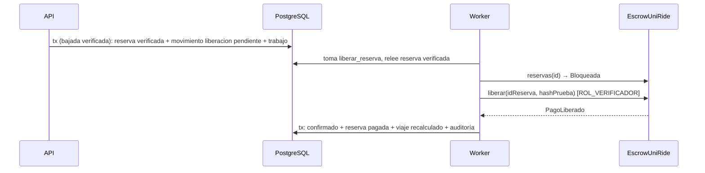

# HU-24 · Liberación del pago — Plan técnico

> Fase SDD: **Plan** (Diseño). Cómo se construye lo que dice `spec.md`.
> Estado: `aprobado (2026-11-08, integrante autorizado)` · Rama: `feat/HU-24-liberacion-pago` en `backend`, `mobile` y raíz, apilada sobre HU-23 (en `contracts` solo si falta una prueba, ver §6).
> **Orden en S3: 6.ª y última.**
> **Requiere confirmación humana (`AGENTS.md` §14):** lógica de escrow (liberación) y estado `pagado`. El contrato desplegado **no** cambia. Variable nueva solo de desarrollo: `VERIFICADOR_LLAVE_PRIVADA`.

## 1. Módulos afectados

| Carpeta | Módulo / componente | Cambio |
|---|---|---|
| backend | `blockchain` | `Cadena.liberarReserva(idReserva, hashPrueba)` firmada por la **cuenta verificadora** (otro `Wallet`, no el relayer); `estadoReservaEscrow` (HU-19) para la idempotencia; `CadenaSimulada` paga al conductor desde el escrow simulado; `crearCadena` exige el firmante KMS del verificador en producción (se suma a SP129) |
| backend | `blockchain/trabajos-onchain.service.ts` | Operación `liberar_reserva` |
| backend | `presencia/bajada` (HU-23) | Al quedar `verificada`, en la misma transacción: `movimiento liberacion_viaje` en la billetera del **conductor** (clave `liberacion:<reservaId>`, `reserva_id`, `metadatos.hashPrueba`) + trabajo `liberar_reserva` |
| backend | `presencia/prueba.ts` (nuevo) | `hashPruebaPresencia(reserva)`: keccak256 de `{ reservaId, hashAbordaje, hashBajada, evaluacion }`, recalculable desde la BD (CA-2) |
| backend | `viajes/estado-viaje.service.ts` | `verificado → pagado` |
| mobile | `viaje-activo/[id].tsx`, Mis viajes, `FilaMovimiento` | Conductor: «Recibirás {monto} URC» → «Recibiste {monto} URC» con enlace al explorador; pasajero: pago *Pendiente* → *Pagado* |
| raíz | `.env.example` | `VERIFICADOR_LLAVE_PRIVADA` (solo Hardhat y desarrollo; prohibida en producción) |

Reutiliza: cola `trabajos_onchain` y su alerta a los 5 intentos, `MovimientosService` (el saldo bloqueado de HU-14 ya se descuenta al confirmarse la liberación con la misma `reserva_id`), conciliación de HU-14, `exploradorTxUrl`.

## 2. Cambios al modelo de datos

Ninguna tabla nueva. `movimientos_billetera.tipo` ya admite `liberacion_viaje`. Sin migración.

## 3. Endpoints

No hay endpoint para liberar (CA-3, `ssd.md` §8). Lo visible se lee con lo existente: `GET /reservas/:id` (agrega `pago: { estado, monto, hashTx, exploradorUrl }`), `GET /billetera/movimientos`, `GET /billetera/saldo`.

### Worker `liberar_reserva`

1. Relee la reserva: si no está `verificada`, termina sin enviar y audita `pago.rechazado` (defensa A-09 en el servidor, además del contrato).
2. `estadoReservaEscrow(id)`: `Liberada` → recupera el hash del evento `PagoLiberado` (respuesta perdida, CA-4); `Bloqueada` → envía `liberar(idReserva, hashPrueba)` con la cuenta verificadora; otro estado → falla permanente con alerta.
3. Éxito, en una transacción: movimiento `confirmado` con `hash_tx` + reserva `pagada` + `EstadoViajeService.recalcular` + auditoría `pago.liberado` (reserva, conductor, monto, hash).
4. Falla de red o de gas: reintento con espera creciente y alerta a los 5 intentos (CA-6).

La doble liberación la impiden tres capas: `UNIQUE(clave_idempotencia)` (`liberacion:<reservaId>`), el estado de la reserva y `ReservaNoBloqueada` del contrato.

Swagger actualizado: [ ]

## 4. Pantallas y voz

| Cliente | Pantalla | Pasos del flujo | Claves i18n nuevas |
|---|---|---|---|
| mobile | Resultado «Viaje verificado» con pago *Pendiente* («Se está registrando en la red de prueba; puede tardar unos minutos») → *Pagado* | automático | `billetera.pago.*` |

Sin comandos de voz (HU-28 lee el estado).

## 5. Diagramas UML

- [ ] Secuencia: liberación por la cola (completa `ssd.md` §9).
- [ ] Estados: viaje `verificado → pagado`.
- [ ] Despliegue: cuenta verificadora (KMS en producción).

## 6. Estrategia de pruebas

| Criterio / amenaza | Tipo | Archivo de prueba |
|---|---|---|
| CA-1, CA-10 viaje completo reserva → abordaje → bajada → pago | e2e (cadena simulada) | `backend/test/viajes/viaje-completo.e2e-spec.ts` |
| CA-2 hash guardado = recalculado | unitaria + e2e | `backend/src/presencia/prueba.spec.ts`, `viaje-completo.e2e-spec.ts` |
| CA-3 / A-09 reserva no verificada nunca se libera | ataque e2e | `backend/test/ataques/a-09-liberacion.e2e-spec.ts` |
| CA-4 / A-09 reintento, respuesta perdida, dos workers | ataque unitaria + e2e | `trabajos-onchain.service.spec.ts`, `a-09-liberacion.e2e-spec.ts` |
| CA-5 / A-09 otra cuenta llama a `liberar` | Hardhat (ya existe en `contracts/test/EscrowUniRide.ts`; se agrega el caso del relayer si falta) | `contracts/test/EscrowUniRide.ts` |
| CA-6 red caída | unitaria | `trabajos-onchain.service.spec.ts` |
| CA-7 / A-10 conservación del total pasajero + conductor + escrow | ataque e2e | `backend/test/ataques/a-10-viaje-completo.e2e-spec.ts` |
| CA-8 conciliación sin diferencias | e2e | `viaje-completo.e2e-spec.ts` |
| CA-9 / A-12 producción sin firmante KMS no arranca; la llave no aparece en logs ni respuestas | unitaria | `backend/src/blockchain/blockchain.service.spec.ts` |
| Mobile: «Recibirás» → «Recibiste», pendiente → pagado | Jest | `mobile/src/__tests__/viaje-activo.test.tsx` |
| Viaje completo contra `EscrowUniRide` en Hardhat local, hash en el historial | manual registrada en MEMORY | — |

Metas de rendimiento: no aplica (asíncrona, `AGENTS.md` §5.8).

## 7. Riesgos

| Riesgo | Probabilidad | Impacto | Mitigación |
|---|---|---|---|
| La cuenta verificadora sin gas en Amoy | Media | Alto | Alerta a los 5 intentos; fondear antes de la demo; Hardhat como respaldo (R-04) |
| El despliegue no otorga `ROL_VERIFICADOR` a la cuenta del backend | Media | Alto | El módulo de Ignition deja los roles para después: documentar el `grantRole` en `contracts/README.md` y comprobarlo al arrancar (lectura de `hasRole`, solo aviso) |
| Viaje con una reserva `verificacion_fallida` nunca llega a `pagado` | Media | Bajo | Esperado hasta HU-20/HU-26 (D-24): las demás reservas se pagan igual |

## 8. Tareas propuestas (se copian a backlog.md al aprobar)

| Tarea | Horas | Responsable |
|---|---|---|
| SP171 · `Cadena.liberarReserva` con cuenta verificadora (real y simulada), `VERIFICADOR_LLAVE_PRIVADA` y bloqueo en producción | 3 | @[POR DEFINIR] |
| SP172 · `hashPruebaPresencia` y encolado en la bajada verificada | 2 | @[POR DEFINIR] |
| SP173 · Worker `liberar_reserva`: idempotencia, estados y auditoría | 3 | @[POR DEFINIR] |
| SP174 · Pruebas e2e y de ataque A-09, A-10, A-12; viaje completo | 4 | @[POR DEFINIR] |
| SP175 · Mobile: estado del pago para conductor y pasajero | 2 | @[POR DEFINIR] |
| SP176 · Viaje completo real contra Hardhat local y documentación de roles del despliegue | 2 | @[POR DEFINIR] |
