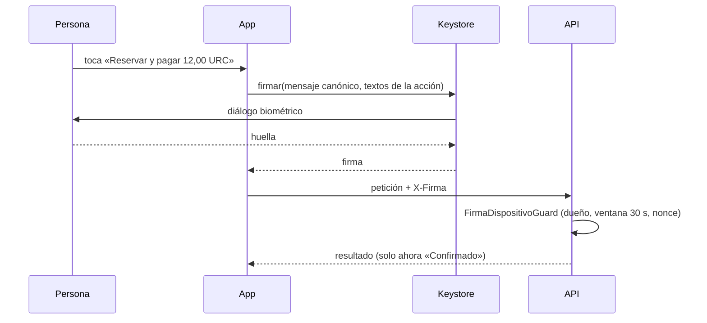

# HU-29 · Confirmación biométrica — Plan técnico

> Fase SDD: **Plan** (Diseño). Cómo se construye lo que dice `spec.md`.
> Estado: `aprobado (2026-11-08, integrante autorizado)` · Rama: `feat/HU-29-confirmacion-biometrica` en `backend`, `mobile` y raíz, apilada sobre HU-10.
> **Orden en S3: 2.ª.** La biometría por firma ya existe (SP125: `setUserAuthenticationParameters(0, AUTH_BIOMETRIC_STRONG)` y `BiometricPrompt` con `CryptoObject`). Esta historia la vuelve una regla verificable en el servidor y un patrón único en la app.
> Sin migraciones ni dependencias nuevas. No cambia ninguna capa: la fija con pruebas.

## 1. Módulos afectados

| Carpeta | Módulo / componente | Cambio |
|---|---|---|
| backend | `comun/firma-dispositivo.guard.ts` | `@AccionSensible(nombre)`: `UseGuards(FirmaDispositivoGuard)` + metadato con el nombre de la acción. Reemplaza a `@RequiereFirmaDispositivo()` donde la acción mueve dinero o verifica un viaje (RN-1) |
| backend | controladores de `billetera`, `viajes` (y los de HU-19, HU-22, HU-23) | Marcan sus acciones con `@AccionSensible` |
| mobile | `src/dispositivo/firma.ts`, `keystore.ts` | `cabecerasFirma(…, textos)`: título y subtítulo del diálogo por acción («Confirma tu reserva», «12,00 URC») |
| mobile | `src/componentes/ConfirmacionBiometrica.tsx` (nuevo) | Resumen + botón con `fingerprint` y monto + manejo de cancelación, bloqueo, sin biometría y llave anulada (códigos de HU-10) |
| mobile | `src/hooks/useAccionSensible.ts` (nuevo) | Ejecuta la petición firmada; estado `reposo` / `firmando` / `enviando` / error; nunca da «Confirmado» antes de la API (CA-9) |
| mobile | `recargar.tsx`, `publicar.tsx`, `(pestanas)/billetera.tsx` | Pasan a usar el componente (sin cambiar sus flujos) |

Reutiliza: `FirmaDispositivoGuard`, `RegistroNonces`, `mensajeCanonico`, `Aviso`/`Notificacion` de `Mensajes.tsx`, `Boton`.

## 2. Cambios al modelo de datos

Ninguno.

## 3. Endpoints

No hay endpoints nuevos. Catálogo de acciones sensibles (RN-1) que deben tener `@AccionSensible`:

| Acción | Ruta | HU |
|---|---|---|
| crear billetera | `POST /billetera` | HU-12 |
| confirmar recarga | `POST /billetera/recargas/:id/confirmar` | HU-13 |
| publicar viaje | `POST /viajes` | HU-17 |
| reservar | `POST /viajes/:id/reservas` | HU-19 |
| registrar llave de trayecto (conductor) | `POST /viajes/:id/llave-trayecto` | HU-22 |
| abordaje | `POST /reservas/:id/abordaje` | HU-22 |
| bajada | `POST /reservas/:id/bajada` | HU-23 |
| cancelar reserva / viaje, retirar | (HU-20, HU-16) | S4 / Reserva |

`GET /billetera/mia` conserva la firma por decisión de HU-12, pero no es una acción sensible del catálogo.

Las rutas que firma la llave de trayecto (desafíos y posiciones, HU-22/HU-23) no piden biometría (RN-2): usan su propio guard.

Swagger: cada `@AccionSensible` agrega a la operación la descripción «Requiere firma biométrica del teléfono vinculado».

## 4. Pantallas y voz

| Cliente | Pantalla | Pasos del flujo | Claves i18n nuevas |
|---|---|---|---|
| mobile | `ConfirmacionBiometrica` (patrón `DESIGN_SYSTEM.md` §9.6) | resumen → botón → diálogo del sistema | `comun.biometria.{no_confirmado,bloqueada,sin_registrar}`, `comun.biometria.dialogo.*` por acción |

| Comando de voz | Acción | Alternativa táctil | ¿Pide biometría? |
|---|---|---|---|
| (HU-27/HU-28 llegan a esta misma pantalla) | abre la confirmación | botón de la acción | Sí, siempre |

## 5. Diagramas UML

- [ ] Secuencia: confirmación biométrica genérica (app → diálogo → firma → API).
- [ ] Paquetes: `comun` (decorador) y `mobile/componentes`.

## 6. Estrategia de pruebas

| Criterio / amenaza | Tipo | Archivo de prueba |
|---|---|---|
| CA-1, CA-2, CA-8, CA-9 | Jest | `mobile/src/__tests__/confirmacion-biometrica.test.tsx` |
| CA-3, CA-6 / A-08 sin firma, firma ajena, firma repetida en cada acción del catálogo | ataque e2e | `backend/test/ataques/a-08-acciones-sensibles.e2e-spec.ts` |
| CA-7 catálogo completo: recorre las rutas registradas y exige `@AccionSensible` en las del catálogo; una ruta de escritura de `billetera`, `viajes`, `reservas` o `presencia` sin firma y fuera de la lista blanca justificada hace fallar | e2e | `backend/test/ataques/a-11-catalogo-sensible.e2e-spec.ts` |
| CA-4 / A-11 la voz no tiene otra ruta: el catálogo no tiene variante sin firma | e2e | `a-11-catalogo-sensible.e2e-spec.ts` |
| CA-5 / A-04 huella ajena | manual en teléfono físico | checklist en MEMORY |

Metas de rendimiento: no aplica.

## 7. Riesgos

| Riesgo | Probabilidad | Impacto | Mitigación |
|---|---|---|---|
| Cambiar `recargar` y `publicar` rompe flujos ya aceptados | Media | Medio | Sus pruebas de Jest no cambian de aserción; solo cambia el componente |
| TalkBack no anuncia los avisos (decisión abierta) | Alta | Bajo | El componente centraliza el aviso: se arregla en un solo lugar cuando se decida |

## 7b. Con qué se cruza

Completado al empezar la implementación del backend (2026-11-10).

| Tema | Decisión y porqué |
|---|---|
| Orden de guards | `@AccionSensible(nombre, ...antes)` recibe los guards que corren antes de la firma (organización, cuenta, identidad). Con varios `@UseGuards` en un método el orden depende de cómo se apilan los decoradores; así quien no cumple recibe su 403 antes que el 401 de la firma y no gasta el nonce. En Billetera los guards de la clase ya corren antes que los del método |
| `GET /billetera/mia` | Sigue con `@RequiereFirmaDispositivo()` (decisión de HU-12): firma sin ser acción del catálogo |
| Swagger | El decorador deja la extensión `x-accion-sensible`; `configurarAplicacion` la vuelve texto en la descripción. Se descartó fusionar `ApiOperation` en el decorador: depende del orden de los decoradores |
| Catálogo | Vive en `test/ataques/catalogo-rutas.ts` y se compara con las rutas leídas de los metadatos de Nest: una ruta nueva entra sola a la prueba. Incluye ya las rutas de HU-19, HU-22 y HU-23 |
| Auditoría | El éxito lo audita cada servicio, como antes (`billetera.creacion`, `billetera.recarga.confirmada`, `viaje.publicacion`); el rechazo de la firma agrega `accionSensible` al detalle |
| Consultas | Ninguna nueva: el guard sigue con un `findFirst` del dispositivo activo por petición |
| Amenazas | A-08 y A-04 (llave ajena con el id del dueño) en `a-08-acciones-sensibles.e2e-spec.ts`, por cada acción; A-11 y CA-7 en `a-11-catalogo-sensible.e2e-spec.ts` |

## 8. Tareas propuestas (se copian a backlog.md al aprobar)

| Tarea | Horas | Responsable |
|---|---|---|
| SP141 · `@AccionSensible` y migración de los controladores existentes; Swagger | 1,5 | @[POR DEFINIR] |
| SP142 · Pruebas de catálogo y de ataque A-08/A-11 | 2 | @[POR DEFINIR] |
| SP143 · Mobile: `ConfirmacionBiometrica`, `useAccionSensible`, textos por acción; adoptarlo en recargar, publicar y billetera | 4 | @[POR DEFINIR] |
| SP144 · Prueba en teléfono físico: huella ajena, cancelar, bloqueo | 0,5 | @[POR DEFINIR] |
