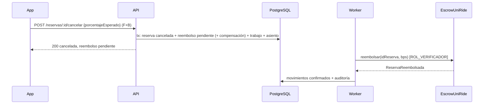

# HU-20 · Cancelación con reembolso — Plan técnico

> Fase SDD: **Plan** (Diseño). Cómo se construye lo que dice `spec.md`.
> Estado: `aprobado (2026-11-15, integrante autorizado)` · Rama: `feat/HU-20-cancelacion-reembolso` en raíz, `backend` y `mobile`, desde `develop`.
> **Orden en S4: 1.ª.**
> **Requiere confirmación humana (`AGENTS.md` §14):** estados de reserva nuevos (`cancelada`, `expirada`) y transiciones del viaje a `cancelado`/`expirado`; lógica de reembolso (escrow, D-18, D-29); migración `018` (amplía CHECK y rehace un índice único parcial, no borra ni transforma datos). El contrato desplegado **no** cambia (`reembolsar` ya existe y reparte).

## 1. Módulos afectados

| Carpeta | Módulo / componente | Cambio |
|---|---|---|
| backend | `reservas` | `CancelacionesService` (nuevo): vista previa, cancelar reserva, cancelar viaje, expirar y reembolso por verificación fallida; `POST /reservas/:id/cancelar`; `GET /reservas/:id` gana `cancelacion` y `reembolso` |
| backend | `reservas/vencimientos.service.ts` (nuevo) | Tic cada 30 s (como la cola on-chain; en pruebas se llama a mano): expiraciones, reservas confirmadas en viajes cancelados (CA-19), viajes sin abordaje y verificaciones fallidas de más de 24 h |
| backend | `viajes` | `POST /viajes/:id/cancelar` (conductor) |
| backend | `viajes/estado-viaje.service.ts` | `cancelar(tx, viajeId)` y `expirar(tx, viajeId)`: siguen siendo el único lugar que escribe el estado del viaje |
| backend | `blockchain` | `Cadena.reembolsarReserva(idReserva, porcentajePasajeroBps)` firmada por la cuenta verificadora y `hashDeReembolso(idReserva)` (evento `ReservaReembolsada`), en `CadenaReal` y `CadenaSimulada` |
| backend | `blockchain/trabajos-onchain.service.ts` | Operación `reembolsar_reserva` |
| backend | `reservas.service.ts` | «Ya reservado» excluye `cancelada` y `expirada` (reservar otra vez tras cancelar, HU-19 RN-1) |
| backend | `presencia.service.ts` | Abordaje: si el `UPDATE` condicional no gana, relee la reserva; si ya no está `abordada` (la ganó una cancelación o expiración), rechaza con `SIN_RESERVA` en vez de responder «ya abordada» (CA-12) |
| backend | `notificaciones` | Plantilla `viaje_cancelado` en `es-BO`, encolada en la misma Tx que la cancelación |
| backend | `test/ataques/catalogo-rutas.ts` | `reserva.cancelar` y `viaje.cancelar` en el catálogo de acciones sensibles (HU-29 CA-7) |
| mobile | `app/cancelar.tsx` (nuevo) | Confirmación de cancelación (reserva o viaje) con vista previa del servidor, política y botón con huella |
| mobile | `app/reserva/[id].tsx`, `componentes/TarjetaMiViaje.tsx` | Botón secundario «Cancelar reserva» / «Cancelar viaje» al final (DESIGN_SYSTEM N9); estados *Cancelada*/*Expirada* y reembolso |
| mobile | `componentes/FilaMovimiento.tsx`, `hooks/useAccionSensible.ts`, `i18n/es-BO.json` | Tipos `reembolso_reserva` y `compensacion_cancelacion`; acciones `cancelar_reserva` y `cancelar_viaje` |

Reutiliza: `@AccionSensible` (F+B), `OrganizacionGuard`, `IdentidadVerificadaGuard`, `MovimientosService.registrar` (idempotente por clave), cola `trabajos_onchain` con reintento y alerta a los 5, `EstadoViajeService` (candado `FOR UPDATE` del viaje), `CorreosService.encolar`, `AuditoriaService`, `useAccionSensible` y `EstadoPago` (patrón de sondeo) en la app.

## 2. Cambios al modelo de datos

| Tabla | Cambio | Restricciones | ¿`organizacion_id` + RLS? |
|---|---|---|---|
| `reservas` | `estado` admite `cancelada` y `expirada`; `motivo` guarda `cancelada_pasajero`, `cancelada_conductor`, `viaje_cancelado` o `sin_abordaje` | Índice único parcial `reservas_viaje_pasajero_activa_key` pasa a `WHERE estado NOT IN ('fallida','cancelada','expirada')` | ya tiene |
| `movimientos_billetera` | `tipo` admite `compensacion_cancelacion` (el 50 % del conductor) | `CHECK` ampliado; sigue solo inserción | persona |
| `trabajos_onchain` | `operacion` admite `reembolsar_reserva` | `CHECK` ampliado | interna |

Migración: `018_cancelaciones`. No borra ni transforma datos; el índice se rehace (`DROP INDEX` + `CREATE UNIQUE INDEX`, las filas actuales ya lo cumplen). Sin GRANT nuevos: el rol de la API ya actualiza `reservas (estado, motivo)` y `viajes (cupos_disponibles, estado)`.

**Libro:** el reembolso es un movimiento `reembolso_reserva` en la billetera del pasajero (clave `reembolso:<reservaId>`, `metadatos: { porcentajePasajeroBps, montoConductor, motivo }`) y, si el reparto es 50/50, un `compensacion_cancelacion` en la del conductor (clave `compensacion:<reservaId>`), ambos `pendiente` en la misma Tx. El trabajo `reembolsar_reserva` cuelga del movimiento del pasajero y confirma los dos con el mismo hash. `MovimientosService.resumen` ya suma como positivo todo lo que no es bloqueo y libera el bloqueo con un `reembolso_reserva` confirmado: no cambia.

## 3. Endpoints

| Método | Ruta | Rol | F/B | Request → Response | Errores (`codigo`) |
|---|---|---|---|---|---|
| GET | `/reservas/:id` | participante | — | agrega `cancelacion: { cancelable, porcentajePasajero (100\|50), montoPasajero, montoConductor, motivo? } \| null` (solo al pasajero) y `reembolso: { estado, montoPasajero, montoConductor, hashTx, exploradorUrl } \| null` | los de HU-19 |
| POST | `/reservas/:id/cancelar` | pasajero verificado | F B | `{ porcentajeEsperado: 100 \| 50 }` → `200 { estado: 'cancelada', reembolso }` | `RESERVA_NO_ENCONTRADA` (404), `RESERVA_PENDIENTE`, `NO_CANCELABLE`, `POLITICA_CAMBIO` (trae la vista previa nueva) (409) |
| POST | `/viajes/:id/cancelar` | conductor verificado | F B | sin cuerpo → `200 { estado: 'cancelado', reservasCanceladas }` | `VIAJE_NO_ENCONTRADO` (404), `NO_CANCELABLE` (409) |

Sin `CuentaActivaGuard`: una cuenta suspendida o bloqueada puede cancelar (spec RN-14). La cancelación repetida devuelve el resultado original por estado: una reserva ya `cancelada` por su pasajero responde `200` con lo mismo, sin otro movimiento (CA-10); la clave del libro impide el doble reembolso aunque dos peticiones se crucen.

Swagger actualizado: [ ]

### Cálculo (función pura `politicaCancelacion`)

`porcentajePasajero = (salida − ahora) > 30 min ? 100 : 50` con la hora del servidor (RN-1, RN-2); `montoConductor = monto − montoPasajero`; montos con `Prisma.Decimal` (el precio es múltiplo de 0,02, RN-7). Conductor, expiración y verificación fallida: siempre 100.

### Transacciones

| Operación | Pasos, en una Tx |
|---|---|
| Cancelar reserva | `UPDATE reservas SET estado='cancelada' WHERE id AND pasajero AND estado='confirmada'` (decide frente al abordaje, CA-12) → si 0 filas, relee y responde `RESERVA_PENDIENTE`, `NO_CANCELABLE` o el resultado previo → compara `porcentajeEsperado` (CA-4) → movimientos + trabajo → si aún no salió, `cupos_disponibles + 1` (tope `cupos_totales`, RN-8) → auditoría `reserva.cancelada` |
| Cancelar viaje | `UPDATE reservas SET estado='cancelada', motivo='cancelada_conductor' WHERE viaje AND estado='confirmada' RETURNING` → `EstadoViajeService.cancelar` (bloquea el viaje y lo pasa a `cancelado` solo si está `publicado`/`reservado` y no hay ninguna `abordada`/`verificada`/`pagada`; si no, la Tx se revierte con `NO_CANCELABLE`) → por cada reserva: movimientos 100 % + trabajo + correo encolado → auditoría `viaje.cancelado`. Las reservas se actualizan **antes** de tomar el candado del viaje, en el mismo orden que el abordaje (reserva → viaje), para no crear un interbloqueo |
| Tic de vencimientos | 1) `confirmada` con salida + 15 min < ahora → `expirada` 100 %, luego `recalcular` (CA-6, CA-8); 2) `confirmada` en viaje `cancelado` → `cancelada` 100 % (CA-19); 3) viaje `publicado`/`reservado` con salida + 15 min < ahora y sin reservas `pendiente`/`abordada`/`verificada`/`pagada` → `expirar` (CA-6, CA-7); 4) `verificacion_fallida` con su prueba de bajada de hace > 24 h y sin `reembolso_reserva` → reembolso 100 % (CA-9). Cada fila en su Tx con `UPDATE` condicional (idempotente, CA-10), con `comoSuperAdmin` porque recorre todas las organizaciones; cada evento audita con la organización de la reserva |

### Worker `reembolsar_reserva`

1. Relee la reserva: debe estar `cancelada`, `expirada` o `verificacion_fallida`; si no, cierra sin mover dinero con `reembolso.rechazado` (A-09).
2. `estadoReservaEscrow`: `bloqueada` → `reembolsarReserva(id, bps)` con la cuenta verificadora; `reembolsada` con el mismo reparto → recupera el hash (respuesta perdida, CA-10); `ninguno`/`liberada` → falla permanente `reembolso.imposible`.
3. Éxito: los dos movimientos `confirmado` con el mismo hash + auditoría `reembolso.confirmado`. Red caída: reintento y alerta `reembolso.atascado` a los 5 (CA-17).

### Consultas (sin N+1)

| Dónde | Consultas |
|---|---|
| `GET /reservas/:id` | +0: la vista previa se calcula con la reserva y el viaje ya leídos; el reembolso sale de la misma consulta de movimientos por `reserva_id` (se amplía el `IN` de tipos) |
| Cancelar viaje | 1 `UPDATE … RETURNING` de todas las reservas; billeteras de pasajeros en 1 `findMany` por `usuario_id IN`; movimientos y trabajos con `createMany` |
| Tic | 4 `SELECT … LIMIT 50` con índices (`reservas(viaje_id, estado)`, `idx_viajes_busqueda`); una Tx por fila elegida |

### Amenazas y su prueba de ataque

| Amenaza | Prueba que demuestra que falla |
|---|---|
| A-08 / A-11 sin firma biométrica, firma ajena o repetida | `a-08-acciones-sensibles.e2e-spec.ts` y `a-11-catalogo-sensible.e2e-spec.ts` (catálogo con las dos rutas nuevas) |
| A-08 porcentaje o monto del cliente | `a-08-cancelacion.e2e-spec.ts`: `porcentajeEsperado: 100` con 10 min a la salida → `POLITICA_CAMBIO`, nunca 100 %; campos extra → 400 |
| A-09 doble reembolso | `a-09-reembolso.e2e-spec.ts`: cancelación repetida, cancelación + tic a la vez, dos workers, respuesta perdida → un solo `ReservaReembolsada` y un solo movimiento; reembolso de una reserva `confirmada` o `pagada` forzado en la cola → `reembolso.rechazado` |
| A-10 conservación | `a-10-cancelacion.e2e-spec.ts`: pasajero + conductor + escrow iguales antes de reservar y después de cancelar al 100 %, al 50/50, expirar y verificación fallida |
| A-13 otra persona u organización | `a-13-cancelacion.e2e-spec.ts`: reserva ajena, viaje ajeno y de otra organización → 404 igual que inexistente, por la API y en la base con el rol de la API |

## 4. Pantallas y voz

| Cliente | Pantalla | Pasos del flujo | Claves i18n nuevas |
|---|---|---|---|
| mobile | `cancelar.tsx?reservaId=` | Detalle de la reserva → «Cancelar reserva» → resumen («Te devolvemos 12,00 URC», «El conductor recibe 6,00 URC» si aplica, política) → «Cancelar reserva» con huella → resultado con el reembolso *Pendiente* → *Confirmado* | `reservas.cancelar.*` |
| mobile | `cancelar.tsx?viajeId=` | Mis viajes › tarjeta del viaje → «Cancelar viaje» → resumen («Se devuelve el 100 % a 2 pasajeros», lista de `GET /viajes/:id/pasajeros`) → huella → resultado | `viajes.cancelar.*` |
| mobile | Reserva, Mis viajes, Movimientos | *Cancelada*, *Expirada*, «Cancelada por el conductor · Te devolvimos {monto} URC», «Reembolsado» en *Verificación fallida*; filas «Reembolso» y «Compensación por cancelación» | `reservas.estado.cancelada`, `.expirada`, `billetera.movimiento.compensacion_cancelacion`, `billetera.reembolso.*` |

`POLITICA_CAMBIO` vuelve al resumen con la vista previa nueva y el botón otra vez (CA-4). La voz llega con HU-28 a esta misma pantalla.

## 5. Diagramas UML

- [ ] Estados: reserva con `cancelada`/`expirada`; viaje con `cancelado`/`expirado`.
- [ ] Secuencia: cancelación del pasajero y reembolso por la cola.
- [ ] Casos de uso: cancelar reserva, cancelar viaje, expirar (sistema).

## 6. Estrategia de pruebas

| Criterio / amenaza | Tipo | Archivo de prueba |
|---|---|---|
| RN-1/RN-2 bordes 30:01 / 30:00 / después de la salida; montos 50/50 exactos | unitaria | `backend/src/reservas/politica-cancelacion.spec.ts` |
| CA-1 vista previa | e2e | `backend/test/reservas/cancelar.e2e-spec.ts` |
| CA-2, CA-3, CA-18, CA-11 | e2e | `cancelar.e2e-spec.ts` |
| CA-4 cambio de política | e2e + ataque | `cancelar.e2e-spec.ts`, `a-08-cancelacion.e2e-spec.ts` |
| CA-5 viaje cancelado, correo encolado | e2e | `backend/test/viajes/cancelar-viaje.e2e-spec.ts` |
| CA-6, CA-7, CA-8, CA-9, CA-19 | e2e (tic a mano, reloj con fechas pasadas) | `backend/test/reservas/vencimientos.e2e-spec.ts` |
| CA-10 / A-09 | ataque e2e + unitaria del worker | `a-09-reembolso.e2e-spec.ts`, `trabajos-onchain.service.spec.ts` |
| CA-12 cancelación y abordaje a la vez | e2e (dos peticiones en paralelo) | `cancelar.e2e-spec.ts` |
| CA-13 / A-08 / A-11 | ataque e2e | `a-08-acciones-sensibles.e2e-spec.ts`, `a-11-catalogo-sensible.e2e-spec.ts` |
| CA-14 / A-08 | ataque e2e | `a-08-cancelacion.e2e-spec.ts` |
| CA-15 / A-13 | ataque e2e | `a-13-cancelacion.e2e-spec.ts` |
| CA-16 / A-10 | ataque e2e | `a-10-cancelacion.e2e-spec.ts` |
| CA-17 red caída | unitaria | `trabajos-onchain.service.spec.ts` |
| Reembolso 100 % y 50/50 real | e2e contra Hardhat (se omite sin `HARDHAT_RPC_URL`) | `backend/test/blockchain/escrow-hardhat.e2e-spec.ts` |
| Mobile: resumen, `POLITICA_CAMBIO`, huella cancelada, resultado y estados | Jest | `mobile/src/__tests__/cancelar.test.tsx` |

Metas de rendimiento: no aplica.

## 7. Riesgos

| Riesgo | Probabilidad | Impacto | Mitigación |
|---|---|---|---|
| Interbloqueo entre cancelar viaje y abordaje | Media | Medio | Mismo orden de candados (reserva → viaje) y prueba en paralelo (CA-12) |
| El tic se cae y las reservas no expiran | Baja | Alto | Igual que la cola on-chain: `try/catch` por fila, log sin datos y reintento en el siguiente tic; la prueba llama al tic a mano |
| Cuenta verificadora sin gas en Amoy | Media | Alto | Alerta a los 5 intentos (HU-24); fondear antes de la demo |
| Reloj del servidor vs. hora de salida | Baja | Medio | Solo la hora del servidor (RN-2); la vista previa muestra el porcentaje que regirá y CA-4 cubre el borde |

## 8. Tareas propuestas (se copian a backlog.md al aprobar)

| Tarea | Horas | Responsable |
|---|---|---|
| SP178 · Migración `018_cancelaciones`, `politicaCancelacion` y `EstadoViajeService.cancelar`/`expirar` | 2 | @[POR DEFINIR] |
| SP179 · `Cadena.reembolsarReserva`/`hashDeReembolso` (real y simulada) y worker `reembolsar_reserva` | 3 | @[POR DEFINIR] |
| SP180 · Cancelar reserva y viaje: endpoints, vista previa en `GET /reservas/:id`, correo, abordaje que relee | 4 | @[POR DEFINIR] |
| SP181 · Tic de vencimientos (expiración, viaje cancelado, viaje sin abordaje, verificación fallida 24 h) | 3 | @[POR DEFINIR] |
| SP182 · Pruebas e2e y de ataque A-08, A-09, A-10, A-11, A-13; Hardhat | 4 | @[POR DEFINIR] |
| SP183 · Mobile: pantalla de cancelación, botones, estados y movimientos nuevos | 4 | @[POR DEFINIR] |
