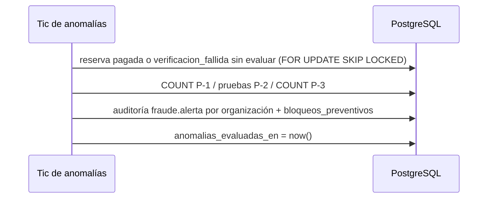

# HU-25 · Detección de anomalías y bloqueo preventivo — Plan técnico

> Fase SDD: **Plan** (Diseño). Cómo se construye lo que dice `spec.md`.
> Estado: `aprobado (2026-11-15, integrante autorizado)` · Rama: `feat/HU-25-deteccion-anomalias` en raíz y `backend`, apilada sobre HU-20 (usa `verificacion_fallida` y la cancelación con bloqueo vigente).
> **Orden en S4: 4.ª.**
> **Requiere confirmación humana (`AGENTS.md` §14):** migración `019_anomalias` (tabla nueva y columna nueva; no borra ni transforma datos) y una regla nueva en la reserva y la publicación (capa de verificación A-10).

## 1. Módulos afectados

| Carpeta | Módulo / componente | Cambio |
|---|---|---|
| backend | `fraude` (nuevo, `ssd.md` §4) | `AnomaliasService`: tic cada 30 s que evalúa reservas `pagada` y `verificacion_fallida` sin evaluar; patrones P-1, P-2 y P-3 como funciones puras; alertas y bloqueos |
| backend | `fraude/bloqueos.service.ts` (nuevo) | `exigirSinBloqueoCuenta(usuarioId)` (403 `BLOQUEO_PREVENTIVO` con `hasta`) y `parBloqueado(a, b)` |
| backend | `reservas.service.ts` | Antes de retener el asiento: par bloqueado → 409 `PAR_BLOQUEADO`; conductor con bloqueo de cuenta → `VIAJE_NO_DISPONIBLE` (como D-27) |
| backend | `viajes` (publicar, búsqueda), `billetera/recargas` (crear y confirmar) | `exigirSinBloqueoCuenta` en publicar, reservar y recargar; la búsqueda oculta los viajes de un conductor con bloqueo de cuenta vigente (como `suspendida_en`) |
| mobile | `i18n/es-BO.json`, `useAccionSensible.ts` | Textos de `BLOQUEO_PREVENTIVO` (con fecha y hora de fin) y `PAR_BLOQUEADO` (sin motivo, RN-9) en reservar, publicar y recargar |

**No** se agrega al `CuentaActivaGuard`: ese guard también protege saldo, abordaje, bajada y posiciones, y el bloqueado debe poder consultar y completar lo ya reservado (CA-7). Cancelar (HU-20) no lo pide.

Reutiliza: patrón de tic de `TrabajosOnchainService` (intervalo, `NODE_ENV=test` sin intervalo), `comoSuperAdmin`, `AuditoriaService`, `presencia/geo.ts` (distancia), `pruebas_presencia` (posiciones y horas del abordaje y la bajada aceptados).

## 2. Cambios al modelo de datos

| Tabla | Cambio | Restricciones | ¿`organizacion_id` + RLS? |
|---|---|---|---|
| `bloqueos_preventivos` (nueva) | `tipo` (`par`/`cuenta`), `usuario_id`, `usuario_par_id` (nulo en `cuenta`; en `par` se guarda el par ordenado `usuario_id < usuario_par_id`), `patron` (`viajes_repetidos`/`sin_desplazamiento`/`verificaciones_fallidas`), `reserva_id` (la que lo disparó), `vence_en`, `creado_en` | `CHECK` de tipo y patrón; `CHECK (tipo = 'cuenta') = (usuario_par_id IS NULL)`; `UNIQUE (reserva_id, patron)` (CA-10); índice `(usuario_id, vence_en)` y `(usuario_par_id, vence_en)`. Solo inserción: el rol de la API tiene `SELECT, INSERT` | persona (D-07): se cuenta por persona en todas sus organizaciones (RN-8); solo lo leen procesos del servidor |
| `reservas` | `anomalias_evaluadas_en TIMESTAMPTZ NULL` | `GRANT UPDATE (anomalias_evaluadas_en)` al rol de la API | ya tiene |

Migración: `019_anomalias`. No borra ni transforma datos; las reservas ya pagadas quedan sin evaluar y el primer tic las evalúa.

**Bloqueo vigente** = existe una fila del tipo con `vence_en > now()`. Extender (CA-9) es insertar otra fila: rige la de `vence_en` mayor; no hay `UPDATE` ni acumulación. Se levanta solo (CA-8): no hay escritura; la auditoría `fraude.bloqueo` guarda inicio y fin al crearse.

## 3. Endpoints

Ninguno nuevo (CA-12: ninguna acción pública levanta un bloqueo). Cambian respuestas existentes:

| Ruta | Error nuevo |
|---|---|
| `POST /viajes/:id/reservas` | 409 `PAR_BLOQUEADO`; 403 `BLOQUEO_PREVENTIVO` (`hasta`) |
| `POST /viajes`, `POST /billetera/recargas`, `POST /billetera/recargas/:id/confirmar` | 403 `BLOQUEO_PREVENTIVO` (`hasta`) |

Swagger actualizado: [ ]

### Evaluación (tic)

Por reserva, en su propia Tx con `comoSuperAdmin`: `SELECT … FROM reservas WHERE estado IN ('pagada','verificacion_fallida') AND anomalias_evaluadas_en IS NULL LIMIT 20 FOR UPDATE SKIP LOCKED`; evalúa, inserta alertas y bloqueos y marca `anomalias_evaluadas_en`. Si algo falla, la Tx se revierte y el siguiente tic la reintenta (CA-11). Nada de esto toca el pago ni el estado (RN-1).

| Patrón | Datos | Regla |
|---|---|---|
| P-1 (`pagada`) | reservas `pagada` del mismo conductor (`viajes.conductor_id`) y pasajero con salida en `(s − 24 h, s]`, `s` = salida de esta | ≥ 3 → alerta + bloqueo de par 7 días |
| P-2 (`pagada`) | pruebas `aceptada` de abordaje y bajada de la reserva: Haversine entre las posiciones del pasajero y diferencia de `creado_en` | < 1000 m o < 180 s → alerta; si el par ya tiene otra reserva P-2 en los 7 días previos (consultando las alertas `fraude.alerta` con patrón `sin_desplazamiento` del par) → bloqueo de par 7 días. Sin alguna prueba: no evalúa P-2 |
| P-3 (`verificacion_fallida`) | reservas `verificacion_fallida` de la persona como pasajero y como conductor, con su prueba de bajada en los últimos 7 días; se evalúa para las dos personas de la reserva | ≥ 3 → alerta + bloqueo de cuenta 72 h para esa persona |

Funciones puras: `p1ViajesRepetidos(salidas, s)`, `p2SinDesplazamiento(abordaje, bajada)`, `p3VerificacionesFallidas(fechas, ahora)`, con los umbrales de la spec RN-11 como constantes.

**Alerta** (CA-13, CA-14): una fila de auditoría `fraude.alerta` por cada organización de las reservas involucradas, con `detalle: { patron, personas, reservas, cantidad?, distanciaM?, minutos?, bloqueoHasta? }`, sin coordenadas. Para contar P-2 previas del par se usa `detalle->>'patron'` y las personas del detalle; si hace falta, un índice parcial por `accion = 'fraude.alerta'`.

### Consultas (sin N+1)

| Dónde | Consultas |
|---|---|
| Tic, por reserva | 1 lectura de la reserva con su viaje; P-1: 1 `COUNT`; P-2: 1 lectura de las 2 pruebas + 1 `COUNT` de alertas; P-3: 1 `COUNT` por persona (2). Constante por reserva |
| Reservar | +1 `EXISTS` sobre `bloqueos_preventivos` (par en cualquier orden y cuenta del conductor) dentro de la Tx existente |
| Búsqueda | `AND NOT EXISTS (…bloqueo de cuenta del conductor vigente…)` en la misma consulta (índice `usuario_id, vence_en`); meta < 2 s se mantiene |

### Amenazas y su prueba de ataque

| Amenaza | Prueba que demuestra que falla |
|---|---|
| A-10 colusión | `a-10-colusion.e2e-spec.ts`: tres viajes pagados del mismo par en 24 h → bloqueo; dos viajes «sin moverse» en 7 días → bloqueo; reservar entre ellos → `PAR_BLOQUEADO` en los dos roles |
| A-07 GPS falso repetido | `a-07-verificaciones-repetidas.e2e-spec.ts`: tres `verificacion_fallida` en 7 días → bloqueo de cuenta; publicar, reservar y recargar → `BLOQUEO_PREVENTIVO`; abordar, bajar, saldo y cancelar siguen |
| A-08 quitarse el bloqueo | mismo archivo: ninguna ruta del catálogo escribe en `bloqueos_preventivos`; el rol de la API no puede `UPDATE`/`DELETE` la tabla |
| A-13 alerta en otra organización | `a-13-anomalias.e2e-spec.ts`: par con reservas en A → las alertas solo en A; un admin de B no ve nada |

## 4. Pantallas y voz

| Cliente | Pantalla | Pasos del flujo | Claves i18n nuevas |
|---|---|---|---|
| mobile | Reservar, Publicar, Recargar | El error del servidor con su texto; en `BLOQUEO_PREVENTIVO`, la fecha y hora de fin con `formato.ts` | `comun.errores.bloqueo_preventivo`, `reservas.confirmar.par_bloqueado` |

Sin comandos de voz.

## 5. Diagramas UML

- [ ] Clases: `BloqueoPreventivo` y relación con `Usuario` y `Reserva`.
- [ ] Secuencia: tic de anomalías.
- [ ] Paquetes: módulo `fraude`.

## 6. Estrategia de pruebas

| Criterio / amenaza | Tipo | Archivo de prueba |
|---|---|---|
| Bordes: 2/3 viajes en 24 h y 24 h exactas; 999/1000 m; 179/180 s; 2/3 fallidas en 7 días; vence 71:59/72:00 h y 7 días | unitaria | `backend/src/fraude/patrones.spec.ts` |
| CA-1, CA-2, CA-3 | e2e (tic a mano) | `backend/test/fraude/anomalias.e2e-spec.ts` |
| CA-4, CA-6, CA-7 | ataque e2e | `a-07-verificaciones-repetidas.e2e-spec.ts` |
| CA-5 | ataque e2e | `a-10-colusion.e2e-spec.ts` |
| CA-8 vence solo; CA-9 extensión sin acumular | e2e (filas con `vence_en` en el pasado) | `anomalias.e2e-spec.ts` |
| CA-10 dos tics a la vez, reevaluación | e2e | `anomalias.e2e-spec.ts` |
| CA-11 falla en la evaluación: el pago ya hecho no cambia y se reintenta | unitaria + e2e | `backend/src/fraude/anomalias.service.spec.ts`, `anomalias.e2e-spec.ts` |
| CA-12 / A-08 | ataque e2e | `a-07-verificaciones-repetidas.e2e-spec.ts` |
| CA-13 / A-13 | ataque e2e | `a-13-anomalias.e2e-spec.ts` |
| CA-14 sin coordenadas en auditoría ni log | e2e | `anomalias.e2e-spec.ts` |
| Mobile: textos de los dos errores | Jest | `mobile/src/__tests__/reserva.test.tsx` (casos nuevos) |

Metas de rendimiento: búsqueda < 2 s con el filtro nuevo.

## 7. Riesgos

| Riesgo | Probabilidad | Impacto | Mitigación |
|---|---|---|---|
| Falsos positivos en la demo (los dos teléfonos del equipo viajan muchas veces juntos) | Alta | Medio | Bloqueos temporales; para la demo, usar pares distintos o viajes de > 1 km; el borrado manual de una fila de bloqueo es operación del equipo en la base (fuera de la API) y queda anotada |
| P-2 depende de la precisión del GPS (82,9 km/h con el teléfono quieto en HU-23) | Media | Bajo | 1 km es holgado frente al ruido de decenas de metros; una sola es solo alerta |
| Contar P-2 previas sobre auditoría | Baja | Bajo | Volumen bajo; índice parcial si la consulta pasa de 50 ms |

## 8. Tareas propuestas (se copian a backlog.md al aprobar)

| Tarea | Horas | Responsable |
|---|---|---|
| SP195 · Migración `019_anomalias` y funciones puras P-1, P-2, P-3 con bordes | 2 | @[POR DEFINIR] |
| SP196 · Módulo `fraude`: tic, alertas por organización y bloqueos | 3 | @[POR DEFINIR] |
| SP197 · Aplicar bloqueos en reservar, publicar, recargar y búsqueda | 2 | @[POR DEFINIR] |
| SP198 · Pruebas e2e y de ataque A-07, A-08, A-10, A-13; textos en la app | 3 | @[POR DEFINIR] |
