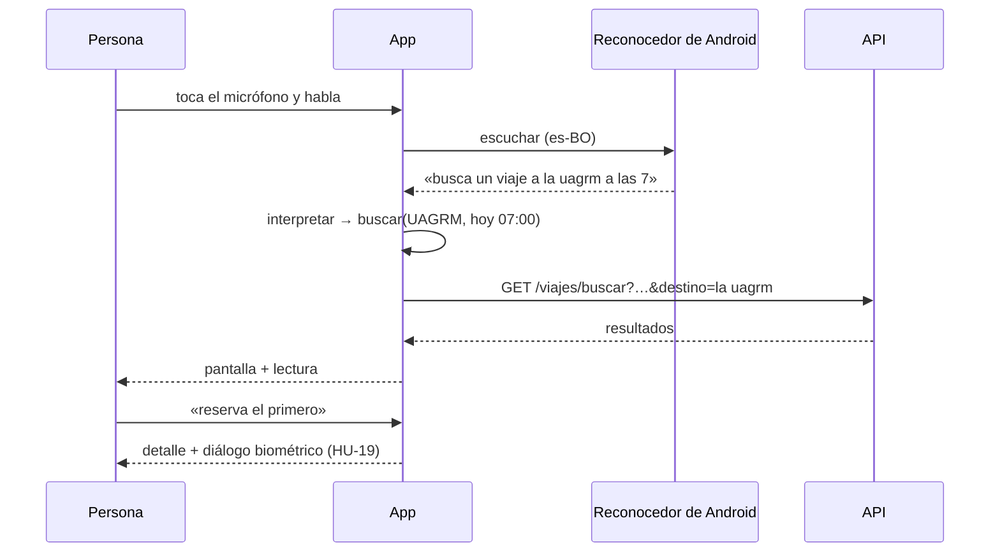

# HU-27 · Reservar por voz — Plan técnico

> Fase SDD: **Plan** (Diseño). Cómo se construye lo que dice `spec.md`.
> Estado: `aprobado (2026-11-15, integrante autorizado)` · Rama: `feat/HU-27-reservar-por-voz` en raíz, `backend` y `mobile`, desde `develop`.
> **Orden en S4: 2.ª** (independiente de HU-20; HU-28 se apila sobre esta).
> **Requiere confirmación humana (`AGENTS.md` §14):** dependencias nuevas `expo-speech` y `expo-speech-recognition` (D-30, elegidas por el integrante el 15/11; falta autorizar la instalación y sus scripts). Cambio compatible de la API: filtro opcional `destino` en `GET /viajes/buscar`.

## 1. Módulos afectados

| Carpeta | Módulo / componente | Cambio |
|---|---|---|
| backend | `viajes` | `BuscarViajesDto.destino?` (texto ≤ 100) y filtro en `ViajesService.buscar`; sin `destino`, la respuesta no cambia (HU-18) |
| mobile | `package.json`, `app.json` | `expo-speech` y `expo-speech-recognition` con versión exacta; plugin de `expo-speech-recognition` con el permiso `RECORD_AUDIO` y el texto del permiso |
| mobile | `src/voz/interprete.ts` (nuevo) | Función pura `interpretar(texto, ahora) → Intencion` para las formas de RN-2 |
| mobile | `src/voz/hora.ts` (nuevo) | Función pura `resolverHora(…)` (RN-4) |
| mobile | `src/voz/useVoz.ts` (nuevo) | Hook sobre `expo-speech-recognition` (escuchar, transcripción parcial, `es-BO` con respaldo `es-ES`, fin por silencio de 5 s) y `expo-speech` (hablar); contador de fallos seguidos |
| mobile | `src/voz/resultados.ts` (nuevo) | Lista de resultados que está en pantalla (la escribe `viajes/buscar.tsx` al enfocar y la borra al salir); `reserva el {n}` la lee (CA-10) |
| mobile | `componentes/BotonVoz.tsx`, `componentes/PanelVoz.tsx` (nuevos) | DESIGN_SYSTEM §8.10: botón de 48 dp y panel inferior con los estados *Escuchando*, *Procesando*, *Respuesta*, *No entendí*, *Sin permiso* |
| mobile | `(pestanas)/index.tsx`, `viajes.tsx`, `billetera.tsx`, `perfil.tsx`, `viajes/[id].tsx`, `reserva/[id].tsx`, `FormularioBusqueda.tsx` | Botón de voz en el encabezado (RN-1); el de Inicio deja de estar desactivado |
| mobile | `viajes/buscar.tsx` | Lee `destino` y `porVoz`; con `porVoz` lee el resumen (CA-3) o el vacío (CA-4) |
| mobile | `viajes/[id].tsx` | Con `porVoz=1` y saldo suficiente, al cargar abre el mismo `useAccionSensible('reservar')` del botón (DESIGN_SYSTEM §9.6.4) y lee el resumen; con saldo corto lee el faltante y no abre la huella |
| mobile | `i18n/es-BO.json` | `voz.*` |

Reutiliza: `buscarViajes` y `ErrorApi` del cliente, `servicios/ubicacion.ts` (origen = ubicación actual), `useAccionSensible` (la huella es la única confirmación), `formato.ts` (horas en 24 h y montos), `Mensajes`/`Aviso`. El reconocedor es el del teléfono (Android); no hay servicio externo nuevo.

## 2. Cambios al modelo de datos

Ninguno.

## 3. Endpoints

| Método | Ruta | Rol | F/B | Request → Response | Errores (`codigo`) |
|---|---|---|---|---|---|
| GET | `/viajes/buscar` | miembro aprobado | — | + `destino?` → los mismos resultados de HU-18, solo los que cumplen RN-3 | `VALIDACION_FALLIDA` (destino > 100) |

**Filtro de destino (RN-3):** el servidor normaliza el texto (minúsculas, sin tildes, solo `[a-z0-9ñ ]`), quita `la, el, los, las, al, a, de, del` y exige que `translate(lower(destino_nombre), 'áéíóúü', 'aeiouu')` contenga cada palabra que queda (`NOT EXISTS (SELECT 1 FROM unnest($palabras) p WHERE … NOT LIKE '%' || p || '%')`). Las palabras ya no tienen `%` ni `_`. Sin palabras útiles, el filtro no se aplica. El orden y el tope de resultados no cambian (RN-5).

Swagger actualizado: [ ]

## 4. Pantallas y voz

| Cliente | Pantalla | Pasos del flujo | Claves i18n nuevas |
|---|---|---|---|
| mobile | `PanelVoz` | Toque en el micrófono → «Te escucho…» con transcripción → «Entendí: viaje a UAGRM, hoy a las 07:00» → abre Resultados | `voz.panel.*`, `voz.comun.*` |
| mobile | Resultados (`viajes/buscar`) | Lee «Encontré {n} viajes. El primero sale a las {hora} a {destino} por {precio} URC.» o el vacío | `voz.buscar.*` |
| mobile | Detalle del viaje | «Reserva el primero» → detalle con el resumen leído → diálogo biométrico de HU-19 | `voz.reservar.*` |

| Comando de voz | Acción | Alternativa táctil | ¿Pide biometría? |
|---|---|---|---|
| «busca un viaje a {destino} a las {hora}» (y formas de RN-2) | Resultados con origen actual, hora de RN-4 y destino | Formulario de Buscar | No |
| «reserva el primero» / «reserva el {n}» | Detalle del viaje {n} con la reserva lista | Tocar el resultado y «Reservar y pagar» | **Sí**, la de HU-19 (la voz no la reemplaza, RN-6) |

**Intérprete** (`interpretar`): normaliza (minúsculas, sin tildes ni signos), reconoce el verbo de RN-2, separa la hora (`a las …`, `… y media`, `hh:mm`, `… horas`, franjas) y el resto es el destino. Devuelve `{ tipo: 'buscar', destino, hora }`, `{ tipo: 'reservar', n }`, `{ tipo: 'falta', dato: 'hora' | 'destino' }` o `{ tipo: 'desconocido' }`. «sí», «confirma» y «reserva» sin número son `desconocido` (RN-6). Ordinales de «primero» a «décimo» y números del 1 al 10.

**Hora** (`resolverHora(h, m, franja?, dia?, ahora)`): con franja o 0–23 exacta; de 1 a 12 sin franja, la primera de `h` o `h + 12` que sea ≥ ahora − 30 min, hoy o, si ninguna, mañana a las `h` (RN-4). «mañana» suelto = día siguiente.

## 5. Diagramas UML

- [ ] Secuencia: búsqueda y reserva por voz hasta el diálogo biométrico.
- [ ] Casos de uso: buscar y reservar por voz (extiende los de HU-18 y HU-19).
- [ ] Componentes: módulo de voz de la app.

## 6. Estrategia de pruebas

| Criterio / amenaza | Tipo | Archivo de prueba |
|---|---|---|
| RN-2, CA-8, CA-9: todas las formas aceptadas, datos faltantes, «sí»/«confirma» | Jest (función pura) | `mobile/src/__tests__/voz-interprete.test.ts` |
| RN-4: 06:00/10:00/20:00 con «a las 7», franjas, «mañana», «y media», 24 h | Jest (función pura) | `mobile/src/__tests__/voz-hora.test.ts` |
| CA-1, CA-2, CA-3, CA-4, CA-11, CA-12, CA-13, silencio | Jest (reconocedor y voz simulados) | `mobile/src/__tests__/voz-panel.test.tsx` |
| CA-5, CA-7, CA-10, CA-14 | Jest | `mobile/src/__tests__/voz-reservar.test.tsx` |
| CA-6 / **A-11** la voz no reserva sin huella: huella cancelada o «confirma» → ninguna petición firmada | Jest de ataque (nombre con `A-11`) | `mobile/src/__tests__/voz-reservar.test.tsx` |
| A-11 en el servidor: la reserva sigue exigiendo F+B | ataque e2e (ya existe) | `backend/test/ataques/a-11-catalogo-sensible.e2e-spec.ts` |
| RN-3 filtro de destino (tildes, artículos, varias palabras, `%` y `_` sin efecto, sin destino = HU-18) | unitaria + e2e | `backend/src/viajes/viajes.service.spec.ts`, `backend/test/viajes/buscar.e2e-spec.ts` |
| A-13 el filtro no abre otras organizaciones | ataque e2e | `backend/test/ataques/a-13-viajes.e2e-spec.ts` (caso con `destino`) |
| Reconocimiento real, ruido moderado, lectura en voz alta | manual en el Infinix X669 (registrar en MEMORY) | — |

Metas de rendimiento: búsqueda < 2 s (HU-18), medida desde la interpretación.

## 7. Riesgos

| Riesgo | Probabilidad | Impacto | Mitigación |
|---|---|---|---|
| `expo-speech-recognition` (comunidad) no compila con Expo SDK 58 / RN 0.88 | Media | Alto | Probar instalación y `expo prebuild` + compilación antes de escribir pantallas (primera tarea); si falla, volver al equipo (D-30) |
| Reconocedor de Google ausente o sin español en el teléfono | Media | Medio | CA-13 y alternativa táctil; comprobarlo en el Infinix al inicio |
| Ruido o acento (R-07) | Media | Bajo | Repregunta y teclado tras 2 fallos (RN-7) |
| Nombres de destino que no contienen lo dicho («la U» vs «UAGRM») | Alta | Bajo | Fuera de alcance (spec §5); el vacío sugiere otra hora y el teclado sigue disponible |
| Compilación nativa lenta en Windows (≈ 30 min) | Alta | Medio | Una sola compilación tras instalar; el resto con Jest |

## 8. Tareas propuestas (se copian a backlog.md al aprobar)

| Tarea | Horas | Responsable |
|---|---|---|
| SP184 · Instalar `expo-speech` y `expo-speech-recognition` (versión exacta, scripts revisados), plugin y compilación nativa | 2 | @[POR DEFINIR] |
| SP185 · Backend: filtro `destino` en la búsqueda con pruebas | 2 | @[POR DEFINIR] |
| SP186 · `interpretar` y `resolverHora` con pruebas de todas las formas | 3 | @[POR DEFINIR] |
| SP187 · `useVoz`, `BotonVoz` y `PanelVoz` en las pantallas de RN-1 | 4 | @[POR DEFINIR] |
| SP188 · Buscar y reservar por voz: resultados leídos y detalle con la huella; pruebas A-11 | 3 | @[POR DEFINIR] |
| SP189 · Prueba en el teléfono físico con ruido moderado | 1 | @[POR DEFINIR] |
