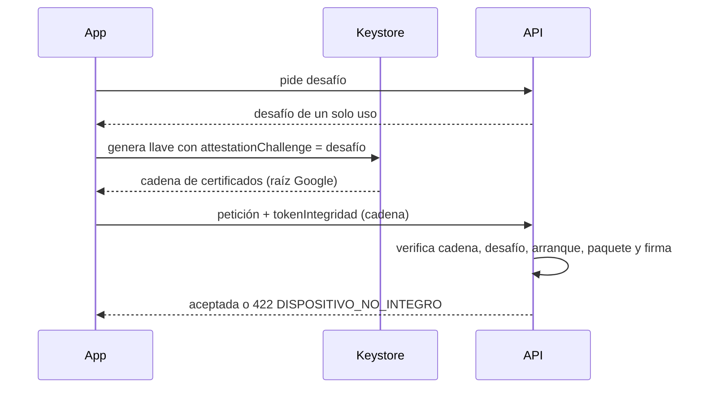

# PB-07 · Atestación del dispositivo con Key Attestation — Plan técnico

> Fase SDD: **Plan** (Diseño). Cómo se construye lo que dice `spec.md`.
> Estado: `aprobado (18/11/2026, equipo)` · Rama: `feat/PB-07-atestacion-keystore` (backend, mobile y principal)
> Solo cuando este plan esté aprobado se cargan sus tareas en `.agents/STEERING/backlog.md`.

## 1. Módulos afectados

| Carpeta | Módulo / componente | Cambio |
|---|---|---|
| backend | `comun/atestacion-keystore.service.ts` | **nuevo**: `AtestacionKeystore extends PlayIntegrityService` |
| backend | `comun/play-integrity.service.ts` | modificado: `crearPlayIntegrity` devuelve `AtestacionKeystore`; se conservan la clase abstracta (token de DI), `PlayIntegritySimulado` y la guarda de producción; se elimina `PlayIntegrityReal` |
| backend | `comun/raices-atestacion.pem` | **nuevo**: raíces públicas de Google para Key Attestation |
| backend | `dispositivos`, `presencia` | sin cambio de código; solo descripciones Swagger de `tokenIntegridad` |
| mobile | `modules/llave-dispositivo` (Kotlin) | modificado: función nativa `atestar(desafio)` |
| mobile | `src/dispositivo/keystore.ts` | modificado: `pedirTokenIntegridad` llama a `atestar` (conserva el simulado solo en `__DEV__`) |
| web, contracts | — | sin cambio |

Reutiliza: la clase abstracta `PlayIntegrityService`, `ResultadoIntegridad`, `ErrorNegocio`, el módulo nativo `LlaveDispositivoModule` y `ErrorKeystore`. El campo `tokenIntegridad` y la columna `veredictoIntegridad` no cambian de nombre (no hay cambio de contrato de API).

**Formato del token:** los certificados de la cadena (hoja primero), cada uno en DER codificado en base64, unidos con comas.

**Verificación en el servidor** (sin dependencias nuevas: `node:crypto` `X509Certificate` y un lector DER mínimo para la extensión `1.3.6.1.4.1.11129.2.1.17`):
1. Cadena: cada certificado emitido por el siguiente (`verify`), vigentes, y el último igual a una raíz de `raices-atestacion.pem` (CA-5).
2. `attestationChallenge` igual al desafío (CA-3) y marca de tiempo del certificado hoja ≤ 5 min (RN-4).
3. `attestationSecurityLevel` y `keymasterSecurityLevel` ≥ TEE (StrongBox cuenta mejor); software → rechazo (CA-2).
4. `rootOfTrust`: `deviceLocked = true` y `verifiedBootState = Verified` (CA-2).
5. `attestationApplicationId`: paquete = `ATESTACION_PAQUETE` y alguna huella SHA-256 de firma ∈ `ATESTACION_FIRMA_SHA256` (CA-4).
6. Token vacío, mal formado o cadena corta → rechazo sin excepción (CA-6). Sin `ATESTACION_FIRMA_SHA256` configurada → 503 fail-closed (RN-3).

El veredicto guardado es `KEY_ATTESTATION_STRONGBOX` o `KEY_ATTESTATION_TEE`.

## 2. Cambios al modelo de datos

Ninguno. Migración: no. ¿Borra o transforma datos o cambia RLS? No.

## 3. Endpoints

Ninguno nuevo ni modificado. Los de HU-09, HU-10, HU-22 y HU-23 siguen aceptando `tokenIntegridad` con la misma validación de forma. Swagger: se actualiza la descripción del campo (de «Play Integrity» a «Atestación de Key Attestation») — [ ]

## 4. Pantallas y voz

Sin pantallas nuevas. Claves i18n nuevas (backend y mobile `es-BO.json`): `comun.integridad.no_soportado` (Android < 8 o sin atestación). Las demás claves existentes se reutilizan.

## 5. Diagramas UML

- [ ] Secuencia: vincular dispositivo y petición sensible (App → módulo nativo → Keystore → API → verificador).
- [ ] Despliegue: quitar Google Play Integrity de los servicios externos.
- [ ] Otros: `AGENTS.md` §4 (tabla de servicios) y §6 (A-03, A-08), que citan Play Integrity.

## 6. Estrategia de pruebas

| Criterio / amenaza | Tipo | Archivo de prueba |
|---|---|---|
| CA-1 | unitaria (cadena de prueba válida firmada por una raíz de prueba inyectada) | `atestacion-keystore.service.spec.ts` |
| CA-2 / A-03 | ataque: nivel software, bootloader abierto, arranque no verificado | ídem |
| CA-3 / A-05 | ataque: desafío distinto; marca de tiempo vieja | ídem |
| CA-4 / A-03 | ataque: paquete distinto; firma de app distinta | ídem |
| CA-5 | ataque: raíz desconocida; certificado alterado; vencido; cadena rota | ídem |
| CA-6 / A-08 | ataque: token vacío, basura, una sola cadena | ídem |
| CA-6 | integración: los servicios de `dispositivos` y `presencia` devuelven 422 con un token no íntegro | specs actuales ya cubren el rechazo; se ajustan sus dobles |
| CA-7 | unitaria: `crearPlayIntegrity` falla con `MODO_EMULADOR_DEV=true` y `NODE_ENV=production`; sin firma configurada falla cerrado | `play-integrity.service.spec.ts` |
| CA-8 | Jest: `pedirTokenIntegridad` delega en `atestar`; simulado solo con `__DEV__` | `keystore.test.ts` |
| CA-1, CA-8 en real | **manual en teléfono físico** (Infinix X669) | acta en `plan.md` §9 al verificar |

Las cadenas de prueba se fabrican en la prueba con una raíz propia (la verificación acepta raíces inyectables). Una cadena real de un teléfono solo se obtiene al probar en el dispositivo.

Metas de rendimiento: verificación de abordaje < 3 s (la verificación local de una cadena de 3 certificados añade milisegundos, sin llamada de red; mejora respecto a Play Integrity).

## 7. Riesgos

| Riesgo | Probabilidad | Impacto | Mitigación |
|---|---|---|---|
| Raíces de Google cambian o rotan | Baja | Alto (nadie puede vincular) | Raíces en un archivo `.pem` versionado; incluir las vigentes de `android.googleapis.com/attestation/root` y comprobar sus huellas al añadirlas |
| Tests sin una cadena real de teléfono | Media | Medio | Cadena fabricada en la prueba + prueba manual obligatoria en teléfono físico antes de cerrar |
| El Infinix X669 o algún teléfono atesta solo en software | Media | Alto (no se podría vincular) | Probar antes en el teléfono; si ocurre, queda documentado como limitación del equipo de prueba |
| Fabricar certificados en tests exige una librería | Media | Bajo | Preferir `node:crypto` y DER a mano; si no alcanza, `@peculiar/x509` solo como devDependency (§14: confirmar) |
| Sin la huella de firma de la app no se puede aceptar nada | Alta hasta tener el APK | Alto | Se configura al compilar con EAS Build (huella de la llave de firma); en desarrollo, huella de la llave de depuración |
| Quitar `@googleapis/playintegrity` y `google-auth-library` | — | Bajo | Quitar dependencias exige confirmación (§14); se propone en este plan |
| Android < 8 no atesta | Baja | Bajo | Mensaje claro; la spec lo acepta |

## 8. Tareas propuestas (se copian a backlog.md al aprobar)

| Tarea | Horas | Responsable |
|---|---|---|
| SP236 · Backend: `AtestacionKeystore` (cadena, desafío, arranque, paquete y firma) y `crearPlayIntegrity` | 4 | [POR DEFINIR] |
| SP237 · Backend: pruebas unitarias y de ataque (CA-1 a CA-7), ajustar dobles y Swagger | 2 | [POR DEFINIR] |
| SP238 · Mobile: función nativa `atestar`, `pedirTokenIntegridad`, claves i18n y pruebas Jest | 3 | [POR DEFINIR] |
| SP239 · Config (`ATESTACION_*` en `.env.example` y producción), quitar dependencias, AGENTS.md §4 y §6 | 1 | [POR DEFINIR] |
| SP240 · Prueba en teléfono físico, verificar y PRs | 2 | [POR DEFINIR] |

Total: 12 h.
