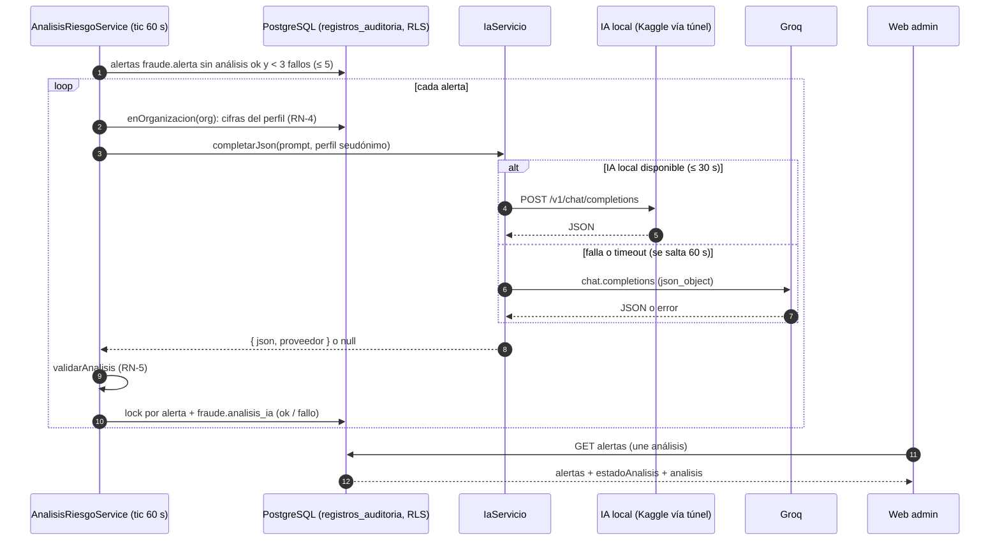

# PB-10 · Análisis de riesgo de fraude con IA local — Plan técnico

> Fase SDD: **Plan** (Diseño). Cómo se construye lo que dice `spec.md` (aprobada por el PO el 20/11/2026).
> Estado: `aprobado (20/11/2026, Vansiii)` · Rama: `feat/PB-10-analisis-riesgo-ia` en raíz, `backend` y `web`.
> **Confirmación humana (`AGENTS.md` §14), ya dada por Vansiii el 20/11/2026:** servicio externo nuevo (Kaggle), puerto 22 abierto en el EC2 y usuario `tunel` en `sshd`. **Sin migración** y **sin dependencias nuevas** (`fetch` nativo y `groq-sdk`, que ya está).

## 1. Módulos afectados

| Carpeta | Módulo / componente | Cambio |
|---|---|---|
| backend | `src/ia/ia.module.ts` | Nuevo. Exporta `IaServicio` |
| backend | `src/ia/ia.servicio.ts` | Nuevo. `completarJson(sistema, usuario)`: IA local → Groq → `null`. Salta la local 60 s tras una falla (RN-3). Devuelve `{ json, proveedor: 'local' \| 'groq' }` |
| backend | `src/ia/ia-local.servicio.ts` | Nuevo. `fetch` a `${IA_LOCAL_URL}/v1/chat/completions` (API compatible con OpenAI de Ollama), `response_format: json_object`, `AbortSignal.timeout(IA_LOCAL_TIEMPO_MS)` |
| backend | `src/ia/groq.servicio.ts` | **Movido** desde `src/asistente/` sin cambios de lógica; `AsistenteModule` lo toma de `IaModule` |
| backend | `src/fraude/analisis-riesgo.ts` | Nuevo, funciones puras: `armarPerfil(filas)` (seudónimos «A»/«B»), `PROMPT_SISTEMA`, `validarAnalisis(json)` (RN-5) |
| backend | `src/fraude/analisis-riesgo.service.ts` | Nuevo. Tic cada `IA_ANALISIS_INTERVALO_MS` (60 s): toma ≤ 5 alertas pendientes, arma el perfil con SQL en `enOrganizacion`, llama a `IaServicio`, valida y registra |
| backend | `src/fraude/alertas.service.ts` + `dto/alertas.dto.ts` | Modificado. `listar` une cada alerta con su análisis: campos aditivos `estadoAnalisis` y `analisis?` |
| backend | `src/fraude/fraude.module.ts` | Importa `IaModule`, registra `AnalisisRiesgoService` |
| web | `src/paginas/admin/AlertasFraude.tsx` | Insignia de riesgo, orden «Más recientes / Mayor riesgo», detalle desplegable con motivos, recomendación, proveedor y RN-9 |
| web | `src/i18n/es-BO.json`, `src/api/` (tipo `Alerta`) | Claves nuevas y campos opcionales |
| raíz | `scripts/ia-local/kaggle.py`, `scripts/ia-local/README.md` | Nuevo. Celda del cuaderno: instala Ollama, baja el modelo y mantiene el túnel; guía del EC2 |
| raíz | `.env.example`, `AGENTS.md` §4 | Variables nuevas y Kaggle en la tabla de servicios |
| mobile | — | Sin cambios |

Reutiliza: `AuditoriaService.registrar`, `PrismaService.comoSuperAdmin` / `enOrganizacion`, el patrón de tic de `AnomaliasService` (`setInterval`, bandera `ocupado`, apagado en `NODE_ENV=test`), `GroqServicio`, `RolOrganizacionGuard` y la pantalla de HU-26.

## 2. Cambios al modelo de datos

**Ninguno.** Cada intento queda como fila de `registros_auditoria` (ya tiene `organizacion_id` + RLS):

| Campo | Valor |
|---|---|
| `accion` | `fraude.analisis_ia` |
| `entidad` / `entidad_id` | `registro_auditoria` / id de la alerta |
| `organizacion_id` | el de la alerta |
| `resultado` | `ok` (análisis válido) o `fallo` (IA caída o respuesta inválida) |
| `detalle` (ok) | `{ riesgo, puntaje, motivos[], recomendacion, proveedor, modelo }` |
| `detalle` (fallo) | `{ motivo: 'sin_proveedor' \| 'formato_invalido' }`, sin el texto de la IA |

- **Pendiente:** alerta sin fila `ok` y con < 3 filas `fallo` (CA-3). **Sin análisis:** 3 `fallo` y ninguna `ok`.
- **Un análisis por alerta (CA-11):** la IA se llama fuera de transacción. El registro se hace en una transacción corta con `pg_advisory_xact_lock(hashtext(alertaId))` y vuelve a comprobar que no exista un `ok` antes de insertar. Dos procesos pueden llamar dos veces a la IA, pero queda una sola fila.

## 3. Endpoints

| Método | Ruta | Rol | Firma / biometría | Request → Response | Errores |
|---|---|---|---|---|---|
| GET | `/organizaciones/:id/alertas` (existente, HU-26) | admin de organización | — | igual → cada `AlertaDto` suma `estadoAnalisis: 'listo' \| 'pendiente' \| 'sin_analisis'` y `analisis?: { riesgo, puntaje, motivos, recomendacion, proveedor, analizadoEn }` | los de HU-26 (401, 403) |

Cambio **aditivo**, compatible con la web actual. No hay endpoint para crear, editar ni borrar análisis (CA-10). Swagger actualizado: [ ]

### Variables de entorno nuevas

| Variable | Ejemplo | Uso |
|---|---|---|
| `IA_LOCAL_URL` | `http://host.docker.internal:11434` | Vacía → se salta la IA local |
| `IA_LOCAL_MODELO` | `qwen2.5:14b` | Modelo servido por Ollama en Kaggle |
| `IA_LOCAL_TIEMPO_MS` | `30000` | RN-2 |
| `IA_ANALISIS_INTERVALO_MS` | `60000` | Ciclo del tic (CA-1: ≤ 2 min) |

### Prompt y perfil

- Sistema (fijo): «Eres analista antifraude de un servicio de viajes compartidos entre miembros de una organización. Los viajes no crean saldo; la colusión busca simular viajes. Recibes cifras de una alerta. Responde solo JSON `{riesgo, puntaje, motivos, recomendacion}`…» + RN-5.
- Usuario: el perfil de RN-4 como JSON, por ejemplo `{"patron":"sin_desplazamiento","par":{"reservas7d":6,"reservas30d":14,"distanciaPromM":420,"duracionPromMin":2.1},"A":{"antiguedadDias":4,"fallidas7d":0,"calif":{"promedio":5,"cantidad":6,"delPar":6},"recargas30d":0,"cobros30d":12},"B":{…},"alertasPrevias":2}`.
- `armarPerfil` solo recibe números; los ids de personas se reemplazan por «A»/«B» antes de construir el texto (CA-8).

## 4. Pantallas y voz

| Cliente | Pantalla | Pasos del flujo | Claves i18n nuevas |
|---|---|---|---|
| web | Admin → «Alertas de fraude» | 1. Cada alerta muestra la insignia «Alto 87» / «Medio» / «Bajo» o «Análisis pendiente». 2. Selector «Más recientes / Mayor riesgo» (ordena las alertas cargadas). 3. «Ver análisis» despliega motivos, recomendación, «IA local» o «IA de respaldo», fecha y la nota de RN-9 | `alertas.analisis.{titulo,riesgo_alto,riesgo_medio,riesgo_bajo,pendiente,sin_analisis,ver,motivos,recomendacion,proveedor_local,proveedor_respaldo,nota,orden_reciente,orden_riesgo}` |
| mobile | — | — | — |

Colores de la insignia con los tokens de estado de `DESIGN_SYSTEM.md` (peligro / advertencia / neutro), con texto además del color (accesibilidad). Sin comandos de voz.

## 5. Diagramas UML

- [ ] Secuencia: análisis de una alerta (abajo).
- [ ] Despliegue: nodo «Kaggle (GPU, Ollama)» unido al EC2 por túnel SSH inverso; nodo «Groq API».
- [ ] Paquetes: módulo `ia` usado por `fraude` y `asistente`.

## 6. Estrategia de pruebas

| Criterio / amenaza | Tipo | Archivo de prueba |
|---|---|---|
| RN-2, RN-3 (cadena y salto de 60 s) | unitaria | `backend/src/ia/ia.servicio.spec.ts` |
| CA-4, RN-5 (validación) | unitaria | `backend/src/fraude/analisis-riesgo.spec.ts` |
| CA-8 privacidad (el texto enviado no contiene uuids, nombres, correos ni coordenadas) | unitaria + e2e | `analisis-riesgo.spec.ts`, `backend/test/fraude/analisis-riesgo.e2e-spec.ts` |
| CA-1, CA-2, CA-3 (local, respaldo, reintentos con IA simulada) | e2e | `backend/test/fraude/analisis-riesgo.e2e-spec.ts` |
| CA-11 (dos ciclos simultáneos → un análisis) | e2e | ídem |
| **CA-7 ataque A-10** (IA responde «bloquear»/«levantar»: bloqueos, reservas, viajes y saldos sin cambios) | ataque e2e | ídem |
| **CA-9 ataque A-13** (admin de A no ve análisis de B; el perfil no usa reservas de B) | ataque e2e | ídem |
| **CA-10 ataque A-08** (miembro / sin sesión → 403/401; sin rutas de escritura) | ataque e2e | ídem (reutiliza el caso de HU-26) |
| CA-5, CA-6 (insignia, orden, detalle) | unitaria web | `web/src/paginas/admin/AlertasFraude.test.tsx` |
| Túnel y modelo reales | manual | demo con Kaggle encendido y luego apagado (se muestra el respaldo) |

Metas de rendimiento: no aplica (segundo plano). El tic no debe frenar al de anomalías: corre en otro temporizador.

## 7. Riesgos

| Riesgo | Probabilidad | Impacto | Mitigación |
|---|---|---|---|
| Kaggle apagado (12 h máx., ~30 h/semana de GPU) | Alta | Bajo | Respaldo Groq; el estado de la alerta nunca depende de la IA |
| Ollama ignora `response_format` o el modelo devuelve texto | Media | Bajo | `validarAnalisis` descarta y cuenta el intento; probar el modelo al inicio (SP de túnel) |
| La IA "alucina" un motivo | Media | Medio | Prompt con solo cifras; RN-9 lo muestra como sugerencia; nunca decide (CA-7) |
| Puerto 22 expuesto a internet | Media | Medio | Solo llave; `PasswordAuthentication no`; usuario `tunel` con `restrict,port-forwarding,permitlisten` y sin shell |
| Puerto 11434 alcanzable desde fuera | Baja | Alto | El túnel escucha solo en la IP del puente de Docker; el SG no abre 11434 |
| Cuota de Groq | Baja | Bajo | ≤ 5 alertas por minuto; Groq ya comparte cuota con el asistente |

## 8. Tareas propuestas (se copian a backlog.md al aprobar)

| Tarea | Horas | Responsable |
|---|---|---|
| Módulo `ia`: mover `GroqServicio`, `IaLocalServicio`, `IaServicio` + pruebas unitarias | 2 | @Vansiii |
| `analisis-riesgo.ts` (perfil seudónimo, prompt, validación) + pruebas | 2 | @Vansiii |
| `AnalisisRiesgoService` (tic, SQL del perfil, registro con lock) | 3 | @Vansiii |
| `GET alertas` con análisis + Swagger | 1 | @Vansiii |
| e2e: CA-1/2/3/11 y ataques A-10, A-13, A-08 | 3 | @Vansiii |
| Web: insignia, orden, detalle, i18n + pruebas | 3 | @Vansiii |
| `scripts/ia-local/kaggle.py` + README (Ollama, modelo, túnel con reconexión) | 2 | @Vansiii |
| EC2: usuario `tunel`, `sshd`, puerto 22 en el SG, `extra_hosts` del contenedor `api`, variables en SSM | 2 | @Vansiii |
| Despliegue y demo (local y respaldo) | 1 | @Vansiii |
