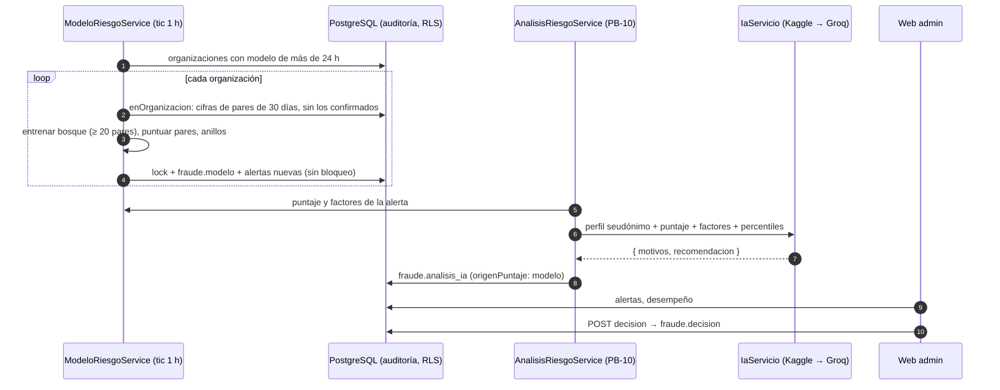

# PB-11 · Modelo de riesgo propio, anillos de colusión y retroalimentación — Plan técnico

> Fase SDD: **Plan** (Diseño). Cómo se construye lo que dice `spec.md` (aprobada por el PO el 21/11/2026).
> Estado: `aprobado (21/11/2026, Vansiii)` · Rama: `feat/PB-11-modelo-riesgo-propio` en raíz, `backend` y `web`.
> **`AGENTS.md` §14:** sin migración, sin dependencias nuevas, sin cambios en Kaggle ni en infraestructura. Cambios de API **aditivos**. La única escritura nueva es la decisión del administrador, que va a la auditoría y no toca bloqueos ni dinero.

## 1. Módulos afectados

| Carpeta | Módulo / componente | Cambio |
|---|---|---|
| backend | `src/fraude/bosque-aislamiento.ts` | Nuevo, puro. Isolation Forest en TS con generador pseudoaleatorio con semilla (mulberry32): `entrenar(filas, semilla)` (100 árboles, muestra 128) y `puntuar(bosque, fila)` → 0–1. Mismo dato + misma semilla = mismo bosque (RN-4) |
| backend | `src/fraude/cifras-par.ts` | Nuevo, puro. Las 10 cifras de RN-3 → vector (log1p en conteos); `estadisticas(filas)` (mediana, MAD, 21 cuantiles por cifra); `percentil(est, i, v)`; `factores(est, fila)` → las 3 cifras con mayor desvío robusto en la dirección sospechosa (RN-5); `escalarPuntaje(s)` → 0–100, con la escala fijada usando los escenarios simulados |
| backend | `src/fraude/anillos.ts` | Nuevo, puro. Grafo de viajes pagados de 30 días; componentes conexas y «pelado» iterativo de quien tiene < 80 % de viajes internos; devuelve los grupos máximos con ≥ 3 personas y ≥ 6 viajes internos (RN-6), con las aristas para dibujarlos |
| backend | `src/fraude/escenarios.ts` | Nuevo, puro, con semilla. Genera organizaciones simuladas con pares normales y de colusión (par repetido, sin desplazamiento, cuentas nuevas que solo se califican entre sí, anillo de 3–5). `evaluar()` → AUC, curva ROC (21 puntos), detección con ≤ 10 % de falsas alarmas (CA-11) |
| backend | `src/fraude/modelo-riesgo.service.ts` | Nuevo. Tic cada `MODELO_RIESGO_INTERVALO_MS` (1 h). Por organización con modelo de más de 24 h: cifras de pares en `enOrganizacion`, quita los pares «Fraude confirmado» (CA-9), entrena si hay ≥ 20 pares, registra `fraude.modelo`, puntúa los pares y crea alertas `comportamiento_atipico` (≥ 80) y `anillo_colusion`, cada una sin repetir en 7 días. Lock por organización y comprobación del modelo del día (CA-16). Mantiene los bosques en memoria por versión y los reconstruye desde la auditoría |
| backend | `src/fraude/patrones.ts` | `PATRONES_ALERTA = [...PATRONES, 'comportamiento_atipico', 'anillo_colusion']`. `PATRONES` (los que bloquean) no cambia |
| backend | `src/fraude/analisis-riesgo.ts` | El perfil suma `modelo: { puntaje, factores[{cifra, valor, percentil}] }` y los percentiles. Con modelo, el prompt pide solo `{motivos, recomendacion}`; riesgo y puntaje salen del modelo (CA-5). `validarAnalisis` exige que cada motivo cite una cifra o un percentil enviados (CA-6). Perfil de anillo: «grupo de N», viajes internos, proporción |
| backend | `src/fraude/analisis-riesgo.service.ts` | Pide el puntaje a `ModeloRiesgoService` (par de la alerta; P-3: par más frecuente; anillo: máximo del grupo). El detalle suma `origenPuntaje: 'modelo' \| 'estimado'`, `factores` y `versionModelo` |
| backend | `src/fraude/alertas.service.ts` + `dto/alertas.dto.ts` + `alertas.controller.ts` | Cada alerta suma `origen`, `factores`, `grafo` (anillo) y `decision`. Nuevos `POST alertas-fraude/:id/decision` y `GET fraude/desempeno` |
| backend | `src/fraude/fraude.module.ts` | Registra `ModeloRiesgoService` |
| web | `src/componentes/Riesgo.tsx` + `.module.css` | Nuevos, solo SVG y CSS: `Medidor` (semicírculo animado 0–100 con bandas bajo, medio y alto), `BarraPercentil` (posición en la organización con marca de la mediana), `Histograma` (puntajes de los pares con línea de umbral), `CurvaRoc`, `GrafoAnillo` (disposición circular, grosor de arista = viajes, nodos con pulso) |
| web | `src/paginas/admin/AlertasFraude.tsx` | Panel «Inteligencia de riesgo» arriba, sección «Desempeño», tarjeta de detalle de la alerta con medidor, factores, explicación, grafo y botones de decisión |
| web | `src/api/cliente.ts`, `src/i18n/es-BO.json` | Tipos y claves nuevas |
| mobile / contracts / Kaggle | — | Sin cambios |

Reutiliza: el patrón de tic de `AnomaliasService`, `PrismaService.comoSuperAdmin` / `enOrganizacion`, `AuditoriaService.registrar`, `pg_advisory_xact_lock` como en PB-10, `IaServicio` tal como está, los guards de HU-26 y los componentes `Cifra`, `Panel` y `Anillo` de `Datos.tsx`.

## 2. Cambios al modelo de datos

**Ninguno.** Todo va a `registros_auditoria`, que ya tiene `organizacion_id` y RLS:

| `accion` | `entidad_id` | `detalle` |
|---|---|---|
| `fraude.modelo` | id de la organización | `{ version, semilla, pares, filas: number[][] (sin ids), estadisticas, histograma[10] }`. Se guardan las cifras y no el bosque: el bosque se reconstruye igual con la semilla (unas decenas de KB por día) |
| `fraude.alerta` (patrones nuevos) | — | `{ patron: 'comportamiento_atipico', personas[2], puntaje, factores }` o `{ patron: 'anillo_colusion', personas[≥3], viajesInternos, proporcion, aristas[{a,b,viajes}] }`. Sin `bloqueoHasta`: nunca bloquean (RN-1) |
| `fraude.analisis_ia` | id de la alerta | Lo de PB-10 + `origenPuntaje`, `factores`, `versionModelo` |
| `fraude.decision` | id de la alerta | `{ decision: 'confirmado' \| 'falso_positivo', nota? }`, con `actor_id`; rige la más reciente (RN-8) |

- **Pares confirmados (CA-9):** pares de alertas cuya última decisión es `confirmado`.
- **Sin repetición (CA-3, CA-4):** antes de alertar se busca otra `fraude.alerta` del mismo patrón con el mismo `personas` (ordenado) en 7 días.
- **Personas en las alertas:** los ids quedan en la auditoría, como en HU-25. La API devuelve solo los nombres al administrador y la IA recibe «A», «B», «C»…

## 3. Endpoints

| Método | Ruta | Rol | Request → Response | Errores |
|---|---|---|---|---|
| GET | `/organizacion/alertas-fraude` (existente) | admin de organización | igual; `patron` acepta los nuevos → `AlertaDto` suma `origen: 'reglas' \| 'modelo' \| 'anillo'`, `factores?[{cifra, valor, percentil}]`, `grafo?{nodos[{nombre}], aristas[{a,b,viajes}]}`, `decision?{valor, nota, autor, en}`; `analisis` suma `origenPuntaje` | 401, 403, 400 |
| POST | `/organizacion/alertas-fraude/:id/decision` | admin de organización | `{ decision, nota? (≤ 200) }` → `204` | 401, 403, 404 `ALERTA_NO_ENCONTRADA` (también si es de otra organización), 400 |
| GET | `/organizacion/fraude/desempeno` | admin de organización | → `{ modelo: { version, entrenadoEn, pares, histograma[10], umbral } \| null, porOrigen: [{ origen, alertas, confirmadas, falsosPositivos, precision \| null }], validacion: { auc, deteccion, falsasAlarmas, roc[{x,y}], escenarios } }` | 401, 403 |

`validacion` sale de `escenarios.evaluar()` sobre una organización simulada y fija. Se calcula una vez al arrancar y se guarda en memoria: son datos simulados, no reales. Swagger actualizado: [ ]

### Variables de entorno nuevas

| Variable | Ejemplo | Uso |
|---|---|---|
| `MODELO_RIESGO_INTERVALO_MS` | `3600000` | Cada cuánto se busca un modelo vencido (> 24 h) |

## 4. Pantallas

Todo en Admin → «Alertas de fraude», solo con SVG y CSS (sin librerías). Usa los tokens de `DESIGN_SYSTEM.md`, en tema claro y oscuro, siempre con texto además del color, y respeta `prefers-reduced-motion`.

1. **Panel «Inteligencia de riesgo»** (arriba): estado del modelo («Modelo propio activo · v12 · entrenado hace 3 h · 42 pares», o «Datos insuficientes: 12 de 20 pares»), un histograma de puntajes de los pares con la línea de umbral en 80 y los pares por encima resaltados, y cifras de pares analizados, anillos y alertas del modelo.
2. **Sección «Desempeño»**: una tarjeta por origen (reglas, modelo, anillo) con un anillo de precisión (confirmadas, falsos positivos, sin decidir), y una tarjeta «Validación del modelo» con la curva ROC, el AUC grande y la detección frente a falsas alarmas. Se aclara que la validación es «con N escenarios simulados».
3. **Detalle de la alerta** (tarjeta desplegable en lugar del `
` actual): medidor de puntaje, chip de origen («Modelo propio» / «Estimado por IA»), los 3 factores como barras de percentil («8 viajes en 7 días · percentil 99»), la explicación de la IA con su proveedor y la nota de RN-10. En un anillo, además, el grafo del grupo. Al pie, los botones «Fraude confirmado» / «Falso positivo», la nota y la última decisión con autor y fecha.
4. Filtro y orden: se suman los dos patrones nuevos; «Mayor riesgo» ordena por el puntaje del modelo.

Claves i18n nuevas: `fraude.modelo.*`, `fraude.desempeno.*`, `fraude.decision.*`, `fraude.factores.*` (una por cifra) y `fraude.alertas.patron.{comportamiento_atipico,anillo_colusion}`.

## 5. Diagramas UML

- [ ] Secuencia: entrenamiento diario y alertas del modelo (abajo).
- [ ] Clases: `ModeloRiesgoService`, `BosqueAislamiento`, `Anillos`, `Escenarios`.
- [ ] Casos de uso: «Decidir sobre una alerta», «Ver desempeño del modelo».

## 6. Estrategia de pruebas

| Criterio / amenaza | Tipo | Archivo de prueba |
|---|---|---|
| RN-4 reproducible (misma semilla → mismo puntaje), puntajes en 0–100 | unitaria | `backend/src/fraude/bosque-aislamiento.spec.ts` |
| **CA-11** AUC ≥ 0,85, detección ≥ 80 % con ≤ 10 % de falsas alarmas | unitaria (falla si baja) | `backend/src/fraude/escenarios.spec.ts` |
| RN-5 factores y percentiles | unitaria | `backend/src/fraude/cifras-par.spec.ts` |
| CA-4, RN-6 anillos (grupo de 4 detectado, par suelto no, 79 % no) | unitaria | `backend/src/fraude/anillos.spec.ts` |
| CA-6 motivo sin cifra → descartado; CA-15 privacidad del perfil nuevo | unitaria | `backend/src/fraude/analisis-riesgo.spec.ts` |
| CA-1, CA-2, CA-3, CA-9, CA-16 | e2e | `backend/test/fraude/modelo-riesgo.e2e-spec.ts` |
| CA-5 (puntaje del modelo en el análisis) | e2e | `backend/test/fraude/analisis-riesgo.e2e-spec.ts` |
| CA-8, CA-10 (decisión e historial; precisión) | e2e | `backend/test/fraude/decisiones.e2e-spec.ts` |
| **CA-12 ataque A-10** (alerta del modelo o de anillo, «falso positivo» e IA «bloquear»: bloqueos, reservas, viajes y saldos sin cambios) | ataque e2e | `modelo-riesgo.e2e-spec.ts`, `decisiones.e2e-spec.ts` |
| **CA-13 ataque A-13** (decidir y ver alertas o desempeño de B → 404/vacío; el modelo de A no usa pares de B) | ataque e2e | ídem |
| **CA-14 ataque A-08** (miembro → 403, sin sesión → 401) | ataque e2e | `decisiones.e2e-spec.ts` |
| CA-7, CA-10 en pantalla (medidor, factores, grafo, decisión, desempeño, «Sin datos») | unitaria web | `web/src/paginas/admin/AlertasFraude.test.tsx`, `web/src/componentes/Riesgo.test.tsx` |
| Producción tiene 0 alertas | manual | sembrar una organización de demostración con `escenarios.ts` (guion `npm run` existente de datos demo, si aplica) y revisar la pantalla |

Rendimiento: entrenar 100 árboles con unos miles de pares tarda milisegundos; corre en segundo plano y no frena a otros tics.

## 7. Riesgos

| Riesgo | Probabilidad | Impacto | Mitigación |
|---|---|---|---|
| Organizaciones reales con < 20 pares: sin modelo en la demo | Alta | Medio | Organización de demostración sembrada con escenarios; CA-2 lo muestra con claridad |
| El AUC con datos simulados no refleja datos reales | Media | Medio | La pantalla dice «escenarios simulados»; la precisión real sale de las decisiones (CA-10) |
| Falsos positivos del modelo | Media | Bajo | Nunca bloquea (RN-1); umbral 80; la decisión del administrador lo mide |
| Envenenamiento: hacer muchos viajes para que el fraude parezca normal | Baja | Medio | Los confirmados se excluyen (CA-9); las reglas de HU-25 siguen siendo independientes |
| Tamaño de `fraude.modelo` en la auditoría | Baja | Bajo | Solo cifras de pares (10 por par); un registro por organización y día |

## 8. Tareas propuestas (se copian a backlog.md al aprobar)

| Tarea | Horas | Responsable |
|---|---|---|
| SP256 · `bosque-aislamiento.ts` + `cifras-par.ts` + pruebas | 3 | @agente |
| SP257 · `escenarios.ts` (generador y evaluación ROC/AUC) + prueba CA-11 | 2 | @agente |
| SP258 · `anillos.ts` + pruebas | 2 | @agente |
| SP259 · `ModeloRiesgoService` (tic, SQL de pares, entrenamiento, alertas nuevas, lock) | 3 | @agente |
| SP260 · PB-10 con el puntaje del modelo (perfil, prompt, validación) | 2 | @agente |
| SP261 · API: decisión, desempeño, campos nuevos de alertas + Swagger | 2 | @agente |
| SP262 · e2e: CA-1/2/3/5/8/9/10/16 y ataques A-10, A-13, A-08 | 3 | @agente |
| SP263 · Web: componentes `Riesgo` (medidor, percentil, histograma, ROC, grafo) + pruebas | 4 | @agente |
| SP264 · Web: panel de inteligencia, desempeño, detalle y decisión, i18n + pruebas | 4 | @agente |
| SP265 · Organización de demostración sembrada y despliegue | 2 | @agente |
