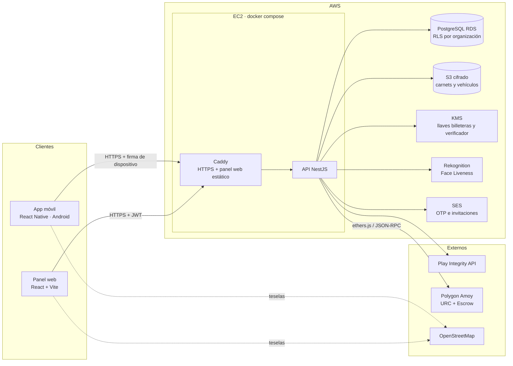
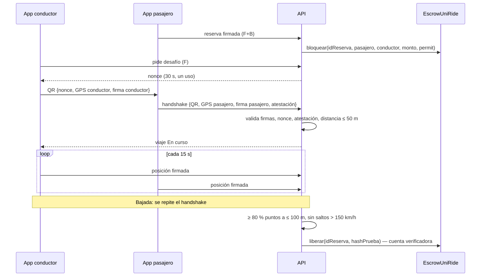

# SSD — Documento técnico de referencia de UniRide

> Equivale al DDS de la materia. Deriva de `AGENTS.md` y del documento técnico (§1.8, §3). Lo que esas fuentes no definen se marca `[DECISIÓN ABIERTA D-xx]` con su entrada en `/.agents/MEMORY/MEMORY.md`, o como **Propuesta** cuando es el diseño más simple compatible con las fuentes y queda pendiente de aprobación del equipo en PB-02 / PB-04. Los cambios de arquitectura real se reflejan acá, no en el roadmap.
>
> Identificadores en español (D-19). Se conservan en inglés solo los nombres impuestos por frameworks, estándares o herramientas (§14).

## 1. Stack técnico

| Capa | Tecnología | Versión | Propósito |
|---|---|---|---|
| Móvil | React Native 0.86 (Expo SDK 57 con módulos nativos), TypeScript 6.0 | Expo ~57.0 | App de conductor y pasajero: cámara, GPS, biometría, Android Keystore, voz |
| Web | React 19.2 + Vite 8.3, TypeScript 6.0 | React 19.2 · Vite 8.3 | Paneles de admin. de organización y super admin. |
| Backend | NestJS 12, TypeScript 6.0, Swagger (`@nestjs/swagger` 12) | NestJS 12.1 | API REST, reglas de negocio, motor de verificación, relayer blockchain |
| ORM | Prisma (D-01), con `prisma.config.ts` | 7.10 | Acceso a PostgreSQL y migraciones |
| Base de datos | PostgreSQL (Amazon RDS) con Row-Level Security | 17 | Datos del negocio y libro mayor |
| Blockchain | Solidity 0.8.28, Hardhat 3, OpenZeppelin, ethers.js | Hardhat 3.19 · OZ 5.6 · ethers 6.17 | Token URC y contrato escrow |
| Red | Polygon Amoy (chain id 80002); Hardhat local como respaldo (R-04) | — | Solo red de prueba |
| Seguridad | JWT + refresh token, Google Play Integrity API, Android Keystore | — | Sesión, atestación, llave de dispositivo |
| Nube | AWS: EC2 (D-02), RDS, S3, KMS, Rekognition Face Liveness, SES | — | Despliegue, archivos, llaves, prueba de vida, correo |
| Proxy HTTPS | Caddy (contenedor en EC2) — Propuesta | se fija en SP13 | TLS automático y servir el build del panel web |
| Mapas | OpenStreetMap | — | Origen, destino y trayecto |
| Voz | Reconocimiento de voz del dispositivo (Android SpeechRecognizer) | — | Comandos en español |
| Contenedores | Docker + Docker Compose | — | Mismo despliegue en local y en EC2 |
| CI | GitHub Actions | — | Lint, pruebas y build en cada PR |
| Pruebas | Vitest + Supertest (backend), Hardhat (Mocha + Chai), Vitest + Testing Library (web), Jest + jest-expo + Testing Library (móvil) | Vitest 4.1 / 5.0 · Jest 29 | Ver §15 |
| Linter y formato | oxlint (backend, web), ESLint con `eslint-config-expo` (móvil), Prettier (todas, `prettier-plugin-solidity` en contratos) | oxlint 1.x · ESLint 9 · Prettier 3.9 | Calidad de código |
| Runtime | Node.js 24 LTS con npm 11 (`.nvmrc`) | 24.x | CI, Docker y máquinas del equipo |

Versiones fijadas el 14/10/2026 (D-05) con la última estable compatible; las exactas están en cada `package-lock.json`.

## 2. Arquitectura general



Regla: los clientes solo hablan con la API. Solo la API toca la base de datos, KMS y la blockchain. El teléfono aporta pruebas firmadas; el servidor y el contrato deciden.

## 3. Estructura del repositorio

Repositorio principal `Vansiii/uniride` con un submódulo de git por aplicación (MEMORY, 14/10/2026). Cada submódulo tiene su CI, su plantilla de PR, su `.nvmrc` y su `AGENTS.md` breve.

```
/AGENTS.md            /SPECS/            /.agents/
/mobile/              submódulo Vansiii/uniride-mobile    — App React Native (Expo)
/web/                 submódulo Vansiii/uniride-web       — Paneles React + Vite
/backend/             submódulo Vansiii/uniride-backend   — API NestJS + Prisma
/contracts/           submódulo Vansiii/uniride-contracts — Solidity + Hardhat 3
/docker-compose.yml   PostgreSQL + backend + MinIO (S3 local) + nodo Hardhat para local; backend + Caddy en EC2
/.env.example         Variables documentadas, sin valores reales
```

## 4. Módulos del backend

Un módulo NestJS por responsabilidad, cada uno con controlador / servicio / repositorio y DTOs validados.

| Módulo | Responsabilidad | HU |
|---|---|---|
| `autenticacion` | Registro, OTP, inicio de sesión, JWT, refresco, cierre de sesión, recuperación de contraseña | HU-05, HU-06, HU-34 |
| `organizaciones` | nombre, nombre_normalizado, tipo (`universidad`/`empresa`), modo_aprobacion (`automatica`/`manual`, por defecto `manual`), precio_maximo_urc, estado | `UNIQUE(nombre_normalizado)`; `precio_maximo_urc > 0` | RLS por `id` |
| `membresias` | organizacion_id, usuario_id, rol (`miembro`/`admin_organizacion`), estado (`pendiente`/`aprobada`/`rechazada`), correo_institucional, decidido_por, decidido_en, motivo | `UNIQUE(organizacion_id, usuario_id)`, `UNIQUE(lower(correo_institucional))` | sí |
| `identidad` | Carnet, prueba de vida, comparación facial, unicidad | HU-08, HU-10 |
| `dispositivos` | Vinculación de llave, atestación, guard de firma de peticiones | HU-09, HU-10, HU-29 |
| `vehiculos` | propietario_id, placa, marca, modelo, color, capacidad, clave_s3_foto, consentimiento_foto_en | `UNIQUE(placa)`, `UNIQUE(propietario_id)` (v1), `capacidad BETWEEN 1 AND 6`, placa `^[0-9]{3,4}[A-Z]{3}$` | persona |
| `viajes` | Publicar, buscar, máquina de estados del viaje, cancelación | HU-17, HU-18, HU-20 |
| `reservas` | Reserva, cupos, reembolsos | HU-19, HU-20 |
| `presencia` | Desafíos, handshake, trazas GPS, verificación de bajada | HU-22, HU-23 |
| `billetera` | Billetera, recarga, historial, retiro, subsidio, libro mayor, conciliación | HU-12–HU-16, HU-24 |
| `blockchain` | Relayer: cola de operaciones on-chain, firma con KMS, reintentos | HU-12, HU-13, HU-19, HU-24 |
| `notificaciones` | Correos SES: envío inmediato (OTP) y cola `correos_salientes` con reintentos (invitaciones, decisiones, avisos) | HU-01, HU-03, HU-05, HU-34 |
| `fraude` | Detección de anomalías y alertas | HU-25, HU-26 |
| `reportes` | Paneles y métricas | HU-32, HU-33 |
| `auditoria` | Registro de verificaciones, pagos, cambios de estado y decisiones de admins | transversal |
| `comun` | Guards (`JwtGuard`, `RolPlataformaGuard`, `OrganizacionGuard`, `RolOrganizacionGuard`, `MiembroVerificadoGuard`, `FirmaDispositivoGuard`), i18n, idempotencia, `PrismaService` (`enOrganizacion`, `comoSuperAdmin`), `AlmacenamientoService` (S3) | transversal |

## 5. Estrategia multi-cliente (A-13)

**Nivel de datos**
- Cada tabla con datos de una organización tiene `organizacion_id NOT NULL` con FK a `organizaciones`.
- RLS habilitado y forzado (`FORCE ROW LEVEL SECURITY`) en esas tablas. La política admite la fila si `organizacion_id = current_setting('app.organizacion_id', true)::uuid` o si `current_setting('app.super_admin', true) = 'true'` (solo endpoints `/admin`).
- Registro y unión a organizaciones (sin organización todavía): la función `organizacion_por_dominio(dominio)` es `SECURITY DEFINER` y devuelve solo el id de la organización activa dueña del dominio.
- Las políticas RLS se escriben en SQL dentro de las migraciones de Prisma (`backend/prisma/migrations/*/migration.sql`), porque Prisma no las modela.
- La API se conecta con un rol de PostgreSQL que **no** es dueño de las tablas ni superusuario, para que RLS no se omita. Las migraciones usan otro rol.
- Excepción de lectura: la política de `SELECT` de `viajes` admite organizaciones vinculadas en `vinculos_organizacion` (HU-04). Ninguna otra tabla cruza organizaciones.
- Datos personales (D-07): `usuarios`, `codigos_otp`, `tokens_refresco`, `verificaciones_identidad`, `dispositivos`, `billeteras`, `recargas`, `movimientos`, `vehiculos`. No llevan `organizacion_id`: el backend los filtra por el usuario del token y a terceros solo expone proyecciones mínimas (`VehiculoPublico`, nombre y correo institucional ante el admin de su organización).
- Tablas internas sin acceso de usuarios: `correos_salientes`, `trabajos_onchain`.

**Nivel de API**
- El JWT lleva `sub` (usuario) y la organización activa. `OrganizacionGuard` comprueba en la base que la membresía existe y está aprobada.
- Cada operación con datos de organización corre dentro de `PrismaService.enOrganizacion(orgId, fn)`, que abre `prisma.$transaction` y primero ejecuta `SELECT set_config('app.organizacion_id', $1, true)` (equivale a `SET LOCAL`, admite parámetros y vence al terminar la transacción). `comoSuperAdmin(fn)` hace lo mismo con `app.super_admin`. `OrganizacionGuard` envuelve los handlers de organización para que ningún módulo lo olvide.
- Nunca se toma el `organizacion_id` del cuerpo de la petición para decidir acceso.
- Super administrador: rol de plataforma; sus endpoints viven bajo `/admin` y no usan la organización activa.

## 6. Modelo de datos PostgreSQL (Propuesta — se confirma en PB-02; tablas de S1 diseñadas en sus `plan.md`)

Claves primarias UUID. Todas las tablas tienen `creado_en`. En Prisma, cada `model` usa nombre singular en PascalCase y `@@map` a la tabla en plural snake_case (`model Viaje { … @@map("viajes") }`). Columna `org`: `sí` = lleva `organizacion_id` + RLS; `persona` = dato personal protegido por dueño (D-07); `interna` = solo procesos del backend. Las tablas de S1 están detalladas en los `plan.md` de sus HU.

| Tabla | Campos clave | Restricciones | org |
|---|---|---|---|
| `organizaciones` | nombre, nombre_normalizado, tipo (`universidad`/`empresa`), modo_aprobacion (`automatica`/`manual`, por defecto `manual`), precio_maximo_urc, estado | `UNIQUE(nombre_normalizado)`; `precio_maximo_urc > 0` | RLS por `id` |
| `dominios_organizacion` | organizacion_id, dominio | `UNIQUE(dominio)` | sí |
| `vinculos_organizacion` | organizacion_id, organizacion_vinculada_id | `UNIQUE(par)`; ambas deben autorizar | sí |
| `usuarios` | correo, hash_contrasena, nombre_completo, rol_plataforma (`super_admin`/null), estado_identidad, intentos_fallidos, bloqueado_hasta, ultima_organizacion_id, consentimiento_datos_en | `UNIQUE(lower(correo))` | persona |
| `membresias` | organizacion_id, usuario_id, rol (`miembro`/`admin_organizacion`), estado (`pendiente`/`aprobada`/`rechazada`), correo_institucional, decidido_por, decidido_en, motivo | `UNIQUE(organizacion_id, usuario_id)`, `UNIQUE(lower(correo_institucional))` | sí |
| `codigos_otp` | correo, proposito (`registro`/`agregar_organizacion`/`recuperacion`), hash_codigo (HMAC), datos JSONB, vence_en, intentos, bloqueado_hasta, usado_en, invalidado_en | vence 10 min; bloqueo 15 min tras 5 fallos; 1 envío/min y 5/h | persona |
| `tokens_refresco` | usuario_id, hash_token, tipo_cliente (`movil`/`web`), vence_en, sesion_vence_en, revocado_en | `UNIQUE(hash_token)`; sesión máxima 30 días móvil, 7 días web (D-16); reuso revoca todas | persona |
| `verificaciones_identidad` | usuario_id, hash_numero_ci, clave_s3_foto_ci, id_sesion_liveness, similitud, id_rostro, estado | `UNIQUE(hash_numero_ci)` para aprobadas; similitud ≥ 90 | persona |
| `dispositivos` | usuario_id, llave_publica, veredicto_atestacion, estado, vinculado_en | un dispositivo activo por usuario (índice único parcial) | persona |
| `vehiculos` | propietario_id, placa, marca, modelo, color, capacidad, clave_s3_foto, consentimiento_foto_en | `UNIQUE(placa)`, `UNIQUE(propietario_id)` (v1), `capacidad BETWEEN 1 AND 6`, placa `^[0-9]{3,4}[A-Z]{3}$` | persona |
| `viajes` | organizacion_id, conductor_id, vehiculo_id, origen, destino, sale_en, cupos_totales, cupos_disponibles, precio_urc, estado | `0 ≤ cupos_disponibles ≤ cupos_totales ≤ vehiculo.capacidad`; `precio_urc ≤ organizaciones.precio_maximo_urc` | sí |
| `reservas` | organizacion_id, viaje_id, pasajero_id, monto_urc, estado, clave_idempotencia | `UNIQUE(viaje_id, pasajero_id)`, `UNIQUE(clave_idempotencia)` | sí |
| `desafios_handshake` | organizacion_id, reserva_id, tipo (`abordaje`/`bajada`), nonce, vence_en, usado_en | `UNIQUE(nonce)`; vence 30 s; un solo uso | sí |
| `pruebas_presencia` | organizacion_id, reserva_id, tipo, firma_conductor, firma_pasajero, posicion_conductor, posicion_pasajero, distancia_m, resultado, hash_prueba | `distancia_m ≤ 50` para aceptar | sí |
| `puntos_gps` | organizacion_id, reserva_id, usuario_id, lat, lng, registrado_en, firma, ubicacion_simulada | | sí |
| `billeteras` | usuario_id, direccion, id_llave_kms | `UNIQUE(usuario_id)`, `UNIQUE(direccion)`; nunca la llave privada | persona |
| `recargas` | usuario_id, monto_bs, estado, referencia_pago | `monto_bs BETWEEN 10 AND 500` | persona |
| `movimientos` | billetera_id, tipo (`recarga`/`bloqueo`/`liberacion`/`reembolso`/`retiro`/`subsidio`), monto_urc, reserva_id, clave_idempotencia, estado (`pendiente`/`confirmado`/`fallido`), hash_tx | `UNIQUE(clave_idempotencia)`; solo inserción (un trigger permite cambiar únicamente `estado` y `hash_tx`) | persona |
| `invitaciones` | organizacion_id, correo, nombre, hash_token, vence_en (72 h), usada_en, reemplazada_en, creado_por | `UNIQUE(hash_token)` | sí |
| `correos_salientes` | destinatario, plantilla, datos JSONB, estado (`pendiente`/`enviado`/`fallido`), intentos, proximo_intento_en, ultimo_error, referencia_tipo, referencia_id | — | interna |
| `trabajos_onchain` | movimiento_id, operacion, intentos, proximo_intento_en, ultimo_error, estado | `UNIQUE(movimiento_id)` | — |
| `registros_auditoria` | organizacion_id (nulo en eventos personales), actor_id, accion, entidad, entidad_id, resultado, detalle JSONB | solo inserción; filas sin organización solo para super admin | sí |

Relaciones: `organizaciones 1–N membresias N–1 usuarios`; `usuarios 1–1 billeteras`; `usuarios 1–N dispositivos`; `usuarios 1–N vehiculos`; `viajes 1–N reservas`; `reservas 1–N desafios_handshake / pruebas_presencia / puntos_gps`; `billeteras 1–N movimientos 1–1 trabajos_onchain`.

## 7. Roles y permisos

| Acción | Super admin | Admin. organización | Conductor | Pasajero |
|---|---|---|---|---|
| Alta de organización | ✔ | — | — | — |
| Dominios, modo de aprobación, tarifas, vínculos | — | ✔ (su org) | — | — |
| Aprobar / rechazar miembros | — | ✔ (su org) | — | — |
| Registrarse, iniciar sesión, unirse a otra org | — | ✔ | ✔ | ✔ |
| Verificar identidad y vincular dispositivo | — | — | ✔ | ✔ |
| Registrar vehículo | — | — | ✔ (membresía aprobada, D-21) | — |
| Publicar / cancelar viaje | — | — | ✔ (verificado) | — |
| Buscar / reservar / cancelar reserva | — | — | — | ✔ (verificado) |
| Handshake de abordaje y bajada | — | — | ✔ (verificado) | ✔ (verificado) |
| Recargar, ver saldo e historial | — | — | ✔ | ✔ |
| Retirar saldo | — | — | ✔ | — |
| Subsidiar saldo | — | ✔ (su org) | — | — |
| Revisar alertas de fraude / panel de org | — | ✔ (su org) | — | — |
| Métricas globales y supervisión de fraude | ✔ | — | — | — |

"Conductor" y "pasajero" son el mismo usuario miembro; conductor = miembro con vehículo. "Verificado" = membresía aprobada + identidad aprobada + dispositivo vinculado.

Datos del vehículo visibles para otros: placa, marca, modelo y color. La foto nunca sale de la API (D-20).

## 8. API (Propuesta — cada `plan.md` la confirma)

Prefijo `/api/v1`. **F** = exige firma de dispositivo + atestación (`FirmaDispositivoGuard`). **B** = la firma usa la llave protegida con biometría.

| Método | Ruta | Rol | F/B | HU |
|---|---|---|---|---|
| GET | `/salud` | público | | PB-01 |
| POST | `/admin/organizaciones` | super admin | | HU-01 |
| GET | `/admin/organizaciones` | super admin | | HU-01 |
| POST | `/admin/organizaciones/{id}/invitacion` | super admin | | HU-01 |
| GET | `/invitaciones/{token}` | público | | HU-01 |
| POST | `/invitaciones/{token}/aceptar` | público | | HU-01 |
| GET | `/organizaciones/{id}/afiliacion` | admin. org | | HU-02 |
| PUT | `/organizaciones/{id}/afiliacion` | admin. org | | HU-02 |
| POST | `/autenticacion/registro` | público | | HU-05 |
| POST | `/autenticacion/verificar-otp` | público | | HU-05 |
| POST | `/autenticacion/reenviar-codigo` | público | | HU-05, HU-07, HU-34 |
| POST | `/autenticacion/iniciar-sesion` | público | | HU-06 |
| POST | `/autenticacion/refrescar` | refresh token | | HU-06 |
| POST | `/autenticacion/cerrar-sesion` | autenticado | | HU-06 |
| GET | `/yo` | autenticado | | HU-06, HU-07 |
| POST | `/autenticacion/recuperar-contrasena` | público | | HU-34 |
| POST | `/autenticacion/restablecer-contrasena` | público (con código) | | HU-34 |
| GET | `/organizaciones/{id}/membresias?estado=pendiente` | admin. org | | HU-03 |
| POST | `/membresias/{id}/decision` | admin. org | | HU-03 |
| POST | `/membresias` | autenticado | | HU-07 |
| POST | `/membresias/confirmar` | autenticado | | HU-07 |
| PUT | `/yo/organizacion-activa` | autenticado | | HU-07 |
| POST | `/vehiculos` | miembro aprobado | | HU-11 |
| GET | `/vehiculos/mio` | autenticado | | HU-11 |
| POST | `/identidad/sesion-liveness` | miembro | | HU-08 |
| POST | `/identidad/verificar` | miembro | | HU-08 |
| POST | `/dispositivos/desafio-vinculacion` | miembro | | HU-09 |
| POST | `/dispositivos/vincular` | miembro | | HU-09 |
| POST | `/viajes` | conductor verificado | F | HU-17 |
| GET | `/viajes/buscar` | pasajero verificado | F | HU-18 |
| GET | `/viajes/{id}` | miembro verificado | F | HU-18 |
| GET | `/billetera` | miembro verificado | F | HU-12, HU-14 |
| GET | `/billetera/movimientos` | miembro verificado | F | HU-14 |
| POST | `/billetera/recargas` | miembro verificado | F B | HU-13 |
| POST | `/billetera/recargas/{id}/simular-pago` | simulador (solo red de prueba) | | HU-13 |
| POST | `/viajes/{id}/reservas` | pasajero verificado | F B | HU-19 |
| POST | `/reservas/{id}/desafios` | conductor verificado | F | HU-22, HU-23 |
| POST | `/reservas/{id}/handshakes` | pasajero verificado | F B | HU-22, HU-23 |
| POST | `/reservas/{id}/posiciones` | conductor / pasajero | F | HU-23 |
| GET | `/reservas/{id}` | participante | F | HU-28 |
| POST | `/reservas/{id}/cancelar` | pasajero | F B | HU-20 |
| POST | `/viajes/{id}/cancelar` | conductor | F B | HU-20 |
| PUT | `/organizaciones/{id}/tarifas` | admin. org | | HU-04 |
| PUT | `/organizaciones/{id}/vinculos` | admin. org | | HU-04 |
| POST | `/billetera/retiros` | conductor | F B | HU-16 |
| POST | `/organizaciones/{id}/subsidios` | admin. org | | HU-15 |
| GET | `/organizaciones/{id}/alertas-fraude` | admin. org | | HU-26 |
| GET | `/organizaciones/{id}/panel` | admin. org | | HU-32 |
| GET | `/admin/metricas` | super admin | | HU-33 |

La liberación del pago (HU-24) no tiene endpoint público: la dispara el servidor al pasar el viaje a `Verificado`.

## 9. Flujo de verificación



**Pasos para quedar "verificado"**
1. Registro con correo de dominio afiliado + OTP (HU-05).
2. Membresía aprobada (automática o manual, HU-02/HU-03).
3. Identidad: foto del carnet + Face Liveness + similitud ≥ 90 %; CI y rostro únicos (HU-08).
4. Dispositivo: par de llaves en Android Keystore (no exportable, con biometría) + atestación Play Integrity validada en el servidor (HU-09).
5. Billetera creada al aprobarse la identidad (HU-12).

**Qué valida el servidor y por qué no se evade**

| Validación en servidor | Ataque que bloquea |
|---|---|
| Liveness y comparación con el carnet los hace Rekognition llamado desde la API, no la app | A-01 |
| Unicidad de CI (hash) y búsqueda de rostro duplicado; un dispositivo activo por cuenta | A-02 |
| Veredicto de Play Integrity decodificado en el servidor, con `requestHash` ligado a la petición | A-03, A-08 |
| Firma de cada petición sensible con la llave de hardware que exige biometría | A-04, A-08, A-11 |
| Nonce de un solo uso, 30 s de vida, marcado `usado_en` en la misma transacción | A-05 |
| Doble firma sobre el mismo nonce + distancia entre ambos GPS ≤ 50 m | A-06 |
| Bandera de ubicación simulada, cruce de trazas y velocidad ≤ 150 km/h | A-07 |
| Máquina de estados solo en el servidor; el cliente no puede fijar estados | A-08 |
| `liberar` solo con `ROL_VERIFICADOR`, solo para `idReserva` bloqueada y no resuelta | A-09 |
| Los viajes no crean saldo; patrones repetitivos → alerta | A-10 |
| Llaves en KMS; el backend solo pide firmas | A-12 |
| `organizacion_id` + RLS + `OrganizacionGuard` | A-13 |

El modo emulador de desarrollo (`MODO_EMULADOR_DEV`) solo omite la atestación, está en `false` por defecto y el arranque falla si vale `true` con `NODE_ENV=production`.

Criterio medible de "invulnerable" propuesto al docente (documento técnico §3.2): ver `[DECISIÓN ABIERTA D-15]`.

## 10. Diseño de la billetera

**Contratos (PB-04, implementados en `contracts/`)**
- `UniCoin` (símbolo `URC`): ERC-20 de OpenZeppelin con `ERC20Permit` y `AccessControl`. `ROL_ACUNADOR` (relayer) acuña con `acunar(destino, monto)` en recargas y subsidios; los viajes nunca acuñan. `ERC20Permit` permite que el usuario firme la autorización y el relayer pague el gas. Las funciones del estándar (`transfer`, `balanceOf`, `permit`) conservan su nombre. La quema para retiros se agrega con HU-16.
- `EscrowUniRide`:
  - `bloquear(idReserva, pagador, conductor, monto, plazo, v, r, s)` (`ROL_OPERADOR`, relayer) retiene el pasaje usando el `permit` del pasajero y **fija el conductor**. Es idempotente: una reserva no se bloquea dos veces.
  - `liberar(idReserva, hashPrueba)` paga el 100 % al conductor fijado y guarda el hash de la prueba de presencia.
  - `reembolsar(idReserva, porcentajePasajeroBps)` devuelve ese porcentaje al pasajero y **el resto al conductor** (D-18): cancelación del pasajero con > 30 min = 10 000 (100 %); con < 30 min = 5 000 (50 % / 50 %); cancelación del conductor o abordaje no verificado a tiempo = 10 000.
  - `liberar` y `reembolsar` exigen `ROL_VERIFICADOR` y fallan con `ReservaNoBloqueada` si la reserva ya se resolvió o nunca existió. Cada operación emite un evento.
- 1 URC = 1 Bs simulado. Montos en BD como `NUMERIC(12,2)`; conversión con `parseUnits` (18 decimales estándar de OpenZeppelin).

**Llaves (A-12)**
- Una llave KMS `ECC_SECG_P256K1` por billetera de usuario, una para el relayer (`ROL_ACUNADOR` en URC y `ROL_OPERADOR` en el escrow; paga el gas) y una para la cuenta verificadora (`ROL_VERIFICADOR`). Ninguna llave privada sale de KMS.

**Qué se registra on-chain**: recargas (acuñación), bloqueos en escrow, liberaciones con `hashPrueba`, reembolsos, retiros (quema) y subsidios.

**Consistencia PostgreSQL ↔ blockchain**
1. La operación crea, en una sola transacción de BD, el `movimiento` (`pendiente`, con clave de idempotencia) y su `trabajo_onchain`.
2. Un worker del módulo `blockchain` toma los trabajos, firma con KMS, envía y espera confirmación; marca `confirmado` con `hash_tx` o reintenta con espera creciente. Nada se descarta en silencio. La app muestra "pendiente" mientras tanto.
3. Idempotencia doble: `UNIQUE(clave_idempotencia)` en BD e `idReserva` única en el contrato.
4. Conciliación periódica: para cada billetera compara `balanceOf` + bloqueado en escrow con los movimientos confirmados; cada diferencia queda en `registros_auditoria` y genera alerta.
5. Saldo disponible = `balanceOf`; saldo bloqueado = suma de reservas activas en escrow (HU-14).

Mecanismo de cola: tabla `trabajos_onchain` en PostgreSQL, sin servicios extra `[D-10]`.

## 11. Comandos de voz

**Móvil** (Android SpeechRecognizer, español). La voz navega y prepara; la biometría autoriza.

| Comando | Acción | Pantalla | Alternativa táctil | HU |
|---|---|---|---|---|
| "busca un viaje a {destino} a las {hora}" | Buscar viajes | Resultados de búsqueda | Botón Buscar + formulario | HU-27 |
| "reserva el primero" / "reserva el {n}" | Iniciar reserva → pide biometría | Confirmación de reserva | Botón Reservar en el resultado | HU-27 |
| "¿cuál es mi saldo?" | Leer saldo en voz alta | Billetera | Pestaña Billetera | HU-28 |
| "¿dónde está mi conductor?" | Leer estado y ubicación | Viaje en curso (mapa) | Tarjeta del viaje activo | HU-28 |
| "cancela mi viaje" | Iniciar cancelación → pide biometría | Confirmar cancelación | Botón Cancelar | HU-28 |
| "ayúdame" | Listar comandos disponibles | Ayuda | Ícono de ayuda | HU-28 |

Si el reconocimiento no es claro, la app repregunta (nunca adivina). Las respuestas se muestran en pantalla y se leen en voz alta.

**Web** (paneles de administración): `[DECISIÓN ABIERTA D-08]`.

## 12. Configuración

**Variables de entorno** (`.env.example`, sin valores reales). Las estándar de herramientas conservan su nombre; las propias del proyecto van en español.

| Variable | Carpeta | Uso |
|---|---|---|
| `NODE_ENV` | backend | `development` / `test` / `production` |
| `SUPER_ADMIN_CORREO`, `SUPER_ADMIN_CONTRASENA_INICIAL` | backend (semilla) | Crean el super admin si no existe; borrar la contraseña tras el primer uso |
| `OTP_SECRETO` | backend | Clave HMAC de los códigos OTP |
| `CORREO_MODO` | backend | `ses` o `consola` (solo desarrollo; el arranque falla si vale `consola` en producción) |
| `PORT` | backend | Puerto HTTP |
| `DATABASE_URL` | backend | Conexión de Prisma con el rol sin privilegios de dueño (RLS) |
| `DATABASE_URL_MIGRACIONES` | backend | Conexión con el rol dueño, solo para `prisma migrate` |
| `JWT_ACCESO_SECRETO` | backend | Firma del token de acceso |
| `JWT_ACCESO_DURACION` | backend | `15m` |
| `JWT_REFRESCO_DURACION_MOVIL` | backend | `30d` (D-16); desde HU-09 exige firma del teléfono vinculado |
| `JWT_REFRESCO_DURACION_WEB` | backend | `7d` (D-16) |
| `AWS_REGION` | backend | Región AWS |
| `S3_BUCKET_SENSIBLE` | backend | Carnets y fotos de vehículos (cifrado) |
| `S3_ENDPOINT` | backend | Vacío en AWS; URL de MinIO en desarrollo |
| `SES_REMITENTE` | backend | Remitente de correos |
| `KMS_LLAVE_RELAYER_ID` | backend | Llave del relayer |
| `KMS_LLAVE_VERIFICADOR_ID` | backend | Llave de la cuenta verificadora |
| `REKOGNITION_COLECCION_ROSTROS` | backend | Colección para detectar rostros duplicados |
| `PLAY_INTEGRITY_PAQUETE` | backend | Paquete Android esperado |
| `GOOGLE_APPLICATION_CREDENTIALS` | backend | Ruta a credenciales para decodificar Play Integrity |
| `CADENA_RPC_URL` | backend | RPC de Amoy o Hardhat local |
| `CADENA_ID` | backend | `80002` (Amoy) o `31337` (Hardhat) |
| `DIRECCION_TOKEN_URC`, `DIRECCION_ESCROW` | backend | Contratos desplegados |
| `EXPLORADOR_TX_URL` | backend | Base del enlace al explorador |
| `MODO_EMULADOR_DEV` | backend | `false` por defecto; prohibido en producción |
| `DOMINIO_PUBLICO` | EC2 (Caddy) | Dominio para el certificado HTTPS |
| `VITE_API_URL` | web | URL de la API |
| `EXPO_PUBLIC_API_URL` | mobile | URL de la API |

**Textos de usuario `es-BO`** (constitución Art. 8). Propuesta más simple: un JSON plano por cliente y un helper `t(clave)` sin librería extra.

```
mobile/src/i18n/es-BO.json    textos de pantallas, errores y respuestas de voz
web/src/i18n/es-BO.json       textos de los paneles
backend/src/i18n/es-BO.json   correos (OTP, invitaciones, decisiones) y mensajes de error
```

La API devuelve errores con `codigo` estable (`VIAJE_CUPOS_EXCEDIDOS`); el cliente lo traduce con su archivo.

## 13. Despliegue en AWS

| Servicio | Uso |
|---|---|
| EC2 (D-02) | Instancia pequeña con Docker Compose: contenedor del backend + Caddy (HTTPS automático y build estático del panel web). Elastic IP + dominio para el certificado |
| RDS PostgreSQL | Base de datos |
| S3 | Fotos cifradas (SSE-KMS) de carnets y vehículos |
| KMS | Llaves de billeteras, relayer y verificador |
| Rekognition Face Liveness | Prueba de vida y comparación facial |
| SES | OTP e invitaciones |
| Budgets | Alertas de costo (R-03); apagar la instancia fuera de horario |

Por qué EC2: AWS App Runner no acepta clientes nuevos desde el 30/04/2026, y EC2 corre el mismo `docker compose` que en local (portabilidad, `AGENTS.md` §9.4).

| Entorno | Dónde | Blockchain |
|---|---|---|
| dev | Local con `docker compose` | Nodo Hardhat local |
| test | GitHub Actions (servicio PostgreSQL en el runner) | Red Hardhat en memoria |
| prod (demo) | AWS (EC2 + RDS) | Polygon Amoy |

Si hace falta un entorno AWS de staging aparte: `[DECISIÓN ABIERTA D-09]` (propuesta: no, por costos).

## 14. Convenciones de nombres

Regla (D-19): todo en español, sin tildes ni ñ en identificadores (`contrasena`, `anio`). Se conserva en inglés solo lo impuesto por frameworks, estándares o herramientas: sufijos de NestJS (`Module`, `Controller`, `Service`, `Guard`, `Dto` y los archivos `.module.ts`, `.service.ts`, etc.), funciones del estándar ERC-20, variables de entorno estándar (`NODE_ENV`, `PORT`, `DATABASE_URL`, `AWS_REGION`) y prefijos `VITE_` / `EXPO_PUBLIC_`.

| Elemento | Convención | Ejemplo |
|---|---|---|
| IDs de trabajo | `HU-xx`, `PB-xx`, tareas `SPxx` | `HU-17`, `SP12` |
| Rama | `feat/HU-xx-slug` | `feat/HU-17-publicar-viaje` |
| Commit | `HU-xx SPyy: descripción` | `HU-17 SP31: valida cupos contra capacidad` |
| Carpeta de feature | `SPECS/features/HU-xx-slug/` | `SPECS/features/HU-17-publicar-viaje/` |
| Archivos TS | kebab-case + sufijo NestJS | `viajes.service.ts`, `crear-viaje.dto.ts` |
| Clases / componentes | PascalCase | `ViajesService`, `CrearViajeDto`, `TarjetaViaje` |
| Variables y funciones | camelCase | `cuposDisponibles`, `buscarViajes()` |
| Modelos Prisma | PascalCase singular + `@@map` | `model Viaje` → tabla `viajes` |
| Tablas y columnas | snake_case, tablas en plural | `viajes.cupos_disponibles` |
| Rutas REST | plural, kebab-case, `/api/v1` | `/api/v1/viajes/{id}/reservas` |
| Códigos de error | UPPER_SNAKE_CASE | `VIAJE_CUPOS_EXCEDIDOS` |
| Variables de entorno propias | UPPER_SNAKE_CASE | `KMS_LLAVE_VERIFICADOR_ID` |
| Claves i18n | `modulo.pantalla.elemento` | `viajes.busqueda.vacio` |
| Contratos | PascalCase; funciones camelCase | `EscrowUniRide.sol`, `liberar()` |
| Roles de contrato | UPPER_SNAKE_CASE | `ROL_VERIFICADOR` |
| Pruebas de ataque | `A-xx` en el nombre | `a-05-repeticion-handshake.e2e-spec.ts` |

## 15. Herramientas de prueba por capa

| Capa | Herramienta | Qué se prueba |
|---|---|---|
| Backend unitarias | Vitest (incluido en NestJS 12) | Servicios, reglas, máquina de estados; ≥ 70 % cobertura |
| Backend integración / e2e | Vitest + Supertest contra PostgreSQL real | Endpoints, RLS, guards, pruebas de ataque A-xx |
| Contratos | Hardhat (Mocha + Chai) | URC, escrow, roles, doble liberación (A-09), reparto de `reembolsar` |
| Web | Vitest + Testing Library (D-06) | Componentes y flujos de panel |
| Móvil | Jest con preset de Expo (D-06) | Lógica de pantallas y parser de voz |
| Atestación y biometría | Manual en teléfono Android físico, con checklist | No se declara verificada si solo se probó en emulador |
| Usabilidad | Cuestionario SUS con 5 usuarios (HU-30) | SUS ≥ 75; flujo principal ≤ 4 pasos |
| Rendimiento | `[POR DEFINIR]` en PB-06 | Abordaje < 3 s, búsqueda < 2 s |
